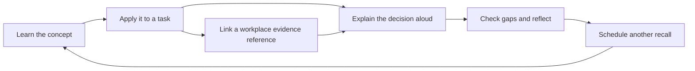

# Level 4 Data Fellowship — study page design

Status: design specification; the study page is not yet implemented.  
Prepared: 2 November 2026.  
Revised: 2 November 2026, to incorporate the supplied Pass-preparation guide and the complete answer bank.  
Project folder: `VibeProjects/L4-fellowship/`.  
Working page title: **Data Fellowship · EPA study desk**.

## 1. Purpose and scope

Build a personal study page that helps a government Level 4 Data Fellowship apprentice understand, apply, recall and discuss the Data Analyst apprenticeship Knowledge, Skills and Behaviours (KSBs) in preparation for their end point assessment (EPA).

The page should answer three practical questions each time it opens:

- What should I study next?
- What can I demonstrate from my own work, and where is the evidence?
- Can I explain my decisions, results and limitations without reading my notes?

The content baseline is the learner's supplied breakdown: **15 Knowledge items, 15 Skills and 7 Behaviours, totalling 37 KSBs**. Preserve the identifiers K1–K15, S1–S15 and B1–B7 throughout content, questions, evidence and exports. The labels below are study summaries of that breakdown, not quotations from an official standard.

The current deliverables are this design and [solutions.md](./solutions.md), which contains an answer guide, personalisation template, evidence guidance, coverage check and follow-up question for every KSB. The proposed page, interactive exercises, persistence and exports described below are future implementation work.

### Assessment assumptions

The learner has supplied a second guide describing what to explain and demonstrate for a Pass. Use it as a preparation checklist alongside the original 37-item curriculum. It is not an independently verified verbatim mark scheme. The learner's applicable standard version, training provider, assessment organisation and assessment date are still unconfirmed. Do not invent assessment durations, evidence quotas, pass thresholds or distinction criteria. Practice timers are study aids.

The official ST0118 version 1.1 standard and AP03 assessment plan were consulted while preparing the answers. The route mapping and source details are in [solutions.md](./solutions.md#sources). They provide a reference configuration, conditional on applicability; confirm it with the provider before enabling assessment-route filters as personal requirements. Map verified criteria explicitly and record discrepancies instead of silently changing identifiers. The supplied source markers, now extending to `[109]`, have no accompanying bibliography and must not become fabricated citations.

## 2. Audience and learning approach

Design for one working apprentice revising in short sessions on a phone or laptop. Assume uneven prior knowledge and a mix of technical tasks and workplace examples. Use plain English, expand acronyms on first use, and distinguish a general explanation from the learner's own experience.

Every KSB follows the same learning cycle:



Reading a lesson, completing a synthetic exercise and demonstrating a workplace skill are different achievements. Record them separately. Knowledge needs clear explanation and application; Skills need an account of the learner's own actions; Behaviours need specific examples of choices, collaboration, results and reflection.

### A useful 20-minute session

1. Recall a due topic from memory for 3 minutes.
2. Read its explanation and correct misconceptions for 5 minutes.
3. Attempt a practical task or evidence reflection for 7 minutes.
4. Give a spoken answer, record gaps and choose the next review for 5 minutes.

Offer a shorter 5-minute recall session and a longer 45-minute practical session. These lengths are optional suggestions, not assessment conditions.

## 3. Visual direction: an analyst's study desk

Use a quiet, precise working environment with generous reading space and a distinctive **KSB index**. Its 37 labelled cells show the breadth of the syllabus; selecting a cell opens that KSB. Group cells by Knowledge, Skills and Behaviours, with a text label and a small progress mark in every cell. On a phone, let each group wrap into rows. Provide an equivalent accessible list and textual group totals.

The index is the memorable element. Keep lessons, prompts and evidence forms calm and largely flat, using clear headings and dividers. Do not imitate an official government service or use government logos. This is a personal learning tool.

### Design tokens

| Token | Value | Use |
| --- | --- | --- |
| `--bg` | `#F2F5F8` | Cool paper background |
| `--surface` | `#FFFFFF` | Reading and editing surfaces |
| `--ink` | `#172A3A` | Main text and headings |
| `--muted` | `#4B5D6B` | Supporting text |
| `--accent` | `#174EA6` | Primary actions, links and active selection |
| `--positive` | `#176B52` | Successful recall, always with text or an icon |

Use the ink colour for important borders and control outlines. Reserve a pale accent tint for the selected KSB and active section. Check actual foreground/background combinations during implementation; palette selection alone does not establish accessibility.

- **Typography:** use `"Trebuchet MS", Arial, sans-serif` for navigation and headings, and `Calibri, "Segoe UI", Arial, sans-serif` for body text. These system stacks need no font downloads. Use monospace only for SQL, code and data examples.
- **Type scale:** body 17–18px with 1.6 line height; supporting text at least 14px; section headings 24–28px; page heading 32px on mobile and up to 40px on desktop. Keep prose near 65–75 characters per line.
- **Spacing:** 4px base unit; 8px between related controls, 16px within small sections, 24px between content groups and 40px between major sections.
- **Shape:** 8px corners for interactive surfaces and controls. Use borders and whitespace to convey grouping; avoid decorative shadows.
- **Alignment:** left aligned text, prompts and numbers with their labels. Centre only short KSB cell identifiers.
- **Motion:** no automatic animation. A short state change may confirm an interaction; disable nonessential transitions when reduced motion is requested.
- **Tone:** direct and supportive. Use “Practise K8”, “Link evidence” and “Show answer guide”. Avoid pressure from streaks or competitive scoring.

### Design review against the brief

The KSB index makes the 37-item curriculum visible and navigable. Longer lessons use a reading surface rather than a grid of equally sized cards. The first screen prioritises the next study action and any gaps; a large percentage score would obscure the difference between understanding and evidence. Government relevance comes from examples of responsible analysis and public service decisions.

## 4. Page structure and responsive layouts

One self-contained static page, with five clearly named sections:

| Section | Main question | Main contents |
| --- | --- | --- |
| Today | What should I do next? | Continue studying, due reviews, evidence gaps, recent activity |
| KSB library | What do I need to learn and explain? | Search, filters, six themes, all 37 answer guides, worked examples and personal response forms |
| My evidence | What have I personally demonstrated? | Evidence reference index, KSB links, reflection and gaps |
| Practice | Can I discuss it clearly? | Attempt before revealing the model answer, compare coverage, practise follow-ups and mixed sessions |
| Plan and sources | What is my plan, and what is verified? | Weekly plan, optional EPA details, references, backup and restore |

Use ordinary links with stable hashes such as `#today`, `#ksb-k8`, `#evidence`, `#practice` and `#plan`. Support browser Back/Forward and direct links to every KSB. Use the exact project path `L4-fellowship` requested by the learner; preserve its case in future links.

### Desktop, around 1280px

```text
┌──────────────────────────────────────────────────────────────────┐
│ Data Fellowship                 Search KSBs             Backup    │
├──────────────┬──────────────────────────────────┬────────────────┤
│ Today        │ Your next session                │ KSB index      │
│ KSB library  │ Practise explaining data quality │ Knowledge      │
│ My evidence  │ [Start 20-minute session]        │ K1 … K15       │
│ Practice     │                                  │ Skills         │
│ Plan and     │ Reviews due                      │ S1 … S15       │
│ sources      │ Topic / last recall / next action│ Behaviours     │
│              │                                  │ B1 … B7        │
│              │ Evidence to strengthen           │ Text totals    │
└──────────────┴──────────────────────────────────┴────────────────┘
```

The wireframe's K8 recommendation is illustrative. A new user's real page starts with an introduction and no fabricated activity. Use a maximum content width of about 1240px, a 200px navigation column and a flexible main column. The index can occupy a 240px side panel when space allows. Lesson detail gets the majority of the reading width; move the index below it on smaller screens.

### Mobile, designed first at 390px

```text
┌───────────────────────────────┐
│ Data Fellowship       Backup  │
│ [Navigate to section       v] │
│ [Search KSBs and topics      ]│
├───────────────────────────────┤
│ Your next session             │
│ [Start a study session]       │
│ Reviews due                   │
│ One clear action per item     │
│                               │
│ Your KSB index                │
│ Knowledge: wrapping KSB cells │
│ Skills: wrapping KSB cells    │
│ Behaviours: wrapping cells    │
└───────────────────────────────┘
```

Below 700px, use a single column and a labelled navigation disclosure with all five section links. At 700–1099px, use navigation plus the main content and place the index inline. At 1100px and above, allow the optional third column. Avoid a fixed bottom bar that covers a keyboard or an answer field.

Do not require horizontal page scrolling at 390px or 320px. Render the KSB list as compact rows on desktop and stacked items on mobile. Only code blocks and genuine data tables may scroll within their own labelled region. Print layouts should expand selected study content, remove navigation and use clear page breaks.

## 5. Content organisation: six study themes

Themes provide a sensible route through the material; the K/S/B views remain available for direct assessment-oriented revision. Each KSB has one primary theme and may link to related topics.

| Theme | Primary KSBs | Study outcome |
| --- | --- | --- |
| Responsible data use | K1, K2, K4, K15, S1, S3, B1 | Explain legal, organisational, classification, security and ethical decisions |
| Planning and delivery | K3, K9, S2, S7, B3, B7 | Turn a stakeholder problem into a scoped, adaptable analysis |
| Data structures, architecture and tools | K5, K6, K11, K12, S4, S9, S15 | Understand how data is stored and justify suitable tools |
| Preparation and quality | K8, K10, S6, S8, B4, B5 | Combine sources safely, investigate problems and validate results |
| Statistics and analytical methods | K13, K14, S10, S11, S13, B2, B6 | Select, apply and explain methods with appropriate limitations |
| User-centred communication | K7, S5, S12, S14 | Make outputs accessible, useful and appropriate for the audience |

## 6. KSB lesson and answer template

Every detail view should contain the following, in order:

1. **Identifier, title and context:** category, theme, related KSBs and study summary. Show the supplied preparation target and any verified official descriptor as separate, sourced fields.
2. **What to cover:** turn the section's Coverage check in `solutions.md` into short, observable checklist items. Identify them as supplied preparation targets, with any official source mapping shown separately.
3. **Answer guide:** display the complete explanation, definitions, tables and technical clarifications from the matching solutions section. Keep longer worked examples expandable. In Learn mode the explanation is available immediately; in Practice mode it remains hidden until requested.
4. **Worked application:** include the existing synthetic examples and any later practical task, clearly labelled. For Skills, explain what still requires performed workplace work; for Behaviours, keep the fictional scenario distinct from the learner's history.
5. **Make it yours:** provide an editable answer using the exact section-specific template as a visible prompt, plus fields for the learner's own actions, reasons, result, limitations and learning. Keep placeholders visible until genuinely completed.
6. **Evidence to reference:** show the section's suggested evidence, allow approved reference IDs and require per-KSB rationales. Never turn a model answer into an evidence entry automatically.
7. **Practise and compare:** present the initial question and the solutions section's follow-up. After an attempt, reveal the answer and show the learner's response alongside it on desktop, or in labelled stacked sections on mobile. Coverage is self-reviewed, not keyword scored.
8. **Review and sources:** learning status, confidence, recall outcome, next review, gap note, source/version details and a direct link to the relevant anchor in `solutions.md`.

### KSB detail layout

```text
K13  Principles of Statistics
Preparation targets: summaries, inference, application

[Learn] [Practise]                 Evidence: no reference

Answer guide                      My response
Definitions and explanation        [Write in your own words       ]
Worked synthetic example           [Add your own project example  ]
[Expand calculation]               [Save my response]

What I covered                     Evidence to reference
[ ] Explain the measures           [Approved reference ID         ]
[ ] Explain inference              [How this supports K13         ]
[ ] Demonstrate real application   [Link evidence]

Follow-up question                 Sources and verification status
```

The example checklist is abbreviated for layout only; the real view must include all relevant items from K13's answer section. The page should not place all 37 long answers on the landing screen. Search and the index lead to one focused KSB view at a time; an optional print selection can expand several.

### Answer content that needs specialised presentation

- K1: show all seven principles with their practical meanings, including the full first principle.
- K4/S3: distinguish overlapping dataset types, organisational security classification and risk descriptions.
- K6/K10: present definitions as readable tables; distinguish UNION from joins and show grain/cardinality checks.
- K13/S10: render formulas accessibly and retain the numerical examples, assumptions, test result and correct interpretation together. Use plain text fallbacks for symbols.
- K14/S11: connect descriptive, predictive and prescriptive stages; show validation and decision constraints, not just a model name.
- S8: use selectable, horizontally contained code blocks with a Copy SQL action and explanatory checks. Running SQL is not required in the browser.
- S12: provide two stakeholder example slots, each with role, need, communication adaptation, collaboration and outcome. Allow more stakeholders; label the two-example target as supplied preparation guidance.
- S13: require a forecast worksheet with target, frequency, history window, holdout, future horizon, model, trend/seasonality assessment, baseline, metrics, visual, projection and limitations. Also include a distinct mining/modelling example slot. A clustering example cannot satisfy the forecast-visual target.
- S14: show both quantitative and qualitative interpretation and the rationale for visuals, including context lost through theme counts.
- B1–B7: use a STAR-L response form with each Behaviour's specific prompt; distinguish B2's minor unexpected change from B7's broader contextual shift.

### Worked lesson example: K8, Data Quality Risks

**Learning outcomes:** distinguish accuracy, completeness, consistency, validity, uniqueness and timeliness; identify missing values and suspicious outliers; explain how a quality issue changes a decision; choose a proportionate correction or escalation.

**Explanation:** a dataset can be complete yet inaccurate, or contain valid values that refer to the wrong person or service. A missing value may mean unknown, not applicable or a collection failure. An outlier may be a genuine event. Define the intended use before deciding what quality is sufficient.

**Synthetic example:** a service-performance report shows a jump in requests after a source join. The lookup contains repeated service identifiers. Check the expected join relationship and row counts before treating the jump as a real change in demand.

**Try it:** identify missing completion dates, inconsistent service names and duplicate lookup keys. Record counts and effects, test a proposed correction and reconcile totals. Keep a transformation log and preserve the source data. Do not automatically delete missing values or outliers.

**Explain it:** “What quality risks did you find, how did you prioritise them, and what changed after your intervention?”

**Answer guide:** name the quality dimension; describe detection; explain the impact on the stakeholder's question; justify treatment or escalation; describe validation; acknowledge residual uncertainty. There may be several defensible approaches.

**Evidence prompt:** link an approved reference to a quality log or validation result, stating exactly what you did. Related topics: S6 for action, K10/S8 for joins and B5 for root cause.

## 7. Complete KSB content and practice map

Each row links directly to its complete answer in `solutions.md` and defines an index summary, an initial practice prompt and a possible evidence connection. The complete coverage targets, personalisation prompts and follow-ups live in the linked solution; the shorter summaries here must not truncate them in the page. Evidence suggestions are examples, not proof that a criterion has been met. All questions are authored practice material, not official assessment questions.

### Knowledge: explain the principles and justify decisions

| KSB and supplied topic | Minimum lesson scope | Initial practice question | Possible connection to your work |
| --- | --- | --- | --- |
| [**K1: Current & Relevant Data Legislation**](./solutions.md#ksb-k1) | UK GDPR and Data Protection Act 2018; lawful basis, purpose limitation, minimisation, retention and individual rights; verify applicable amendments and effective dates against authoritative sources | How did data legislation affect what you collected, accessed, retained and shared? | A sanitised account of a lawful data-handling decision; do not assume consent is always the lawful basis |
| [**K2: Organisational Data Policies & Standards**](./solutions.md#ksb-k2) | Access controls, approved storage, retention, secure sharing, incident reporting and organisational responsibilities | Which organisational policies shaped your analysis, and how did you check compliance? | Approved policy references and an account of following them |
| [**K3: Principles of the Data Analysis Lifecycle**](./solutions.md#ksb-k3) | Planning, preparation, analysis, refinement/comparison and communication; iteration and validation between stages | Walk through a project lifecycle and explain a point where you revisited an earlier stage. | A project timeline and decision log |
| [**K4: Data Classification Types**](./solutions.md#ksb-k4) | Open, public, administrative and research data; provenance, licensing and appropriate use; distinguish these types from organisational security markings | How did the type and classification of your data affect access and reuse? | A classification rationale checked against the organisation's actual scheme |
| [**K5: Structured vs. Unstructured Data**](./solutions.md#ksb-k5) | Tabular schemas and free-form text/audio/video; semi-structured formats as a useful bridge; extraction and analysis implications | How would your approach change between a table of service records and free-text feedback? | A comparison of source formats and preparation choices |
| [**K6: Data Structures & Database System Design**](./solutions.md#ksb-k6) | Relational keys, relationships, schemas and normalisation; NoSQL document/key-value concepts; implementation, indexing and maintenance trade-offs | Why was a particular database design suitable, and what trade-offs did it create? | A sanitised schema sketch and explanation of key relationships |
| [**K7: User Experience (UX) & Domain Context Principles**](./solutions.md#ksb-k7) | Simplicity, accessibility, task design and domain definitions; how user decisions determine metrics and layout | How did users' tasks and domain knowledge change the design of your output? | A design rationale with user feedback |
| [**K8: Data Quality Risks**](./solutions.md#ksb-k8) | Accuracy, completeness, consistency, timeliness, validity and uniqueness; NULLs, outliers, mitigation and escalation | What made a quality issue material, and how did you decide whether to correct or escalate it? | A quality assessment with impact and residual limitations |
| [**K9: Defining Customer Requirements**](./solutions.md#ksb-k9) | Stakeholder mapping, interviews, problem statements, scope, constraints, acceptance criteria and change control | How did you turn a broad stakeholder request into measurable requirements? | An agreed brief and traceable acceptance criteria |
| [**K10: Combining Data Sources**](./solutions.md#ksb-k10) | Keys, grain, join types, cardinality, duplicates, aggregation and reconciliation | Why did you choose that join, and how did you check it had not inflated or lost records? | A join rationale with row-count and total checks |
| [**K11: Organisational Analysis Tools & Methods**](./solutions.md#ksb-k11) | Available organisational tools; licensed software versus code; capability, accessibility, cost, reproducibility and support | Why did you choose your analysis tool over another available option? | A comparison of realistic tools and constraints |
| [**K12: Organisational Data Architecture**](./solutions.md#ksb-k12) | Databases, warehouses, lakes and Big Data concepts; ingestion, central storage, lineage, access and storage policies | Where did your data come from, where was it held, and how was access governed? | An approved high-level architecture and lineage explanation |
| [**K13: Principles of Statistics**](./solutions.md#ksb-k13) | Mean, median, spread and distributions; sampling, uncertainty, confidence intervals, hypotheses, p-values and t-test assumptions | How would you explain a statistical result, its assumptions and uncertainty to a non-specialist? | A statistical interpretation; a p-value is not the probability that the null hypothesis is true |
| [**K14: Principles of Analytics Types**](./solutions.md#ksb-k14) | Descriptive summaries, predictive models and prescriptive recommendations; assumptions, validation and decision context | What changes when the question moves from “what happened?” to “what might happen?” to “what should we do?” | A reasoned comparison using one business question; prediction alone does not establish causation |
| [**K15: Data Ethics**](./solutions.md#ksb-k15) | Fairness, bias, transparency, accountability, consent where applicable, proportionality and potential harm | What ethical risk remained even if your analysis was legally permitted? | An ethical reflection describing a trade-off and mitigation |

### Skills: demonstrate what you personally did

| KSB and supplied topic | Minimum lesson scope | Initial practice question | Possible evidence reference |
| --- | --- | --- | --- |
| [**S1: Operating Data Systems in Compliance**](./solutions.md#ksb-s1) | Apply legal and organisational controls; privacy by design, minimum necessary access and secure handling | Describe the controls you applied while using a data system and why they were appropriate. | A sanitised handling checklist or account of access and minimisation decisions |
| [**S2: Applying the Data Analysis Lifecycle**](./solutions.md#ksb-s2) | Carry out and document the lifecycle, including validation, iteration and handover | Show how your actions connected the project brief to the delivered result. | A project log linking activities and outputs |
| [**S3: Applying Principles of Data Classification**](./solutions.md#ksb-s3) | Classify a dataset, justify handling and apply suitable redaction or anonymisation; distinguish pseudonymisation | How did you classify the data and check that the protection you applied was sufficient? | An approved classification/redaction record with a re-identification risk discussion |
| [**S4: Analysing Diverse Data Structures & Designs**](./solutions.md#ksb-s4) | Adapt extraction, reshaping and querying to different source structures and database designs | What did you change when analysing data from different structures? | Annotated queries or transformation steps with a schema explanation |
| [**S5: Applying UX & Domain Context**](./solutions.md#ksb-s5) | Apply accessible layout, chart choices, terminology and user feedback to a real decision | What user need drove a specific design choice, and how did you evaluate it? | A sanitised before/after output and feedback summary |
| [**S6: Mitigating & Resolving Quality Risks**](./solutions.md#ksb-s6) | Profile, prioritise, resolve or escalate issues; validate corrections and explain remaining risk | Take one quality problem from detection through resolution and validation. | A quality log, checks and escalation rationale |
| [**S7: Implementing Customer Requirements**](./solutions.md#ksb-s7) | Turn requirements into scope, milestones, deliverables and acceptance checks | How can you demonstrate that your final output met the agreed requirements? | A requirements-to-deliverables mapping |
| [**S8: Combining & Preparing Multi-Source Data**](./solutions.md#ksb-s8) | Clean and join multiple sources using suitable SQL, Power Query, Python or equivalent; preserve lineage | Demonstrate how you prepared and joined sources and verified the combined result. | Reproducible transformation steps and reconciliation results |
| [**S9: Tools for Data Architecture**](./solutions.md#ksb-s9) | Use approved tools to query, connect to or interact with organisational infrastructure under appropriate permissions | How did you use your tools to work with the data infrastructure safely and effectively? | An approved query/connection workflow described without credentials or sensitive host details |
| [**S10: Applying Statistical Methodologies**](./solutions.md#ksb-s10) | Perform exploratory data analysis (EDA), summary statistics and a suitable inferential test; check assumptions | Why was your statistical method suitable, and what did your checks reveal? | An analysis output with assumptions, uncertainty and interpretation |
| [**S11: Applying Predictive & Advanced Analytics**](./solutions.md#ksb-s11) | Fit and evaluate a suitable regression/classification model, compare a baseline, avoid leakage and turn findings into a justified recommendation | How did you evaluate your model, and what action could its results support? | Model evaluation and a recommendation stating constraints and uncertainty |
| [**S12: Stakeholder Communication & Collaboration**](./solutions.md#ksb-s12) | Prepare examples with at least two distinct stakeholders; adapt styles/channels, collaborate and show outcomes; include other relevant stakeholders | How did you adapt communication and collaboration for two different stakeholders, and what changed? | Two sanitised stakeholder accounts with needs, channels, feedback and outcomes |
| [**S13: Time Series Forecasting & Data Mining**](./solutions.md#ksb-s13) | Produce a visual forecast with target, window, horizon, chosen model, time-based validation, baseline, RMSE or another suitable metric, trend, seasonality and projections; retain a separate mining/modelling example | How did you choose, evaluate and communicate the forecast, and what did your separate mining/modelling work show? | Forecast plot/table, model and metric calculation, uncertainty and a distinct mining/modelling example |
| [**S14: Visual Representation of Qualitative & Quantitative Data**](./solutions.md#ksb-s14) | Represent measures and categories/themes; choose charts, labels, scales, text summaries and accessible alternatives | How did your visualisation communicate both numerical results and qualitative context? | An annotated output with a chart rationale and accessible explanation |
| [**S15: Selecting Optimal Data Analysis Tools**](./solutions.md#ksb-s15) | Evaluate and apply a suitable tool against requirements, data scale, reproducibility, cost and support | Which options did you evaluate, why did you choose one, and how did it perform? | A tool decision log and resulting practical output |

### Behaviours: describe choices, impact and reflection

Use **STAR-L: Situation, Task, Action, Result, Learning** as an optional answer structure. Emphasise the learner's contribution, the effect on others and a specific lesson. A claim such as “I am resilient” is a starting point for reflection, not evidence.

| KSB and supplied topic | Minimum lesson scope | Initial practice question | Possible evidence connection |
| --- | --- | --- | --- |
| [**B1: Safe & Secure Working Environment**](./solutions.md#ksb-b1) | Maintain secure access, professional working habits and a productive environment; act on concerns | Tell me about a time your everyday working practices protected data or prevented a security problem. | A specific account of secure working and the outcome |
| [**B2: Adaptability & Problem Solving**](./solutions.md#ksb-b2) | Handle a small unexpected operational problem while maintaining progress | Describe an unexpected issue, the options you considered and how you kept work moving. | A short incident and decision reflection |
| [**B3: Independent & Collaborative Working**](./solutions.md#ksb-b3) | Own tasks, recognise limits, seek useful input and consider effects on colleagues | When did you work independently, and when did involving others improve the outcome? | A contribution log or feedback linked to a specific result |
| [**B4: Logical & Analytical Thinking**](./solutions.md#ksb-b4) | Take initiative, break down a problem, test hypotheses and reason from evidence | How did you structure an ambiguous data problem and decide what to investigate first? | A reasoning trail or analytical decision log |
| [**B5: Root Cause Analysis**](./solutions.md#ksb-b5) | Distinguish symptoms from causes, test explanations and prevent recurrence | How did you establish the root cause and check that your solution prevented it happening again? | A cause investigation and follow-up check |
| [**B6: Resilience & Lessons Learned**](./solutions.md#ksb-b6) | Respond constructively to setbacks, use feedback and change future practice | Describe a setback, what you learned and what you subsequently did differently. | A retrospective tied to a later improvement |
| [**B7: Flexibility in Contextual Shifts**](./solutions.md#ksb-b7) | Adapt to a larger change in scope, direction or responsibilities; reset expectations | What changed in the wider context, and how did you adapt your plan and communicate the effect? | An updated plan and reflection on stakeholder impact |

## 8. Practical exercise studio

Use a fictional public-service performance scenario throughout the first learning path: service requests, monthly service metrics, a service lookup and synthetic feedback. Supply a data dictionary, source notes and known planted issues when the page is built. The data must contain no real citizen or employee records.

Every exercise has an objective, instructions, a starter dataset or scenario, optional hints, a worked approach, a self-check and explicit KSB links. The worked approach should explain reasoning and limitations, not just provide code to copy. Tools should match the learner's approved environment; a browser preview cannot substitute for operating actual workplace systems.

| Exercise | Deliverable and self-check | Primary Skills |
| --- | --- | --- |
| Scope the service question | A problem statement, stakeholder map, acceptance criteria and lifecycle plan; check each deliverable against a user decision | S2, S7 |
| Classify and handle the data | A reasoned classification, minimum required fields and handling plan; distinguish data type, security marking, anonymisation and pseudonymisation | S1, S3 |
| Understand the sources and choose tools | A schema/lineage sketch, a justified tool comparison and a query or connection walkthrough; explain permissions and source structure | S4, S9, S15 |
| Prepare, join and validate | A reproducible cleaning/join workflow and issue log; reconcile row counts, key uniqueness, totals and unresolved risks | S6, S8 |
| Explore, test and predict | EDA, a justified statistical test, a simple predictive model, a required visual forecast with baseline/error metrics and a separate mining/modelling example; check assumptions, compare baselines and explain uncertainty | S10, S11, S13 |
| Communicate a decision | An accessible view combining measures and feedback themes, a short technical note and a stakeholder briefing; explain how feedback changed the output | S5, S12, S14 |

For statistics and models, show what a sensible conclusion would and would not support. Include sampling bias, missingness, correlation versus causation, small samples, leakage and validation on unseen data. Forecasts must respect time order; recommendations must account for policy, operational constraints and human judgement.

Each exercise also asks for a short Behaviour reflection. Synthetic practice can expose learning gaps and support an explanation, but must remain labelled as practice. Never manufacture workplace experience, stakeholder feedback or results.

## 9. Evidence notebook

Evidence entries are references plus reflections. One entry can support several KSBs, but every link needs a sentence explaining what that item demonstrates for that specific KSB. A document attachment alone is insufficient context.

### Entry fields

- A stable ID, generic title, project alias and local date.
- An approved reference ID pointing to material retained in the organisation's authorised evidence location. Avoid sensitive paths, system addresses or personal names in the study page.
- Context, task, the learner's own actions, method/tool choice, outcome and limitations.
- What was done independently, where others contributed and how stakeholders were affected.
- Linked KSB IDs, each with a rationale and a useful section/page reference if safe to record.
- Learning, a possible follow-up question and the next action needed.
- Evidence state: none, draft reflection, reference linked or review recorded. A review records who/what role reviewed it and when only if appropriate to retain; it does not imply assessor approval.

The coverage view lists all 37 KSBs and shows whether each has a meaningful rationale, a reference and any review note. Highlight missing rationale, unverified references and ageing examples as prompts to check. Do not invent expiry dates or require a fixed number of examples.

### Public repository and workplace material

`VibeProjects` is public. Commit only generic study content, synthetic datasets and material explicitly approved for public release. Keep real government datasets, restricted policies, identifiable examples, access details and original evidence in approved organisational storage. A private-sounding filename or an obscure link does not make a public file private.

Future personal notes and progress remain in the learner's browser by default and are excluded from the committed curriculum. Browser storage is not encrypted evidence storage and does not make a public static page an approved government system. Use sanitised reflections and abstract evidence references. Do not provide raw workplace evidence uploads or automatic synchronisation.

## 10. Recall and discussion practice

### Modes

- **Quick recall:** one question, an answer field or silent/spoken response, then an answer guide. Require an explicit “Show answer guide” action before revealing guidance.
- **Scenario practice:** ask the learner to choose and justify a course of action. Discuss alternatives rather than awarding marks solely for keywords.
- **Project walkthrough:** use the learner's chosen evidence reference and prompt for requirements, lifecycle, quality, analysis, communication and impact.
- **Mixed discussion:** select at least one Knowledge, one Skill and one Behaviour prompt. Show the selected KSBs and let the learner change them. Make session length and timer optional.
- **Weak-topic review:** revisit items with uncertain recall, missing explanations or evidence gaps; explain why each was selected.

Seed the first question bank with the 37 questions in the content map and the 37 Follow-up prompts in `solutions.md`. Use the section-specific Answer guide and Coverage check after the learner attempts the question. Add further scenario questions as content develops. Map questions to stable KSB identifiers and distinguish authored practice from any later licensed or officially published material.

### Compare an answer without pretending to grade it

After “Show answer guide”, display the original response, model explanation, personalisation prompt and evidence suggestions. Let the learner mark each preparation target as Not yet covered, Needs detail or Covered in my response, with a short note. Offer “Revise my response” and “Save self-review”. Missing workplace examples remain evidence gaps even if the theory is well recalled. Do not calculate an official Pass, infer evidence from vocabulary or automatically overwrite the learner's response with the guide.

### Self-review guide

After responding, ask:

1. Did I explain the concept accurately in my own words?
2. Did I give a concrete example and identify my own contribution?
3. Did I justify the method and consider an alternative?
4. Did I explain the result, validation and limitations?
5. Could I answer a follow-up and describe what I learned?

For Behaviours, foreground actions, effects on others and learning. For Skills, foreground the performed work and validation. Record gaps in the learner's own words. These prompts are a study aid, not an official marking rubric.

Spoken practice does not require a microphone: display the question, let the learner speak aloud, then note a brief reflection. Keep audio recording and automated grading outside the first version. The initial page needs no external AI service.

## 11. Progress, review scheduling and the study plan

Keep the following dimensions separate for each KSB:

| Dimension | Values | Meaning |
| --- | --- | --- |
| Learning | Not started / Learning / Can explain | Learner-recorded understanding; “Can explain” should follow recall |
| Confidence | Unset or 1–5 | A subjective feeling; never a substitute for evidence |
| Recall | No attempt / Needed help / Partial / Explained independently | The learner's review of the latest attempt |
| Evidence | None / Draft / Reference linked / Review recorded | The state of the supporting reflection and reference |
| Answer coverage | Not reviewed / per-target Not yet covered, Needs detail or Covered in my response | A self-review against supplied preparation targets; separate from confidence and evidence |
| Review | Last attempt and next local date | When to revisit the topic |

Use factual summaries such as “6 of 15 Knowledge topics marked Can explain” and “2 of 7 Behaviours have an evidence reference”. Label all totals as self-recorded. Do not combine these into an EPA pass probability or a single official readiness percentage. Keep unattempted items visible and unknown confidence unset.

### Simple, transparent review rules

- After an attempt marked **Needed help**, suggest tomorrow.
- After **Partial**, suggest in 3 days.
- After **Explained independently**, suggest in 7 days; after a second consecutive independent recall, suggest 14 days.
- Let the learner change any suggested date. An overdue item remains due until reviewed or rescheduled; it does not change confidence automatically.
- New topics have no last-attempt date and are introduced through the theme path. A missed session produces a helpful next action, not a penalty.

These are convenient defaults, not a claim that a particular spacing algorithm is optimal. Store dates using local calendar dates. Recalculate due items when the page opens or returns to focus.

### Today ordering

Recommend one next action in this order: resume an unfinished session; otherwise review the oldest due topic; otherwise continue the first incomplete theme. Show separate evidence-gap suggestions underneath. Break ties with the stable KSB order K1–K15, S1–S15, B1–B7. Allow the learner to choose freely and show the reason for the recommendation.

### Repeatable weekly pattern

| Session | Focus | Useful output |
| --- | --- | --- |
| First session | Knowledge recall plus one practical task | A corrected explanation and a task result |
| Second session | Evidence mapping and Behaviour reflection | A clearer personal example with linked KSB rationale |
| Third session | Mixed discussion and gap review | A short list of weak topics and next review dates |

Let the learner set available study days and session lengths. If an assessment date is entered, show time remaining and upcoming planned sessions without promising that the schedule guarantees coverage. Allow a manual priority for topics raised by a coach.

## 12. Search, filters and interaction details

- Search identifiers, titles, explanations, themes and question text. A search for `K8`, `quality` or `NULL` should find relevant material; it must not send personal notes to a server.
- Filters include K/S/B category, theme, learning state, due review and evidence state. Combine filters consistently, display the active selections and provide “Clear filters”.
- KSB rows show ID, title, learning state, next review and evidence state. Opening a row reveals the lesson. Keep the selected ID visible in the detail heading.
- Save edits locally after a short debounce and on leaving the field. Show “Saved on this device” only after a successful storage write. In-memory mode must say that changes will be lost when the page closes.
- Before navigating away from an unsaved answer, save it if possible or clearly retain it in memory. A practice session can be paused and resumed.
- A timer has Start, Pause, Resume and Reset controls. Reaching zero invites continuation or review; never erase an answer or force submission.
- Deleting an evidence entry offers an undo action. Clearing all personal data requires an explicit confirmation naming what will be removed.

### Empty and error states

| Situation | Required response |
| --- | --- |
| First visit | “Start with Responsible data use, or choose a KSB.” Show no invented progress and no assumed assessment date |
| No matching search | “No KSBs match these filters.” Offer Clear filters and show the search text |
| No evidence for a KSB | “Add a sanitised reflection and an approved evidence reference.” Keep practice available |
| No reviews due | Offer the next unstarted topic or a freely selected practice session |
| Browser storage unavailable | Explain that this session uses temporary memory and offer an export |
| Invalid backup | State the validation problem; leave existing data untouched and let the learner choose another file |
| Newer/unsupported backup version | Explain the version mismatch and preserve the original file and existing state |
| Unverified source | Show “Source verification pending” and the missing details; never render a made-up citation |

## 13. Accessibility and reading comfort

Target WCAG 2.2 AA during implementation and verify the relevant criteria; this design document is not a conformance claim.

- Use semantic headings, landmarks, native links/buttons and explicit form labels. Add a skip link and a logical focus order.
- Make the KSB index usable by keyboard, screen reader and touch. Accessible names include ID, title and textual state; selecting an item must not rely on hover.
- Use visible focus outlines. Keep sticky elements from obscuring focused content. Return focus appropriately after closing a dialog or changing a view.
- Aim for 44px touch targets. Maintain at least 4.5:1 contrast for normal text and 3:1 for large text and meaningful interface boundaries.
- Do not convey status solely through colour. Pair progress marks with labels and provide textual totals for the index.
- Support zoom and reflow, reduced motion and long titles. Let users enlarge lesson text without breaking controls.
- Announce save failures and important confirmations politely. Avoid announcing every keystroke or timer second.
- Give charts a title, explanation and accessible table or text alternative. Represent qualitative themes carefully and preserve uncertainty.
- Reveal answer guides with a button exposing its expanded state. Avoid essential content hidden in tooltips.

## 14. Static implementation constraints and data model

Follow the repository defaults when the page is implemented: start with one `index.html` containing HTML, CSS and JavaScript. Use vanilla browser features, relative paths, no build step, no backend and no required third-party services. The page must open directly from disk and work on GitHub Pages under `/L4-fellowship/`.

Embed the initial curriculum and synthetic data or load any optional later data as local JavaScript rather than relying on `fetch()` for the essential file-open experience. Keep curriculum definitions separate in code from personal progress. Do not import code from other projects.

### Suggested project organisation

```text
L4-fellowship/
  design.md             This document; revised to incorporate answers
  solutions.md          Canonical public answer bank for all 37 KSBs; created now
  index.html            Future static study page
  AGENTS.md             Future implementation notes, stable IDs and storage rules
  sources.md            Future verified reference register
  docs/                 Future generic study notes approved for public release
  practice/             Future synthetic data and generic exercise instructions
```

The current scope creates `design.md` and `solutions.md`. Do not create empty placeholder files or put private evidence into any of these folders. Larger curriculum data can move to a local `.js` file if size warrants it; preserve the build-free, self-contained project.

### Integrating solutions into the future page

`solutions.md` is the canonical authored answer bank. Every section exposes a stable explicit anchor `ksb-k1` through `ksb-b7`; keep these anchors stable. Its repeated blocks are Answer guide, Make it yours, Evidence to reference, Coverage check and Follow-up. Some sections also contain worked examples or tables that belong with their explanations.

When implementing, derive the in-page curriculum from these blocks and embed it in `index.html` (or a local curriculum JavaScript file if size warrants it). Store the source filename, source anchor and content revision in each KSB record. Essential answers must not depend on fetching Markdown at runtime: that would break direct file opening in some browsers. No mandatory build tool or remote Markdown service is introduced.

Keep a direct “Read source answer” link to `./solutions.md#ksb-k8` or the selected KSB's equivalent. A normal hosted Markdown file may open as text or download depending on the host; the in-page answer remains fully readable. Do not rely on the host rendering Markdown as the study interface.

Check all 37 answer records against their source sections whenever content changes. Preserve tables, example labels, caveats and source-verification notes. Do not copy only a short definition while omitting required application or evidence prompts. A curriculum revision must not erase personal notes; mark an earlier self-review as needing recheck when its checklist changes.

For S13, render the documented synthetic holdout forecast using a small accessible SVG with direct series labels, differing line styles and the accompanying data table. Show training/holdout and future projection windows clearly; do not join future estimates to actuals as if they were observations. Read values from the same in-page data record for both the plot and table to prevent disagreement. Retain the model and baseline RMSE explanation. Mermaid in the source document is a documentation visual, not a runtime chart dependency.

### Conceptual records

| Record | Essential fields |
| --- | --- |
| KSB definition | Stable ID, category, title/summary, theme, answer guide, personalisation template, evidence prompts, coverage targets, follow-up, worked examples, exercise/question/source IDs, source filename/anchor, content revision and optional verified official descriptor/route |
| Personal KSB state | KSB ID, learning state, optional confidence, latest recall, local review dates, consecutive independent recalls, sanitised personal response, per-target self-review, response revision, reviewed content revision and private gap note |
| Evidence reference | Stable ID, generic title, project alias, approved reference ID, STAR-L reflection, per-KSB rationale, evidence state, review note |
| Practice attempt | Stable ID, question ID, KSB IDs, local date, response/reflection, self-review result, gaps and optional elapsed seconds |
| Source | Stable ID, title, publisher, URL if known, version/effective date, checked date, verification state and supported KSB IDs |
| Settings | Optional standard/assessment details, available study days, preferred session length and manually prioritised KSB IDs |

Use the exact storage namespace **`l4-fellowship.v1`**, containing one JSON object with a numeric `version` field, settings, KSB state, evidence references, attempts and any unfinished session. Initialise every KSB with unknown or empty personal state. Never rename a shipped key without a tested migration.

Wrap every storage read and write in `try/catch`. Handle missing/corrupt JSON and quota failures without a blank screen. Retain corrupt saved data for recovery rather than silently overwriting it. Fall back to in-memory state with a visible message. Store calendar dates as local `YYYY-MM-DD`, not by slicing a UTC timestamp.

### Backup, restore and export

Provide a labelled JSON backup download and a separate printable Markdown study summary. Explain that downloads can contain personal reflections and must be stored appropriately. A public curriculum export excludes all personal state.

For restore, validate file size, schema version, value types, allowed states and KSB IDs before changing anything. Treat imported notes as plain text; never execute imported HTML or code. Show a preview with record counts and offer Merge or Replace. Match stable IDs; retain existing conflicting entries by default and report conflicts for explicit resolution. Before Replace, offer a download of the current state. Apply changes only after the learner confirms the preview, and leave the current state intact if validation or persistence fails.

No login, cross-device sync, cloud evidence storage or analytics tracking is needed for the first version. Browser backups are the planned way to move personal state between devices. Do not claim offline reload support until it is implemented and checked; direct file opening covers the initial local-use requirement.

## 15. Content sources and maintenance

Maintain a visible reference register, initially populated from [the solutions reference register](./solutions.md#sources). Record the learner's supplied guides as preparation baselines; record the official standard/plan as consulted but not yet confirmed applicable. Preserve the distinction between a fully read source, a checked search extract and a source that still needs verification. The missing `[1]`–`[109]` bibliography and provider-specific arrangements remain source gaps.

During content development, use authoritative sources for legislation and assessment requirements; appropriate sources include the applicable apprenticeship standard/assessment plan, official legislation and Information Commissioner's Office guidance. Record exact documents, versions and checked dates when consulted. Do not imply any of them were verified merely by naming their publishers in this design.

Organisation-specific policies and architecture must be described by the learner within their authorised environment. Public lessons can explain principles without copying restricted material. On K1, distinguish UK GDPR from a generic reference to GDPR and verify later legal amendments and their commencement dates before claiming guidance is current. On K4/S3, distinguish dataset categories from an organisation's actual security classification and handling rules.

Version changes to curriculum content explicitly. Preserve IDs, question links and personal progress. If official criteria differ from the supplied breakdown, show a traceable mapping and request provider clarification as part of source verification; do not invent equivalence or silently mark coverage complete.

## 16. Delivery stages and acceptance criteria

### Stage A: design and complete answer bank — current scope

- Create `VibeProjects/L4-fellowship/design.md`.
- Create `VibeProjects/L4-fellowship/solutions.md` with a substantive answer guide, personalisation template, evidence prompt, coverage check and follow-up for each KSB.
- Include all 37 supplied KSB identifiers, faithful study topics and an initial discussion prompt for each.
- Define the study flow, page layout, visual direction, exercises, evidence model, practice, progress and implementation constraints.
- Make assessment and source uncertainties visible and avoid invented personal experience or progress.
- Link all 37 design-map rows to the matching stable solution anchor. Incorporate the supplied specific targets, especially S12's two-stakeholder preparation and S13's evaluated visual forecast plus broader mining/modelling scope.

### Stage B: minimum useful page — future work

Implement the five sections, all answer guides from `solutions.md`, the theme map, questions and follow-ups, personal response/self-review forms, sanitised evidence references, review scheduling, local persistence and backup/restore. Preserve the complete content and caveats from the answer bank. Publish new practical tasks only when written and checked; an empty exercise template must not appear complete.

### Stage C: deeper learning material — future work

Expand the current worked examples, add the full synthetic exercise pack, develop additional scenario questions, complete outstanding source checks and incorporate confirmed provider-specific assessment requirements. Add further features only when they solve a demonstrated study need.

### Functional acceptance for the eventual page

1. Every KSB from K1–K15, S1–S15 and B1–B7 appears exactly once in the primary curriculum, with no missing or unexpected identifiers. The six themes cover all 37 once.
2. Search finds identifiers and meaningful topic terms; category, theme and state filters work together and can be cleared.
3. A learner can open a KSB, attempt a question before revealing guidance, record a gap, schedule a review and resume after reloading.
4. Learning, confidence, recall and evidence states remain distinct. New profiles contain no fabricated completion or experience.
5. Evidence entries support several KSBs with separate rationales, and missing references remain visible as gaps.
6. Backup/restore preserves state, validates malformed or newer-version files, handles conflicts and avoids silent replacement.
7. Storage failures leave a usable page with a clear temporary-state message and an export option.
8. Navigation, lesson disclosure, practice and forms work with keyboard alone and on a phone. Screen-reader labels express KSB state.
9. The page works at 390px, 320px and desktop widths, at increased text size and with reduced motion. No page-level horizontal scrolling or covered controls occurs.
10. The initial page opens from disk and under its GitHub Pages subpath, without a framework, build command, backend or required network call.
11. Guidance is traceable to a source or visibly pending verification. Assessment rules are introduced only with the applicable source/version.
12. Public project files contain only generic, synthetic or explicitly approved material. Personal progress never becomes part of a repository commit automatically.
13. All 37 KSB views contain the full matching solution, personalisation template, evidence prompt, coverage check and follow-up. Source links resolve to stable anchors; no example is represented as the learner's performed work.
14. Practice hides guidance until requested, preserves the original response and supports self-review against visible preparation targets without assigning an official grade.
15. S12 supports at least two distinct stakeholder examples; S13 includes the specified forecast worksheet, accessible plot/table, baseline/error metrics and a separate mining/modelling example; S14 includes both data types.
16. The K13/S10 numerical examples and S13 calculations are internally reproducible. The page keeps actuals, held-out forecasts, future projections and illustrative assumptions distinct.

### Verification plan

For these documents, check the complete KSB ID set in both files, theme coverage, all 37 design-to-solution anchors, all repeated answer blocks and the assessment-route map. Independently recalculate the synthetic descriptive statistics, t-test and forecast/baseline metrics and run the teaching SQL against small in-memory fixtures. Review the supplied topic details against the answers. No application or browser behaviour is being claimed at the documentation stage.

When implementing, exercise the actual study-to-review flow, evidence linking and backup restore. Check local-date scheduling across a timezone boundary, direct hash navigation, corrupt storage, quota failure and import conflicts. Inspect the page at phone and desktop sizes, test keyboard focus and read real screenshots. Use a focused browser smoke check for the larger application, following the repository guidance, and record only checks actually performed.
