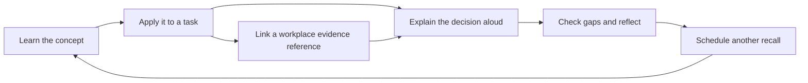

# Level 4 Data Fellowship — study page design

Status: implemented as a static study page on 3 November 2026. See [verification](./tests/VERIFICATION.md) for checks and limits.  
Prepared: 2 November 2026.  
Revised: 3 November 2026, after implementing the answer-led study page.  
Project folder: `VibeProjects/L4-fellowship/`.  
Working page title: **Data Fellowship · EPA study desk**.

## 1. Purpose and scope

Build a personal study page that helps a government Level 4 Data Fellowship apprentice understand, apply, recall and discuss the Data Analyst apprenticeship Knowledge, Skills and Behaviours (KSBs) in preparation for their end point assessment (EPA).

The page should answer three practical questions each time it opens:

- What should I study next?
- What can I demonstrate from my own work, and where is the evidence?
- Can I explain my decisions, results and limitations without reading my notes?

The content baseline is the learner's supplied breakdown: **15 Knowledge items, 15 Skills and 7 Behaviours, totalling 37 KSBs**. Preserve the identifiers K1–K15, S1–S15 and B1–B7 throughout content, questions, evidence and exports. The labels below are study summaries of that breakdown, not quotations from an official standard.

The delivered page is [index.html](./index.html), with the full answer bank in [curriculum.js](./curriculum.js). [solutions.md](./solutions.md) remains the canonical answer guide, with a personalisation template, evidence guidance, coverage check and follow-up for every KSB. The page includes study views, practice, evidence references, synthetic exercises, browser persistence and backup/restore. This document retains the design rationale; implementation checks and limits are recorded in [tests/VERIFICATION.md](./tests/VERIFICATION.md).

### Assessment assumptions

The learner has supplied a second guide describing what to explain and demonstrate for a Pass. Use it as a preparation checklist alongside the original 37-item curriculum. It is not an independently verified verbatim mark scheme. The learner's applicable standard version, training provider, assessment organisation and assessment date are still unconfirmed. Do not invent assessment durations, evidence quotas, pass thresholds or distinction criteria. Practice timers are study aids.

The official ST0118 version 1.1 standard and AP03 assessment plan were consulted while preparing the answers. The route mapping and source details are in [solutions.md](./solutions.md#sources). They provide a reference configuration, conditional on applicability; confirm it with the provider before enabling assessment-route filters as personal requirements. Map verified criteria explicitly and record discrepancies instead of silently changing identifiers. The supplied source markers, now extending to `[109]`, have no accompanying bibliography and must not become fabricated citations.

## 2. Audience and learning approach

Design for one working apprentice revising in short sessions on a phone or laptop. Assume uneven prior knowledge and a mix of technical tasks and workplace examples. Use plain English, expand acronyms on first use, and distinguish a general explanation from the learner's own experience.

Every KSB follows the same learning cycle:



Reading a lesson, completing a synthetic exercise and demonstrating a workplace skill are different achievements. Record them separately. Knowledge needs clear explanation and application; Skills need an account of the learner's own actions; Behaviours need specific examples of choices, collaboration, results and reflection.

### A useful 20-minute session

1. Recall a due topic from memory for 3 minutes.
2. Read its explanation and correct misconceptions for 5 minutes.
3. Attempt a practical task or evidence reflection for 7 minutes.
4. Give a spoken answer, record gaps and choose the next review for 5 minutes.

Offer a shorter 5-minute recall session and a longer 45-minute practical session. These lengths are optional suggestions, not assessment conditions.

## 3. Visual direction: an analyst's study desk

Use a quiet, precise working environment with generous reading space and a distinctive **KSB index**. Its 37 labelled cells show the breadth of the syllabus; selecting a cell opens that KSB. Group cells by Knowledge, Skills and Behaviours, with a text label and a small progress mark in every cell. On a phone, let each group wrap into rows. Provide an equivalent accessible list and textual group totals.

The index is the memorable element. Keep lessons, prompts and evidence forms calm and largely flat, using clear headings and dividers. Do not imitate an official government service or use government logos. This is a personal learning tool.

### Design tokens

| Token | Value | Use |
| --- | --- | --- |
| `--bg` | `#F2F5F8` | Cool paper background |
| `--surface` | `#FFFFFF` | Reading and editing surfaces |
| `--ink` | `#172A3A` | Main text and headings |
| `--muted` | `#4B5D6B` | Supporting text |
| `--accent` | `#174EA6` | Primary actions, links and active selection |
| `--positive` | `#176B52` | Successful recall, always with text or an icon |

Use the ink colour for important borders and control outlines. Reserve a pale accent tint for the selected KSB and active section. Check actual foreground/background combinations during implementation; palette selection alone does not establish accessibility.

- **Typography:** use `"Trebuchet MS", Arial, sans-serif` for navigation and headings, and `Calibri, "Segoe UI", Arial, sans-serif` for body text. These system stacks need no font downloads. Use monospace only for SQL, code and data examples.
- **Type scale:** body 17–18px with 1.6 line height; supporting text at least 14px; section headings 24–28px; page heading 32px on mobile and up to 40px on desktop. Keep prose near 65–75 characters per line.
- **Spacing:** 4px base unit; 8px between related controls, 16px within small sections, 24px between content groups and 40px between major sections.
- **Shape:** 8px corners for interactive surfaces and controls. Use borders and whitespace to convey grouping; avoid decorative shadows.
- **Alignment:** left aligned text, prompts and numbers with their labels. Centre only short KSB cell identifiers.
- **Motion:** no automatic animation. A short state change may confirm an interaction; disable nonessential transitions when reduced motion is requested.
- **Tone:** direct and supportive. Use “Practise K8”, “Link evidence” and “Show answer guide”. Avoid pressure from streaks or competitive scoring.

### Design review against the brief

The KSB index makes the 37-item curriculum visible and navigable. Longer lessons use a reading surface rather than a grid of equally sized cards. The first screen prioritises the next study action and any gaps; a large percentage score would obscure the difference between understanding and evidence. Government relevance comes from examples of responsible analysis and public service decisions.

## 4. Page structure and responsive layouts

One self-contained static page, with five clearly named sections:

| Section | Main question | Main contents |
| --- | --- | --- |
| Today | What should I do next? | Continue studying, due reviews, evidence gaps, recent activity |
| KSB library | What do I need to learn and explain? | Search, filters, six themes, all 37 answer guides, worked examples and personal response forms |
| My evidence | What have I personally demonstrated? | Evidence reference index, KSB links, reflection and gaps |
| Practice | Can I discuss it clearly? | Attempt before revealing the model answer, compare coverage, practise follow-ups and mixed sessions |
| Plan and sources | What is my plan, and what is verified? | Weekly plan, optional EPA details, references, backup and restore |

Use ordinary links with stable hashes such as `#today`, `#ksb-k8`, `#evidence`, `#practice` and `#plan`. Support browser Back/Forward and direct links to every KSB. Use the exact project path `L4-fellowship` requested by the learner; preserve its case in future links.

### Desktop, around 1280px

```text
┌──────────────────────────────────────────────────────────────────┐
│ Data Fellowship                 Search KSBs             Backup    │
├──────────────┬──────────────────────────────────┬────────────────┤
│ Today        │ Your next session                │ KSB index      │
│ KSB library  │ Practise explaining data quality │ Knowledge      │
│ My evidence  │ [Start 20-minute session]        │ K1 … K15       │
│ Practice     │                                  │ Skills         │
│ Plan and     │ Reviews due                      │ S1 … S15       │
│ sources      │ Topic / last recall / next action│ Behaviours     │
│              │                                  │ B1 … B7        │
│              │ Evidence to strengthen           │ Text totals    │
└──────────────┴──────────────────────────────────┴────────────────┘
```

The wireframe's K8 recommendation is illustrative. A new user's real page starts with an introduction and no fabricated activity. Use a maximum content width of about 1240px, a 200px navigation column and a flexible main column. The index can occupy a 240px side panel when space allows. Lesson detail gets the majority of the reading width; move the index below it on smaller screens.

### Mobile, designed first at 390px

```text
┌───────────────────────────────┐
│ Data Fellowship       Backup  │
│ [Navigate to section       v] │
│ [Search KSBs and topics      ]│
├───────────────────────────────┤
│ Your next session             │
│ [Start a study session]       │
│ Reviews due                   │
│ One clear action per item     │
│                               │
│ Your KSB index                │
│ Knowledge: wrapping KSB cells │
│ Skills: wrapping KSB cells    │
│ Behaviours: wrapping cells    │
└───────────────────────────────┘
```

Below 700px, use a single column and a labelled navigation disclosure with all five section links. At 700–1099px, use navigation plus the main content and place the index inline. At 1100px and above, allow the optional third column. Avoid a fixed bottom bar that covers a keyboard or an answer field.

Do not require horizontal page scrolling at 390px or 320px. Render the KSB list as compact rows on desktop and stacked items on mobile. Only code blocks and genuine data tables may scroll within their own labelled region. Print layouts should expand selected study content, remove navigation and use clear page breaks.

## 5. Content organisation: six study themes

Themes provide a sensible route through the material; the K/S/B views remain available for direct assessment-oriented revision. Each KSB has one primary theme and may link to related topics.

| Theme | Primary KSBs | Study outcome |
| --- | --- | --- |
| Responsible data use | K1, K2, K4, K15, S1, S3, B1 | Explain legal, organisational, classification, security and ethical decisions |
| Planning and delivery | K3, K9, S2, S7, B3, B7 | Turn a stakeholder problem into a scoped, adaptable analysis |
| Data structures, architecture and tools | K5, K6, K11, K12, S4, S9, S15 | Understand how data is stored and justify suitable tools |
| Preparation and quality | K8, K10, S6, S8, B4, B5 | Combine sources safely, investigate problems and validate results |
| Statistics and analytical methods | K13, K14, S10, S11, S13, B2, B6 | Select, apply and explain methods with appropriate limitations |
| User-centred communication | K7, S5, S12, S14 | Make outputs accessible, useful and appropriate for the audience |

## 6. KSB lesson and answer template

Every detail view should contain the following, in order:

1. **Identifier, title and context:** category, theme, related KSBs and study summary. Show the supplied preparation target and any verified official descriptor as separate, sourced fields.
2. **What to cover:** turn the section's Coverage check in `solutions.md` into short, observable checklist items. Identify them as supplied preparation targets, with any official source mapping shown separately.
3. **Answer guide:** display the complete explanation, definitions, tables and technical clarifications from the matching solutions section. Keep longer worked examples expandable. In Learn mode the explanation is available immediately; in Practice mode it remains hidden until requested.
4. **Worked application:** include the existing synthetic examples and any later practical task, clearly labelled. For Skills, explain what still requires performed workplace work; for Behaviours, keep the fictional scenario distinct from the learner's history.
5. **Make it yours:** provide an editable answer using the exact section-specific template as a visible prompt, plus fields for the learner's own actions, reasons, result, limitations and learning. Keep placeholders visible until genuinely completed.
6. **Evidence to reference:** show the section's suggested evidence, allow approved reference IDs and require per-KSB rationales. Never turn a model answer into an evidence entry automatically.
7. **Practise and compare:** present the initial question and the solutions section's follow-up. After an attempt, reveal the answer and show the learner's response alongside it on desktop, or in labelled stacked sections on mobile. Coverage is self-reviewed, not keyword scored.
8. **Review and sources:** learning status, confidence, recall outcome, next review, gap note, source/version details and a direct link to the relevant anchor in `solutions.md`.

### KSB detail layout

```text
K13  Principles of Statistics
Preparation targets: summaries, inference, application

[Learn] [Practise]                 Evidence: no reference

Answer guide                      My response
Definitions and explanation        [Write in your own words       ]
Worked synthetic example           [Add your own project example  ]
[Expand calculation]               [Save my response]

What I covered                     Evidence to reference
[ ] Explain the measures           [Approved reference ID         ]
[ ] Explain inference              [How this supports K13         ]
[ ] Demonstrate real application   [Link evidence]

Follow-up question                 Sources and verification status
```

The example checklist is abbreviated for layout only; the real view must include all relevant items from K13's answer section. The page should not place all 37 long answers on the landing screen. Search and the index lead to one focused KSB view at a time; an optional print selection can expand several.

### Answer content that needs specialised presentation

- K1: show all seven principles with their practical meanings, including the full first principle.
- K4/S3: distinguish overlapping dataset types, organisational security classification and risk descriptions.
- K6/K10: present definitions as readable tables; distinguish UNION from joins and show grain/cardinality checks.
- K13/S10: render formulas accessibly and retain the numerical examples, assumptions, test result and correct interpretation together. Use plain text fallbacks for symbols.
- K14/S11: connect descriptive, predictive and prescriptive stages; show validation and decision constraints, not just a model name.
- S8: use selectable, horizontally contained code blocks with a Copy SQL action and explanatory checks. Running SQL is not required in the browser.
- S12: provide two stakeholder example slots, each with role, need, communication adaptation, collaboration and outcome. Allow more stakeholders; label the two-example target as supplied preparation guidance.
- S13: require a forecast worksheet with target, frequency, history window, holdout, future horizon, model, trend/seasonality assessment, baseline, metrics, visual, projection and limitations. Also include a distinct mining/modelling example slot. A clustering example cannot satisfy the forecast-visual target.
- S14: show both quantitative and qualitative interpretation and the rationale for visuals, including context lost through theme counts.
- B1–B7: use a STAR-L response form with each Behaviour's specific prompt; distinguish B2's minor unexpected change from B7's broader contextual shift.

### Worked lesson example: K8, Data Quality Risks

**Learning outcomes:** distinguish accuracy, completeness, consistency, validity, uniqueness and timeliness; identify missing values and suspicious outliers; explain how a quality issue changes a decision; choose a proportionate correction or escalation.

**Explanation:** a dataset can be complete yet inaccurate, or contain valid values that refer to the wrong person or service. A missing value may mean unknown, not applicable or a collection failure. An outlier may be a genuine event. Define the intended use before deciding what quality is sufficient.

**Synthetic example:** a service-performance report shows a jump in requests after a source join. The lookup contains repeated service identifiers. Check the expected join relationship and row counts before treating the jump as a real change in demand.

**Try it:** identify missing completion dates, inconsistent service names and duplicate lookup keys. Record counts and effects, test a proposed correction and reconcile totals. Keep a transformation log and preserve the source data. Do not automatically delete missing values or outliers.

**Explain it:** “What quality risks did you find, how did you prioritise them, and what changed after your intervention?”

**Answer guide:** name the quality dimension; describe detection; explain the impact on the stakeholder's question; justify treatment or escalation; describe validation; acknowledge residual uncertainty. There may be several defensible approaches.

**Evidence prompt:** link an approved reference to a quality log or validation result, stating exactly what you did. Related topics: S6 for action, K10/S8 for joins and B5 for root cause.

## 7. Complete KSB content and practice map

Each row links directly to its complete answer in `solutions.md` and defines an index summary, an initial practice prompt and a possible evidence connection. The complete coverage targets, personalisation prompts and follow-ups live in the linked solution; the shorter summaries here must not truncate them in the page. Evidence suggestions are examples, not proof that a criterion has been met. All questions are authored practice material, not official assessment questions.

### Knowledge: explain the principles and justify decisions

| KSB and supplied topic | Minimum lesson scope | Initial practice question | Possible connection to your work |
| --- | --- | --- | --- |
| [**K1: Current & Relevant Data Legislation**](./solutions.md#ksb-k1) | UK GDPR and Data Protection Act 2018; lawful basis, purpose limitation, minimisation, retention and individual rights; verify applicable amendments and effective dates against authoritative sources | How did data legislation affect what you collected, accessed, retained and shared? | A sanitised account of a lawful data-handling decision; do not assume consent is always the lawful basis |
| [**K2: Organisational Data Policies & Standards**](./solutions.md#ksb-k2) | Access controls, approved storage, retention, secure sharing, incident reporting and organisational responsibilities | Which organisational policies shaped your analysis, and how did you check compliance? | Approved policy references and an account of following them |
| [**K3: Principles of the Data Analysis Lifecycle**](./solutions.md#ksb-k3) | Planning, preparation, analysis, refinement/comparison and communication; iteration and validation between stages | Walk through a project lifecycle and explain a point where you revisited an earlier stage. | A project timeline and decision log |
| [**K4: Data Classification Types**](./solutions.md#ksb-k4) | Open, public, administrative and research data; provenance, licensing and appropriate use; distinguish these types from organisational security markings | How did the type and classification of your data affect access and reuse? | A classification rationale checked against the organisation's actual scheme |
| [**K5: Structured vs. Unstructured Data**](./solutions.md#ksb-k5) | Tabular schemas and free-form text/audio/video; semi-structured formats as a useful bridge; extraction and analysis implications | How would your approach change between a table of service records and free-text feedback? | A comparison of source formats and preparation choices |
| [**K6: Data Structures & Database System Design**](./solutions.md#ksb-k6) | Relational keys, relationships, schemas and normalisation; NoSQL document/key-value concepts; implementation, indexing and maintenance trade-offs | Why was a particular database design suitable, and what trade-offs did it create? | A sanitised schema sketch and explanation of key relationships |
| [**K7: User Experience (UX) & Domain Context Principles**](./solutions.md#ksb-k7) | Simplicity, accessibility, task design and domain definitions; how user decisions determine metrics and layout | How did users' tasks and domain knowledge change the design of your output? | A design rationale with user feedback |
| [**K8: Data Quality Risks**](./solutions.md#ksb-k8) | Accuracy, completeness, consistency, timeliness, validity and uniqueness; NULLs, outliers, mitigation and escalation | What made a quality issue material, and how did you decide whether to correct or escalate it? | A quality assessment with impact and residual limitations |
| [**K9: Defining Customer Requirements**](./solutions.md#ksb-k9) | Stakeholder mapping, interviews, problem statements, scope, constraints, acceptance criteria and change control | How did you turn a broad stakeholder request into measurable requirements? | An agreed brief and traceable acceptance criteria |
| [**K10: Combining Data Sources**](./solutions.md#ksb-k10) | Keys, grain, join types, cardinality, duplicates, aggregation and reconciliation | Why did you choose that join, and how did you check it had not inflated or lost records? | A join rationale with row-count and total checks |
| [**K11: Organisational Analysis Tools & Methods**](./solutions.md#ksb-k11) | Available organisational tools; licensed software versus code; capability, accessibility, cost, reproducibility and support | Why did you choose your analysis tool over another available option? | A comparison of realistic tools and constraints |
| [**K12: Organisational Data Architecture**](./solutions.md#ksb-k12) | Databases, warehouses, lakes and Big Data concepts; ingestion, central storage, lineage, access and storage policies | Where did your data come from, where was it held, and how was access governed? | An approved high-level architecture and lineage explanation |
| [**K13: Principles of Statistics**](./solutions.md#ksb-k13) | Mean, median, spread and distributions; sampling, uncertainty, confidence intervals, hypotheses, p-values and t-test assumptions | How would you explain a statistical result, its assumptions and uncertainty to a non-specialist? | A statistical interpretation; a p-value is not the probability that the null hypothesis is true |
| [**K14: Principles of Analytics Types**](./solutions.md#ksb-k14) | Descriptive summaries, predictive models and prescriptive recommendations; assumptions, validation and decision context | What changes when the question moves from “what happened?” to “what might happen?” to “what should we do?” | A reasoned comparison using one business question; prediction alone does not establish causation |
| [**K15: Data Ethics**](./solutions.md#ksb-k15) | Fairness, bias, transparency, accountability, consent where applicable, proportionality and potential harm | What ethical risk remained even if your analysis was legally permitted? | An ethical reflection describing a trade-off and mitigation |

### Skills: demonstrate what you personally did

| KSB and supplied topic | Minimum lesson scope | Initial practice question | Possible evidence reference |
| --- | --- | --- | --- |
| [**S1: Operating Data Systems in Compliance**](./solutions.md#ksb-s1) | Apply legal and organisational controls; privacy by design, minimum necessary access and secure handling | Describe the controls you applied while using a data system and why they were appropriate. | A sanitised handling checklist or account of access and minimisation decisions |
| [**S2: Applying the Data Analysis Lifecycle**](./solutions.md#ksb-s2) | Carry out and document the lifecycle, including validation, iteration and handover | Show how your actions connected the project brief to the delivered result. | A project log linking activities and outputs |
| [**S3: Applying Principles of Data Classification**](./solutions.md#ksb-s3) | Classify a dataset, justify handling and apply suitable redaction or anonymisation; distinguish pseudonymisation | How did you classify the data and check that the protection you applied was sufficient? | An approved classification/redaction record with a re-identification risk discussion |
| [**S4: Analysing Diverse Data Structures & Designs**](./solutions.md#ksb-s4) | Adapt extraction, reshaping and querying to different source structures and database designs | What did you change when analysing data from different structures? | Annotated queries or transformation steps with a schema explanation |
| [**S5: Applying UX & Domain Context**](./solutions.md#ksb-s5) | Apply accessible layout, chart choices, terminology and user feedback to a real decision | What user need drove a specific design choice, and how did you evaluate it? | A sanitised before/after output and feedback summary |
| [**S6: Mitigating & Resolving Quality Risks**](./solutions.md#ksb-s6) | Profile, prioritise, resolve or escalate issues; validate corrections and explain remaining risk | Take one quality problem from detection through resolution and validation. | A quality log, checks and escalation rationale |
| [**S7: Implementing Customer Requirements**](./solutions.md#ksb-s7) | Turn requirements into scope, milestones, deliverables and acceptance checks | How can you demonstrate that your final output met the agreed requirements? | A requirements-to-deliverables mapping |
| [**S8: Combining & Preparing Multi-Source Data**](./solutions.md#ksb-s8) | Clean and join multiple sources using suitable SQL, Power Query, Python or equivalent; preserve lineage | Demonstrate how you prepared and joined sources and verified the combined result. | Reproducible transformation steps and reconciliation results |
| [**S9: Tools for Data Architecture**](./solutions.md#ksb-s9) | Use approved tools to query, connect to or interact with organisational infrastructure under appropriate permissions | How did you use your tools to work with the data infrastructure safely and effectively? | An approved query/connection workflow described without credentials or sensitive host details |
| [**S10: Applying Statistical Methodologies**](./solutions.md#ksb-s10) | Perform exploratory data analysis (EDA), summary statistics and a suitable inferential test; check assumptions | Why was your statistical method suitable, and what did your checks reveal? | An analysis output with assumptions, uncertainty and interpretation |
| [**S11: Applying Predictive & Advanced Analytics**](./solutions.md#ksb-s11) | Fit and evaluate a suitable regression/classification model, compare a baseline, avoid leakage and turn findings into a justified recommendation | How did you evaluate your model, and what action could its results support? | Model evaluation and a recommendation stating constraints and uncertainty |
| [**S12: Stakeholder Communication & Collaboration**](./solutions.md#ksb-s12) | Prepare examples with at least two distinct stakeholders; adapt styles/channels, collaborate and show outcomes; include other relevant stakeholders | How did you adapt communication and collaboration for two different stakeholders, and what changed? | Two sanitised stakeholder accounts with needs, channels, feedback and outcomes |
| [**S13: Time Series Forecasting & Data Mining**](./solutions.md#ksb-s13) | Produce a visual forecast with target, window, horizon, chosen model, time-based validation, baseline, RMSE or another suitable metric, trend, seasonality and projections; retain a separate mining/modelling example | How did you choose, evaluate and communicate the forecast, and what did your separate mining/modelling work show? | Forecast plot/table, model and metric calculation, uncertainty and a distinct mining/modelling example |
| [**S14: Visual Representation of Qualitative & Quantitative Data**](./solutions.md#ksb-s14) | Represent measures and categories/themes; choose charts, labels, scales, text summaries and accessible alternatives | How did your visualisation communicate both numerical results and qualitative context? | An annotated output with a chart rationale and accessible explanation |
| [**S15: Selecting Optimal Data Analysis Tools**](./solutions.md#ksb-s15) | Evaluate and apply a suitable tool against requirements, data scale, reproducibility, cost and support | Which options did you evaluate, why did you choose one, and how did it perform? | A tool decision log and resulting practical output |

### Behaviours: describe choices, impact and reflection

Use **STAR-L: Situation, Task, Action, Result, Learning** as an optional answer structure. Emphasise the learner's contribution, the effect on others and a specific lesson. A claim such as “I am resilient” is a starting point for reflection, not evidence.

| KSB and supplied topic | Minimum lesson scope | Initial practice question | Possible evidence connection |
| --- | --- | --- | --- |
| [**B1: Safe & Secure Working Environment**](./solutions.md#ksb-b1) | Maintain secure access, professional working habits and a productive environment; act on concerns | Tell me about a time your everyday working practices protected data or prevented a security problem. | A specific account of secure working and the outcome |
| [**B2: Adaptability & Problem Solving**](./solutions.md#ksb-b2) | Handle a small unexpected operational problem while maintaining progress | Describe an unexpected issue, the options you considered and how you kept work moving. | A short incident and decision reflection |
| [**B3: Independent & Collaborative Working**](./solutions.md#ksb-b3) | Own tasks, recognise limits, seek useful input and consider effects on colleagues | When did you work independently, and when did involving others improve the outcome? | A contribution log or feedback linked to a specific result |
| [**B4: Logical & Analytical Thinking**](./solutions.md#ksb-b4) | Take initiative, break down a problem, test hypotheses and reason from evidence | How did you structure an ambiguous data problem and decide what to investigate first? | A reasoning trail or analytical decision log |
| [**B5: Root Cause Analysis**](./solutions.md#ksb-b5) | Distinguish symptoms from causes, test explanations and prevent recurrence | How did you establish the root cause and check that your solution prevented it happening again? | A cause investigation and follow-up check |
| [**B6: Resilience & Lessons Learned**](./solutions.md#ksb-b6) | Respond constructively to setbacks, use feedback and change future practice | Describe a setback, what you learned and what you subsequently did differently. | A retrospective tied to a later improvement |
| [**B7: Flexibility in Contextual Shifts**](./solutions.md#ksb-b7) | Adapt to a larger change in scope, direction or responsibilities; reset expectations | What changed in the wider context, and how did you adapt your plan and communicate the effect? | An updated plan and reflection on stakeholder impact |

## 8. Practical exercise studio

Use a fictional public-service performance scenario throughout the first learning path: service requests, monthly service metrics, a service lookup and synthetic feedback. Supply a data dictionary, source notes and known planted issues when the page is built. The data must contain no real citizen or employee records.

Every exercise has an objective, instructions, a starter dataset or scenario, optional hints, a worked approach, a self-check and explicit KSB links. The worked approach should explain reasoning and limitations, not just provide code to copy. Tools should match the learner's approved environment; a browser preview cannot substitute for operating actual workplace systems.

| Exercise | Deliverable and self-check | Primary Skills |
| --- | --- | --- |
| Scope the service question | A problem statement, stakeholder map, acceptance criteria and lifecycle plan; check each deliverable against a user decision | S2, S7 |
| Classify and handle the data | A reasoned classification, minimum required fields and handling plan; distinguish data type, security marking, anonymisation and pseudonymisation | S1, S3 |
| Understand the sources and choose tools | A schema/lineage sketch, a justified tool comparison and a query or connection walkthrough; explain permissions and source structure | S4, S9, S15 |
| Prepare, join and validate | A reproducible cleaning/join workflow and issue log; reconcile row counts, key uniqueness, totals and unresolved risks | S6, S8 |
| Explore, test and predict | EDA, a justified statistical test, a simple predictive model, a required visual forecast with baseline/error metrics and a separate mining/modelling example; check assumptions, compare baselines and explain uncertainty | S10, S11, S13 |
| Communicate a decision | An accessible view combining measures and feedback themes, a short technical note and a stakeholder briefing; explain how feedback changed the output | S5, S12, S14 |

For statistics and models, show what a sensible conclusion would and would not support. Include sampling bias, missingness, correlation versus causation, small samples, leakage and validation on unseen data. Forecasts must respect time order; recommendations must account for policy, operational constraints and human judgement.

Each exercise also asks for a short Behaviour reflection. Synthetic practice can expose learning gaps and support an explanation, but must remain labelled as practice. Never manufacture workplace experience, stakeholder feedback or results.

## 9. Evidence notebook

Evidence entries are references plus reflections. One entry can support several KSBs, but every link needs a sentence explaining what that item demonstrates for that specific KSB. A document attachment alone is insufficient context.

### Entry fields

- A stable ID, generic title, project alias and local date.
- An approved reference ID pointing to material retained in the organisation's authorised evidence location. Avoid sensitive paths, system addresses or personal names in the study page.
- Context, task, the learner's own actions, method/tool choice, outcome and limitations.
- What was done independently, where others contributed and how stakeholders were affected.
- Linked KSB IDs, each with a rationale and a useful section/page reference if safe to record.
- Learning, a possible follow-up question and the next action needed.
- Evidence state: none, draft reflection, reference linked or review recorded. A review records who/what role reviewed it and when only if appropriate to retain; it does not imply assessor approval.

The coverage view lists all 37 KSBs and shows whether each has a meaningful rationale, a reference and any review note. Highlight missing rationale, unverified references and ageing examples as prompts to check. Do not invent expiry dates or require a fixed number of examples.

### Public repository and workplace material

`VibeProjects` is public. Commit only generic study content, synthetic datasets and material explicitly approved for public release. Keep real government datasets, restricted policies, identifiable examples, access details and original evidence in approved organisational storage. A private-sounding filename or an obscure link does not make a public file private.

Future personal notes and progress remain in the learner's browser by default and are excluded from the committed curriculum. Browser storage is not encrypted evidence storage and does not make a public static page an approved government system. Use sanitised reflections and abstract evidence references. Do not provide raw workplace evidence uploads or automatic synchronisation.

## 10. Recall and discussion practice

### Modes

- **Quick recall:** one question, an answer field or silent/spoken response, then an answer guide. Require an explicit “Show answer guide” action before revealing guidance.
- **Scenario practice:** ask the learner to choose and justify a course of action. Discuss alternatives rather than awarding marks solely for keywords.
- **Project walkthrough:** use the learner's chosen evidence reference and prompt for requirements, lifecycle, quality, analysis, communication and impact.
- **Mixed discussion:** select at least one Knowledge, one Skill and one Behaviour prompt. Show the selected KSBs and let the learner change them. Make session length and timer optional.
- **Weak-topic review:** revisit items with uncertain recall, missing explanations or evidence gaps; explain why each was selected.

Seed the first question bank with the 37 questions in the content map and the 37 Follow-up prompts in `solutions.md`. Use the section-specific Answer guide and Coverage check after the learner attempts the question. Add further scenario questions as content develops. Map questions to stable KSB identifiers and distinguish authored practice from any later licensed or officially published material.

### Compare an answer without pretending to grade it

After “Show answer guide”, display the original response, model explanation, personalisation prompt and evidence suggestions. Let the learner mark each preparation target as Not yet covered, Needs detail or Covered in my response, with a short note. Offer “Revise my response” and “Save self-review”. Missing workplace examples remain evidence gaps even if the theory is well recalled. Do not calculate an official Pass, infer evidence from vocabulary or automatically overwrite the learner's response with the guide.

### Self-review guide

After responding, ask:

1. Did I explain the concept accurately in my own words?
2. Did I give a concrete example and identify my own contribution?
3. Did I justify the method and consider an alternative?
4. Did I explain the result, validation and limitations?
5. Could I answer a follow-up and describe what I learned?

For Behaviours, foreground actions, effects on others and learning. For Skills, foreground the performed work and validation. Record gaps in the learner's own words. These prompts are a study aid, not an official marking rubric.

Spoken practice does not require a microphone: display the question, let the learner speak aloud, then note a brief reflection. Keep audio recording and automated grading outside the first version. The initial page needs no external AI service.

## 11. Progress, review scheduling and the study plan

Keep the following dimensions separate for each KSB:

| Dimension | Values | Meaning |
| --- | --- | --- |
| Learning | Not started / Learning / Can explain | Learner-recorded understanding; “Can explain” should follow recall |
| Confidence | Unset or 1–5 | A subjective feeling; never a substitute for evidence |
| Recall | No attempt / Needed help / Partial / Explained independently | The learner's review of the latest attempt |
| Evidence | None / Draft / Reference linked / Review recorded | The state of the supporting reflection and reference |
| Answer coverage | Not reviewed / per-target Not yet covered, Needs detail or Covered in my response | A self-review against supplied preparation targets; separate from confidence and evidence |
| Review | Last attempt and next local date | When to revisit the topic |

Use factual summaries such as “6 of 15 Knowledge topics marked Can explain” and “2 of 7 Behaviours have an evidence reference”. Label all totals as self-recorded. Do not combine these into an EPA pass probability or a single official readiness percentage. Keep unattempted items visible and unknown confidence unset.

### Simple, transparent review rules

- After an attempt marked **Needed help**, suggest tomorrow.
- After **Partial**, suggest in 3 days.
- After **Explained independently**, suggest in 7 days; after a second consecutive independent recall, suggest 14 days.
- Let the learner change any suggested date. An overdue item remains due until reviewed or rescheduled; it does not change confidence automatically.
- New topics have no last-attempt date and are introduced through the theme path. A missed session produces a helpful next action, not a penalty.

These are convenient defaults, not a claim that a particular spacing algorithm is optimal. Store dates using local calendar dates. Recalculate due items when the page opens or returns to focus.

### Today ordering

Recommend one next action in this order: resume an unfinished session; otherwise review the oldest due topic; otherwise continue the first incomplete theme. Show separate evidence-gap suggestions underneath. Break ties with the stable KSB order K1–K15, S1–S15, B1–B7. Allow the learner to choose freely and show the reason for the recommendation.

### Repeatable weekly pattern

| Session | Focus | Useful output |
| --- | --- | --- |
| First session | Knowledge recall plus one practical task | A corrected explanation and a task result |
| Second session | Evidence mapping and Behaviour reflection | A clearer personal example with linked KSB rationale |
| Third session | Mixed discussion and gap review | A short list of weak topics and next review dates |

Let the learner set available study days and session lengths. If an assessment date is entered, show time remaining and upcoming planned sessions without promising that the schedule guarantees coverage. Allow a manual priority for topics raised by a coach.

## 12. Search, filters and interaction details

- Search identifiers, titles, explanations, themes and question text. A search for `K8`, `quality` or `NULL` should find relevant material; it must not send personal notes to a server.
- Filters include K/S/B category, theme, learning state, due review and evidence state. Combine filters consistently, display the active selections and provide “Clear filters”.
- KSB rows show ID, title, learning state, next review and evidence state. Opening a row reveals the lesson. Keep the selected ID visible in the detail heading.
- Save edits locally after a short debounce and on leaving the field. Show “Saved on this device” only after a successful storage write. In-memory mode must say that changes will be lost when the page closes.
- Before navigating away from an unsaved answer, save it if possible or clearly retain it in memory. A practice session can be paused and resumed.
- A timer has Start, Pause, Resume and Reset controls. Reaching zero invites continuation or review; never erase an answer or force submission.
- Deleting an evidence entry offers an undo action. Clearing all personal data requires an explicit confirmation naming what will be removed.

### Empty and error states

| Situation | Required response |
| --- | --- |
| First visit | “Start with Responsible data use, or choose a KSB.” Show no invented progress and no assumed assessment date |
| No matching search | “No KSBs match these filters.” Offer Clear filters and show the search text |
| No evidence for a KSB | “Add a sanitised reflection and an approved evidence reference.” Keep practice available |
| No reviews due | Offer the next unstarted topic or a freely selected practice session |
| Browser storage unavailable | Explain that this session uses temporary memory and offer an export |
| Invalid backup | State the validation problem; leave existing data untouched and let the learner choose another file |
| Newer/unsupported backup version | Explain the version mismatch and preserve the original file and existing state |
| Unverified source | Show “Source verification pending” and the missing details; never render a made-up citation |

## 13. Accessibility and reading comfort

Target WCAG 2.2 AA during implementation and verify the relevant criteria; this design document is not a conformance claim.

- Use semantic headings, landmarks, native links/buttons and explicit form labels. Add a skip link and a logical focus order.
- Make the KSB index usable by keyboard, screen reader and touch. Accessible names include ID, title and textual state; selecting an item must not rely on hover.
- Use visible focus outlines. Keep sticky elements from obscuring focused content. Return focus appropriately after closing a dialog or changing a view.
- Aim for 44px touch targets. Maintain at least 4.5:1 contrast for normal text and 3:1 for large text and meaningful interface boundaries.
- Do not convey status solely through colour. Pair progress marks with labels and provide textual totals for the index.
- Support zoom and reflow, reduced motion and long titles. Let users enlarge lesson text without breaking controls.
- Announce save failures and important confirmations politely. Avoid announcing every keystroke or timer second.
- Give charts a title, explanation and accessible table or text alternative. Represent qualitative themes carefully and preserve uncertainty.
- Reveal answer guides with a button exposing its expanded state. Avoid essential content hidden in tooltips.

## 14. Static implementation constraints and data model

Follow the repository defaults when the page is implemented: start with one `index.html` containing HTML, CSS and JavaScript. Use vanilla browser features, relative paths, no build step, no backend and no required third-party services. The page must open directly from disk and work on GitHub Pages under `/L4-fellowship/`.

Embed the initial curriculum and synthetic data or load any optional later data as local JavaScript rather than relying on `fetch()` for the essential file-open experience. Keep curriculum definitions separate in code from personal progress. Do not import code from other projects.

### Suggested project organisation

```text
L4-fellowship/
  design.md             This document; revised to incorporate answers
  solutions.md          Canonical public answer bank for all 37 KSBs; created now
  index.html            Future static study page
  AGENTS.md             Future implementation notes, stable IDs and storage rules
  sources.md            Future verified reference register
  docs/                 Future generic study notes approved for public release
  practice/             Future synthetic data and generic exercise instructions
```

The current scope creates `design.md` and `solutions.md`. Do not create empty placeholder files or put private evidence into any of these folders. Larger curriculum data can move to a local `.js` file if size warrants it; preserve the build-free, self-contained project.

### Integrating solutions into the future page

`solutions.md` is the canonical authored answer bank. Every section exposes a stable explicit anchor `ksb-k1` through `ksb-b7`; keep these anchors stable. Its repeated blocks are Answer guide, Make it yours, Evidence to reference, Coverage check and Follow-up. Some sections also contain worked examples or tables that belong with their explanations.

When implementing, derive the in-page curriculum from these blocks and embed it in `index.html` (or a local curriculum JavaScript file if size warrants it). Store the source filename, source anchor and content revision in each KSB record. Essential answers must not depend on fetching Markdown at runtime: that would break direct file opening in some browsers. No mandatory build tool or remote Markdown service is introduced.

Keep a direct “Read source answer” link to `./solutions.md#ksb-k8` or the selected KSB's equivalent. A normal hosted Markdown file may open as text or download depending on the host; the in-page answer remains fully readable. Do not rely on the host rendering Markdown as the study interface.

Check all 37 answer records against their source sections whenever content changes. Preserve tables, example labels, caveats and source-verification notes. Do not copy only a short definition while omitting required application or evidence prompts. A curriculum revision must not erase personal notes; mark an earlier self-review as needing recheck when its checklist changes.

For S13, render the documented synthetic holdout forecast using a small accessible SVG with direct series labels, differing line styles and the accompanying data table. Show training/holdout and future projection windows clearly; do not join future estimates to actuals as if they were observations. Read values from the same in-page data record for both the plot and table to prevent disagreement. Retain the model and baseline RMSE explanation. Mermaid in the source document is a documentation visual, not a runtime chart dependency.

### Conceptual records

| Record | Essential fields |
| --- | --- |
| KSB definition | Stable ID, category, title/summary, theme, answer guide, personalisation template, evidence prompts, coverage targets, follow-up, worked examples, exercise/question/source IDs, source filename/anchor, content revision and optional verified official descriptor/route |
| Personal KSB state | KSB ID, learning state, optional confidence, latest recall, local review dates, consecutive independent recalls, sanitised personal response, per-target self-review, response revision, reviewed content revision and private gap note |
| Evidence reference | Stable ID, generic title, project alias, approved reference ID, STAR-L reflection, per-KSB rationale, evidence state, review note |
| Practice attempt | Stable ID, question ID, KSB IDs, local date, response/reflection, self-review result, gaps and optional elapsed seconds |
| Source | Stable ID, title, publisher, URL if known, version/effective date, checked date, verification state and supported KSB IDs |
| Settings | Optional standard/assessment details, available study days, preferred session length and manually prioritised KSB IDs |

Use the exact storage namespace **`l4-fellowship.v1`**, containing one JSON object with a numeric `version` field, settings, KSB state, evidence references, attempts and any unfinished session. Initialise every KSB with unknown or empty personal state. Never rename a shipped key without a tested migration.

Wrap every storage read and write in `try/catch`. Handle missing/corrupt JSON and quota failures without a blank screen. Retain corrupt saved data for recovery rather than silently overwriting it. Fall back to in-memory state with a visible message. Store calendar dates as local `YYYY-MM-DD`, not by slicing a UTC timestamp.

### Backup, restore and export

Provide a labelled JSON backup download and a separate printable Markdown study summary. Explain that downloads can contain personal reflections and must be stored appropriately. A public curriculum export excludes all personal state.

For restore, validate file size, schema version, value types, allowed states and KSB IDs before changing anything. Treat imported notes as plain text; never execute imported HTML or code. Show a preview with record counts and offer Merge or Replace. Match stable IDs; retain existing conflicting entries by default and report conflicts for explicit resolution. Before Replace, offer a download of the current state. Apply changes only after the learner confirms the preview, and leave the current state intact if validation or persistence fails.

No login, cross-device sync, cloud evidence storage or analytics tracking is needed for the first version. Browser backups are the planned way to move personal state between devices. Do not claim offline reload support until it is implemented and checked; direct file opening covers the initial local-use requirement.

## 15. Content sources and maintenance

Maintain a visible reference register, initially populated from [the solutions reference register](./solutions.md#sources). Record the learner's supplied guides as preparation baselines; record the official standard/plan as consulted but not yet confirmed applicable. Preserve the distinction between a fully read source, a checked search extract and a source that still needs verification. The missing `[1]`–`[109]` bibliography and provider-specific arrangements remain source gaps.

During content development, use authoritative sources for legislation and assessment requirements; appropriate sources include the applicable apprenticeship standard/assessment plan, official legislation and Information Commissioner's Office guidance. Record exact documents, versions and checked dates when consulted. Do not imply any of them were verified merely by naming their publishers in this design.

Organisation-specific policies and architecture must be described by the learner within their authorised environment. Public lessons can explain principles without copying restricted material. On K1, distinguish UK GDPR from a generic reference to GDPR and verify later legal amendments and their commencement dates before claiming guidance is current. On K4/S3, distinguish dataset categories from an organisation's actual security classification and handling rules.

Version changes to curriculum content explicitly. Preserve IDs, question links and personal progress. If official criteria differ from the supplied breakdown, show a traceable mapping and request provider clarification as part of source verification; do not invent equivalence or silently mark coverage complete.

## 16. Delivery stages and acceptance criteria

### Stage A: design and complete answer bank — current scope

- Create `VibeProjects/L4-fellowship/design.md`.
- Create `VibeProjects/L4-fellowship/solutions.md` with a substantive answer guide, personalisation template, evidence prompt, coverage check and follow-up for each KSB.
- Include all 37 supplied KSB identifiers, faithful study topics and an initial discussion prompt for each.
- Define the study flow, page layout, visual direction, exercises, evidence model, practice, progress and implementation constraints.
- Make assessment and source uncertainties visible and avoid invented personal experience or progress.
- Link all 37 design-map rows to the matching stable solution anchor. Incorporate the supplied specific targets, especially S12's two-stakeholder preparation and S13's evaluated visual forecast plus broader mining/modelling scope.

### Stage B: minimum useful page — implemented

Implement the five sections, all answer guides from `solutions.md`, the theme map, questions and follow-ups, personal response/self-review forms, sanitised evidence references, review scheduling, local persistence and backup/restore. Preserve the complete content and caveats from the answer bank. Publish new practical tasks only when written and checked; an empty exercise template must not appear complete.

### Stage C: further learning material — ongoing content work

The implemented practical studio includes six tasks, worked approaches, self-checks and four downloadable synthetic datasets. Further work can expand examples and scenario questions, complete outstanding source checks and incorporate confirmed provider-specific assessment requirements. Add features only when they solve a demonstrated study need.

### Functional acceptance for the eventual page

1. Every KSB from K1–K15, S1–S15 and B1–B7 appears exactly once in the primary curriculum, with no missing or unexpected identifiers. The six themes cover all 37 once.
2. Search finds identifiers and meaningful topic terms; category, theme and state filters work together and can be cleared.
3. A learner can open a KSB, attempt a question before revealing guidance, record a gap, schedule a review and resume after reloading.
4. Learning, confidence, recall and evidence states remain distinct. New profiles contain no fabricated completion or experience.
5. Evidence entries support several KSBs with separate rationales, and missing references remain visible as gaps.
6. Backup/restore preserves state, validates malformed or newer-version files, handles conflicts and avoids silent replacement.
7. Storage failures leave a usable page with a clear temporary-state message and an export option.
8. Navigation, lesson disclosure, practice and forms work with keyboard alone and on a phone. Screen-reader labels express KSB state.
9. The page works at 390px, 320px and desktop widths, at increased text size and with reduced motion. No page-level horizontal scrolling or covered controls occurs.
10. The initial page opens from disk and under its GitHub Pages subpath, without a framework, build command, backend or required network call.
11. Guidance is traceable to a source or visibly pending verification. Assessment rules are introduced only with the applicable source/version.
12. Public project files contain only generic, synthetic or explicitly approved material. Personal progress never becomes part of a repository commit automatically.
13. All 37 KSB views contain the full matching solution, personalisation template, evidence prompt, coverage check and follow-up. Source links resolve to stable anchors; no example is represented as the learner's performed work.
14. Practice hides guidance until requested, preserves the original response and supports self-review against visible preparation targets without assigning an official grade.
15. S12 supports at least two distinct stakeholder examples; S13 includes the specified forecast worksheet, accessible plot/table, baseline/error metrics and a separate mining/modelling example; S14 includes both data types.
16. The K13/S10 numerical examples and S13 calculations are internally reproducible. The page keeps actuals, held-out forecasts, future projections and illustrative assumptions distinct.

### Verification plan

For these documents, check the complete KSB ID set in both files, theme coverage, all 37 design-to-solution anchors, all repeated answer blocks and the assessment-route map. Independently recalculate the synthetic descriptive statistics, t-test and forecast/baseline metrics and run the teaching SQL against small in-memory fixtures. Review the supplied topic details against the answers. The implemented application has now been exercised in a browser; see the verification record for the actual checks and their limits.

When implementing, exercise the actual study-to-review flow, evidence linking and backup restore. Check local-date scheduling across a timezone boundary, direct hash navigation, corrupt storage, quota failure and import conflicts. Inspect the page at phone and desktop sizes, test keyboard focus and read real screenshots. Use a focused browser smoke check for the larger application, following the repository guidance, and record only checks actually performed.

## 17. Implementation record — 3 November 2026

The page is implemented in `index.html`, with the full authored curriculum in a relative `curriculum.js` file. The split keeps the 37 long answer records separate while preserving direct file opening and the build-free application. There is no runtime Markdown dependency, backend, login, required external service or analytics tracking.

Delivered features include all five main sections; six themes and 37-topic index; complete answer guides and personal responses; coverage self-review; S12/S13 worksheets; local-date recall scheduling; evidence rationales and draft recovery; quick, follow-up, mixed, project and weak-topic practice; optional timer and resumable sessions; weekly plan; conditional assessment-route filters; synthetic studio downloads; accessible forecast; JSON backup/restore with per-record conflict choices; Markdown summary and print styles.

The storage key remains `l4-fellowship.v1`. Corrupt storage is preserved, failed writes retain temporary state, and changes from another tab disable stale writes. Public source content remains separate from browser-only personal state.

See [README.md](./README.md) for running the page, [AGENTS.md](./AGENTS.md) for maintenance invariants and [tests/VERIFICATION.md](./tests/VERIFICATION.md) for executed checks. The earlier proposed folder layout is a roadmap; current files are `index.html`, `curriculum.js`, `solutions.md`, `design.md`, `README.md`, `AGENTS.md` and the focused test/authoring utilities under `tests/`.

## 18. Guided study, worked project and readiness — implemented 3 November 2026

All three improvement ideas are implemented within the existing static page and visual system.

### Guided lessons

Every KSB now starts with a concise “Explain it in 60 seconds” explanation, a fictional worked example, a common mistake and a probing question. These blocks live in `solutions.md` alongside the full original guide. Definitions/calculations remain available in an expandable section. Learn / Worked example / My answer / Practise controls open, scroll and focus the appropriate content; on phones these controls remain available while reading. The personal response is not prefilled with model content.

### Complete fictional project

The Worked project navigation opens six lifecycle/reflection stages with eight artefacts: brief, handling/architecture note, quality/SQL log, statistics, forecasting/pattern mining, validation, stakeholder communication and reflection. `worked-project.md` is the source. Each artefact has explicit KSB rationales, and the complete map covers all 37 IDs. Interactive comparisons show the flawed 357-row join versus the validated 300-row grain. The dashboard switches between request measures and coded feedback, with exact-value alternatives. The portfolio and approved fictional lookup can be downloaded. All examples, roles, approvals and feedback remain clearly fictional and do not update personal completion.

### Readiness and useful next actions

A separate Readiness view shows recall, personal examples and evidence for every KSB, with category/gap filters. The next three suggestions also appear on Today and open a matching short explanation, probing question, personal response or evidence form. Recommendations prioritise due/weak recall, then meaningful example/evidence gaps; they are not assessment grades. Confidence remains separate.

Personal-example status uses an explicit `exampleConfirmed` self-check alongside a nonempty response. A draft alone is not sufficient, and editing/replacing a response clears the self-check. The additive field defaults to false when older version-1 progress loads. The `l4-fellowship.v1` key, existing notes, evidence and settings are preserved. Probing sessions add a supported question type without removing earlier ones.

The checked-in curriculum contains both Markdown sources and their hashes, so all features work from disk without runtime Markdown fetches. The relative script URL carries a release suffix to avoid combining the new application with cached older content. Both browser suites, actual case SQL and responsive screenshots were verified; see the updated verification record.

## 19. Selected practice improvements — implemented 4 November 2026

The three requested additions are grouped under Practice, using Discussion / Analysis labs / Workplace scenarios / Misconception quiz navigation. Existing page routes and personal progress remain available.

### Interactive analysis labs

Three synthetic labs let the learner change an assumption and see actual calculations update. The statistics lab distinguishes observed, imputed and deliberately excluded durations, comparing the mean, median and included count. The join lab displays inputs and outputs for four joins plus UNION/UNION ALL, with duplicate-key control and count/measure reconciliation. The forecast lab changes the initial training window, candidate method and horizon; it reports both candidate and naive errors on the same available held-out actuals, keeping unknown future projections out of RMSE. Each lab has linked KSBs, explicit assumptions, an exact-value table and a reflection prompt. The labs need no external libraries or runtime service.

### Branching workplace scenarios

The three fictional cases concern an unreliable extract, conflicting requirements and an urgent scope change. A decision requires an approach and a justification before consequences are shown. Choices lead to different authored nodes, including conditional, defensible alternatives and routes with unresolved risk. Saved trails are replayed against the graph; imported transitions cannot supply their own outcome. Drafts and completed routes survive reload. Replay explicitly replaces only that case. Discussion follow-ups remain available, without copying fictional experience into personal evidence.

### Misconception questions

Thirty True/False statements cover common misunderstandings across all KSB identifiers, with explanations in the canonical `solutions.md` answer-key appendix. The learner can add reasoning, then reveal the answer and its explanation. Related KSB links provide deeper guidance. Question sets can be paused and resumed; repeated reveal/reload does not create extra attempts. Previously missed and due queues support later review. Incorrect answers suggest one day, correct answers seven days and consecutive correct answers fourteen days. These are transparent study defaults, not assessment rules.

Question results remain separate from KSB recall and evidence. The activity records use an additive `learningTools` section within `l4-fellowship.v1`, with defaults for older backups, strict import validation and conflict-aware merging. Existing notes, worksheets, evidence and sessions remain compatible. Public-source revision is 4 November; unchanged KSB checklist revisions are retained so personal coverage is not reset merely because practice tools were added.

The compiler embeds the authored lab/scenario JSON and the Markdown question bank alongside the existing curriculum. All three source hashes are checked. The three browser suites and focused numerical/SQL checks were run, and phone/desktop layouts were inspected; see the verification record for scope and limits.

## 20. Reasoning, workplace context and connected explanations — 5 November 2026

All five further improvements are implemented within the existing build-free study desk. They use the established paper/ink/blue palette, native controls, visible focus and plain-text personal fields. Four tools sit below Practice; the organisation notebook sits under Plan and sources and is also linked from relevant lessons. Eight Practice links wrap without a horizontal scrolling requirement. Compact activity indexes sit beside the task on wide screens and above it on small screens.

### Find and fix a mistake

`#repairs` and `#repairs-<id>` present four deliberately flawed synthetic analyses: duplicate-key inflation, a truncated bar chart, an inverted p-value interpretation and forecast leakage. The learner must diagnose the fault, explain the decision impact and select a correction before feedback appears. Every choice has specific feedback; the walkthrough explains the correction, limits and recurrence checks. Editing a response hides the old feedback until resubmission. Starting again confirms replacement of this activity only. The join walkthrough reconciles five joined rows totalling 90 with three source requests totalling 60; the chart correction gives 10 requests / 10%, not a threefold increase.

### Choose an analysis method

`#methods` and its six focused routes cover paired differences, independent means with unequal variances, linear association, numerical prediction, binary prediction and seasonal monthly forecasting. A selection, rationale and assumptions/checks are required. Feedback explains the option, required validation and alternative methods. Written reasoning is self-reviewed against the authored explanation; no generated marking or automatic competence claim is made. Drafts and feedback state survive reload independently for each question.

### Answer improvement workshop

`#workshop` and `#workshop-k8` (or any other KSB) retain a separate draft for each of the 37 KSBs. Three fictional examples illustrate knowledge, skill and behaviour responses: each compares a vague answer with six annotated parts—context, personal contribution, reasoning, evidence, outcome and limitations/learning. The learner can load their saved KSB response, edit it and perform six explicit self-checks. Editing clears those checks. Loading over a workshop draft and copying over a different saved KSB response require confirmation. Copying does not set recall, coverage or evidence; it clears the KSB personal-example confirmation for another review. The specific KSB guide remains linked because a category example is not a complete answer to every KSB in that category.

### My organisation notebook

`#organisation` and four focused sections—policies, tools, architecture and stakeholders—store a sanitised summary, approved reference ID/title, manually entered verification date and last editing date. All fields persist on the device. References render as inert text, never executable links or imported HTML. Appropriate KSB lessons and workshop views display the current notes from the same record, avoiding copied stale versions. The user can clear a section after confirmation. No documents are uploaded and no policy is automatically verified.

### KSB connections map

`#connections` and nine focused paths cover all 37 KSBs. A KSB filter narrows the selectable learning paths. Each path shows why its topics connect, then groups linked lesson nodes into Understand → Apply → Work professionally. The columns become a vertical flow on small screens. Nodes display actual self-recorded learning and evidence states in words. Each connection has a combined discussion prompt and its own saved explanation. Relevant evidence is drawn from the user's existing references and includes the rationales for the KSBs in that path. Empty states offer an evidence action. These are learning connections, not official assessment-route groupings.

| Path | KSBs |
| --- | --- |
| Quality risk to root cause | K8, S6, B5 |
| Responsible data | K1, K2, K4, K15, S1, S3, B1 |
| Structure and reliable joins | K5, K6, K10, K12, S4, S8, S9, B4 |
| Requirements and useful output | K7, K9, S5, S7, B3 |
| Tool selection | K11, S15, B4 |
| Statistical interpretation | K13, S10, B4 |
| Prediction and recommendations | K14, S11, S13, B6 |
| Communication and visuals | K7, S12, S14, B3 |
| Delivery and adaptation | K3, S2, B2, B6, B7 |

### Content and persistence

`reasoning-activities.json` is the canonical authored source for these exercises, feedback, workshop annotations, notebook prompts and paths. The authoring compiler validates IDs, KSB references, choices, six-part annotations and all-37 connection coverage. It embeds the content in `curriculum.js` and records `reasoningSha256` as a fourth source hash. The 37 core answers and 30 misconception questions remain canonical in `solutions.md`.

The additive top-level `studyTools` object in the unchanged `l4-fellowship.v1` state holds `repairs`, `methods`, `workshops`, `organisation` and `connections` dictionaries. Older v1 data receives empty dictionaries. Imports validate known identifiers, choices, booleans, text limits, real calendar dates, self-check IDs and complete responses before revealed feedback. Explanations and notes are escaped at every HTML boundary. Every record is included in JSON backup/restore and the Markdown summary; merge conflicts are resolved per record with the current record retained by default. Missing sections in an old backup do not erase new work during merge.

The new browser check exercises the actual correction/method flows, draft persistence, intentional answer replacement, notebook integration, evidence connections, export/import conflicts, malformed imports, direct file opening, keyboard controls and responsive layouts. All existing browser checks remain required.

## 21. Uncertainty, transfer, communication and offline study — 5 November 2026

The six further additions use the existing visual system and static application. Desktop Practice navigation includes each activity; at phone widths a labelled native activity selector keeps the menu compact. Offline and installation settings live under Plan and sources. Existing URLs, personal progress and version-1 backups remain supported.

### Statistical uncertainty lab

`#uncertainty` varies sample size per group (10–500), known equal population standard deviation (1–30 days), estimated reduction (−10 to 10 days), confidence level (90/95/99%) and a smallest useful reduction (0–20 days). It computes a standard error, a two-sided normal interval and a two-sided p-value for a zero difference. This is explicitly a teaching model of two independent normal populations with known equal variability; real analyses may require estimated standard errors, t methods or other designs. Statistical significance and the practical threshold are explained separately.

The lab also generates 100 reproducible sample estimates around a declared simulation truth using a seeded generator. Each interval uses the chosen confidence procedure. The first 20 appear in a labelled plot; a table provides all 100 estimates, endpoints and coverage checks. The learner can generate another set. It explains that coverage is a property of repeated sampling, not a posterior probability for a fixed parameter. Settings and seed persist. Calculations are checked against independent Python NormalDist/erfc values, and the interval table independently reconciles its coverage count.

### Confidence and accuracy

The misconception quiz now offers an optional certainty rating before feedback: Unsure, Fairly confident or Very confident. Unfinished ratings survive reload. Submission records the choice, rating and local date once; feedback does not offer a retrospective rating control. `#calibration` shows accuracy within each confidence group and filters confident mistakes, correct-but-unsure answers and the other groups. Each question contributes its latest *rated* attempt only; unrated attempts do not invent ratings or replace that comparison. Revisit protects an existing unfinished quiz. These records remain separate from KSB confidence, recall, evidence and competence.

### What changes if…?

`#changes` and three focused cases compare an original plan with one changed condition: independent samples become paired, a unique lookup gains conflicts, or a new policy could break the forecast's historical assumptions. A choice and explanation are required before feedback. The feedback identifies which assumptions need revisiting, what can remain and a further question. Drafts and review state save independently; editing hides previous feedback.

### Stakeholder briefing studio

`#briefing` provides two synthetic scenarios (monthly demand and missing completion dates) plus a blank option for sanitised personal findings. Senior decision-maker and technical-colleague audiences have separate drafts and specific guidance. Each draft contains question, finding, uncertainty, action and an optional approved reference. Fictional examples demonstrate how to adapt detail while preserving facts and limitations. A live escaped preview and Markdown download use the learner's actual words. Changing audience never silently rewrites or copies a draft. The other audience's saved version can be inspected for comparison.

### Evidence retrieval rehearsal

`#retrieval` and `#retrieval-k8` (or any valid KSB) use the existing authored discussion questions. The learner selects one saved evidence reference, with references already linked to the question sorted first, then explains support, personal contribution and limitations. Only after submission does the tool display the reference's current mapping rationale and review prompts. The alternative is an explicit evidence gap and next action. Rehearsal does not change evidence status, KSB responses or recall. If an evidence record is deleted or absent after import, explanations remain and the UI requests another reference or a gap before a new submission.

### Installable offline page and backups

`manifest.webmanifest`, 192/512 PNG icons and `sw.js` support browser installation at the existing project URL. Registration uses the project-relative scope only. `#offline` reports readiness, connection, offline release identifier and available updates; the browser-specific install prompt is used when offered, with manual home-screen instructions otherwise. Direct file opening remains supported and does not attempt service-worker registration.

The authoring utility `tests/build_offline.py` hashes the public application, embedded curriculum, source guides, authored JSON, manifest and icons into a release. Installation fetches and verifies the entire release before writing the cache. A mismatched or incomplete deployment cannot become the active offline copy. Navigation and versioned curriculum are served from the matching active cache, so a network HTML response cannot be mixed with an older curriculum. Older caches are retained to serve existing tabs' versioned curriculum; only caches within this project's namespace are consulted. Personal records and backups are never placed in the service-worker cache.

A new worker waits until the learner chooses Save and apply update or closes the older clients. The action saves first and reloads only the initiating tab after activation. If storage is unavailable or another-tab protection is active, reload is blocked and the session remains exportable. Offline-cache availability is confirmed before promising offline study; external references require a network connection, and browser eviction can remove cached files. Installation does not sync devices.

The Today page places a backup reminder after the primary study action. It and the offline/settings views show the last recorded JSON download request and suggest a weekly backup. The date records requesting the download, not proof that the browser or user retained the file. The JSON file includes the date and all new records.

### Sources, state and checks

`rehearsal-activities.json` is the authored changed-case and briefing source. The compiler validates identifiers, KSB mappings, choice feedback and four-part audience examples, embeds it as `C.rehearsal` and records `rehearsalSha256` as the fifth source hash. Existing core answers remain in `solutions.md`.

The additive `rehearsal` state section contains uncertainty settings/seed, per-question calibration records, per-case change responses, per-scenario/audience briefing drafts, per-KSB retrieval records and `lastBackupOn`. An optional certainty field extends unfinished quiz sessions. Missing fields in old v1 backups receive defaults. Import validates ranges, identifiers, flags, bounded text, choices and dates; feedback requires a complete explanation or explicit gap. Removed evidence IDs are retained as dangling references for recovery. Merge conflicts are handled per record with current data retained by default. All records appear in the Markdown summary and JSON backup.

Two new browser suites cover the activities and the service-worker lifecycle, alongside the four existing suites. Offline tests use a disposable project subpath and actual network disconnection. They exercise a rejected mismatched release, waiting activation, saving failure, temporary-session export/restore and persistence through update/reload. Native OS installation UI is browser-specific and is not asserted by headless tests.

## 22. Daily practice rhythm and earned rewards — 5 November 2026

The gamification is a layer over the existing Data Fellowship activities. Today leads with Recall, Apply and Explain missions; due recall is prioritised, followed by the selected weekly quest and weaker or less recently practised topics. An unfinished tracked block resumes its activity. The broader study plan remains available below the board and opens automatically when a discussion/study session is unfinished. KSB learning, confidence, personal examples, recall and evidence retain their separate meaning.

### Completed practice and scoring

The first completed block of each type on a local date earns 20 XP; completing all three adds 40, for a daily cap of 100 XP. Further completed blocks remain in history and can contribute to spaced check-ins and milestones. Incorrect answers and Needed help recall outcomes can earn practice XP after feedback and review. Opening pages, planning, pinning badges, downloading cards and scheduling reminders create no practice events.

Recall reviews already have an explicit outcome action, so recording one creates a dated completion. Each quiz set has a stable ID. Advancing after feedback creates one reviewed-question record; five distinct reviewed questions in that set support one Recall block. Removing a supporting review invalidates the block's scoring until that record is explicitly restored.

For application and writing activities, the learner chooses Track this activity, works through it, then selects Finish practice block. Completion requires an interaction since tracking, the relevant source condition, a short reflection and an explicit self-review. Source conditions include a scenario outcome, submitted reasoning feedback, a reviewed evidence explanation/gap, a complete four-part briefing or six reviewed workshop checks. Labs require interaction and a learning reflection. Starting another tracked activity preserves its existing answer fields; replacing a nonempty unfinished block reflection requires confirmation. Completion does not copy answers or change KSB/evidence status.

### Check-ins and consecutive days

Three configurable windows partition the local day; defaults end at 12:00 and 17:00. Suggested reminder times are 08:30, 13:00 and 19:00. Each completed block records its actual timestamp, timezone offset, local date, window index and the boundaries used at completion. Imports verify that the date/time/window agree. Changing the schedule applies to future practice and preserves historical assignments.

Daily trio means the three different block types. A three-check-in date means at least one completed block in each window, including additional practice after reaching the XP cap. Study streaks use consecutive local dates with completed blocks, with today still available to extend a run ending yesterday. Trio streaks and best runs are shown separately. Missed dates retain earlier earned milestones and best runs. Time calculations use local calendar arithmetic across DST, not fixed 24-hour-day subtraction.

### Badges, levels and a growing study desk

Eleven illustrated SVG badges cover first practice, daily trio, seven-/30-day streaks, five three-check-in dates, later-day quiz recovery, five explicit evidence rehearsals/gaps, both audiences for a briefing, all 37 KSBs explicitly practised, a weekly quest and the optional mixed rehearsal. Each badge shows its requirement, current progress and first qualifying local date. Details link to the actual qualifying day. Up to three earned badges can be pinned on Today; badge cards download as local SVG files. Correcting history recalculates eligibility. The 37-KSB badge uses explicit recall/workshop/retrieval targets, not all the KSB tags on one quiz question.

Cosmetic levels advance every 300 XP, with a visible progress bar. Self-contained clickable SVG desk art unlocks through clear milestones: lamp for a daily trio, books for five explicit KSBs, plant for a seven-day streak, chart for all 37, trophy for a first badge and magnifier for a mistake challenge. The art links into existing study tools. Brief new-unlock animation respects the user's celebration preference and reduced motion. Reloading or importing old achievements does not repeat an unlock animation.

### Weekly quests, discussion and replay

Three authored three-step packs appear at `#quests`: Data quality detective, Forecast explorer and Discussion rehearsal. Completion derives from qualifying distinct practice records in the same Monday–Sunday week; the chosen pack supplies mission suggestions, and earlier completed weeks retain their patches. The optional weekly rehearsal reuses the mixed Knowledge/Skill/Behaviour discussion tools, preserves unfinished sessions and records all three reviewed attempts. Its completion badge adds no separate XP.

`#habits` shows current/best study and trio streaks, XP, a chosen week's exact daily receipts, check-in counts and dated history. The XP chart has an equivalent table, including zero-activity dates. The weekly replay uses recorded blocks only and supports play/pause, previous/next and seeking. It pauses on navigation, source changes and hidden tabs; reduced motion uses manual navigation. The same records produce a Markdown recap and a downloadable SVG progress card. Removing a practice record recalculates rewards without removing KSB answers/evidence. Undo is available. Removal IDs prevent an older merged backup from silently restoring deleted practice.

### Reminders and persistence

`#habit-settings` validates window order and a reminder inside each window. It downloads three recurring calendar events with alarms for the next 90 days, using floating local times so the receiving calendar handles its timezone/DST. The learner imports the .ics file; the static page itself does not schedule closed-browser alerts or write to an external calendar. Calendar files contain no study notes.

`gamification.js` contains the pure reward definitions, local-date helpers, source-derived calculations and badge artwork. `index.html` integrates activity completion and UI. The new relative script runs from disk and is included in the verified offline release. Older open tabs can retrieve their matching versioned helper from retained project caches.

The unchanged v1 state receives an additive `game` section: settings, dated events, removed record IDs and one unfinished tracked block. Quiz-set identity and optional mixed-rehearsal fields are additive. Totals and earned badges are derived, never authoritative imported counters. Events retain bounded reflections, known activity targets, validated facts and stable IDs. Duplicate IDs are rejected within an import and deduplicated during merge; conflicting records retain current values unless explicitly replaced. Settings and unfinished blocks also have conflict handling, while removal IDs merge as a union. New records appear in normal JSON backups and the Markdown study summary. Existing pre-feature study records remain intact; visit-based rewards start from newly recorded completions.

Verification adds pure scoring/date checks and a seventh browser suite for the real mission workflows, rewards, calendar, history correction, imports and replay. The offline suite also verifies a newly earned practice record through disconnection, verified update and reload. Desktop and phone layouts are reviewed alongside the existing six browser suites.

## 23. Visual memory cues for all 37 KSBs — 5 November 2026

Each KSB now has a unique authored SVG illustration, a memorable cue name and a short sentence linking the picture to its meaning. The official KSB code/title remains visible. The same geometry is used in the Today index, library, lesson heading, discussion practice, readiness matrix, connection nodes, related-topic chips and single-topic daily missions. Topic illustrations are distinct from earned badges: they are learning cues, available immediately, and do not indicate completion.

The shapes deliberately distinguish related knowledge, skills and behaviours. For example, K1 uses law scales, S1 a key turning in a shield, and B1 a locked workstation. K8 shows a warning in a table, S6 a repair patch and B5 roots under a magnifier. K3 is a lifecycle wheel; S2 is a route with footsteps. K11 has a toolbox; S15 highlights a selected tool. Captions reinforce these relationships without replacing the complete answer guides.

| KSB | Visual cue |
| --- | --- |
| K1 | Law scales |
| K2 | The organisation rulebook |
| K3 | The lifecycle wheel |
| K4 | Four data drawers |
| K5 | Grid and loose threads |
| K6 | The database blueprint |
| K7 | A user-centred compass |
| K8 | Warning in the table |
| K9 | The stakeholder target |
| K10 | Interlocking data pieces |
| K11 | The analysis toolbox |
| K12 | The data building |
| K13 | The bell and its centre |
| K14 | The three-way signpost |
| K15 | A heart in careful hands |
| S1 | A key turning in a shield |
| S2 | Footsteps through the lifecycle |
| S3 | The classification stamp |
| S4 | The shape adaptor |
| S5 | A dashboard under the cursor |
| S6 | A repair patch on the table |
| S7 | Requirements carried to the finish flag |
| S8 | Two streams through a preparation funnel |
| S9 | A terminal plugged into a server |
| S10 | The calculator and test result |
| S11 | A model inside a crystal ball |
| S12 | Two voices in conversation |
| S13 | A calendar with a forecast line |
| S14 | A brush beside the chart |
| S15 | The selected tool |
| B1 | The locked workstation |
| B2 | A detour around a roadblock |
| B3 | One person connected to a team |
| B4 | A chess knight on logical steps |
| B5 | A magnifying glass over roots |
| B6 | A bending tree with a new leaf |
| B7 | A boat changing course |

### Learning and visual presentation

`#visual-map`, linked from the library and Today KSB index, displays all 37 illustrations and mnemonic sentences grouped into Knowledge, Skills and Behaviours. Each card opens the existing lesson URL. A Print memory sheet control uses a two-column print layout with vector illustrations and cards that avoid page breaks. The regular gallery uses three desktop columns, two at intermediate widths and one on phones. Library search includes the cue name and sentence, so a learner remembering “roadblock” can find B2.

Small index pictures are 27 pixels with an adjacent KSB ID; the gallery uses 60–74 pixel pictures, and lesson headings use 48–64 pixels plus the visible mnemonic caption. Related chips use smaller repeated artwork. Consistent blue, green and amber accents help group K/S/B, while the unique shape, code, full title and caption carry the meaning. Decorative SVGs are hidden from assistive technology and keyboard focus; accessible links and visible text retain the topic identification. No platform-dependent emoji, external images, remote fonts or new animation are required.

### Sources and preservation

`ksb-visuals.json` is the canonical authored mapping. The optional compiler verifies exactly the 37 known IDs, unique names and SVG bodies, bounded captions, XML structure and an allowlist of SVG shape tags/attributes. Scripts, external resources, event attributes and arbitrary text inside the art are not allowed. It embeds the trusted visual object into each existing curriculum record and records `visualSha256` as the sixth content-source hash. Imported personal backups cannot replace this authored artwork.

The runtime uses the existing relative `curriculum.js` file with a new cache version; no additional required script or runtime fetch is introduced. The new source JSON and embedded artwork are included in the verified offline release. Existing KSB identifiers, guide revisions, routes, saved answers, coverage, evidence, practice history and reward rules are unchanged. Visiting the visual map or inspecting a picture creates no XP or completion record.

Verification adds a browser check for all 37 cue-to-topic associations across surfaces, search, keyboard access, responsive sizes, print/PDF output and direct file opening. The existing seven browser suites remain required; offline reloads also cover the complete visual map.

## 24. Prominent practice shortcuts and success feedback — 5 November 2026

Today places a labelled “Your practice shortcuts” panel immediately beneath the three daily missions and their completion counts. View quests and Badges and study desk use large filled blue navigation buttons with distinct flag/trophy illustrations. Practice history and weekly replay, and Times and calendar reminders, use matching bordered buttons. Each has a short description, a visible focus outline and a generous touch target. The two-column layout becomes a single column on phones. The selected quest's lower View quests action is also styled as a button. Destinations remain ordinary links with their existing hash URLs; the original mission controls retain their keyboard order.

A correct submitted misconception answer, correction challenge, method decision or changed-assumption choice displays “Well done!” near the bottom of the viewport. Completing all three steps of a weekly quest displays “Congratulations!” and its name. Detection compares the quest's steps immediately before and after the new event, separately for each week, so a later week's completion still receives feedback even when its badge was earned earlier. Rendering, reloading, importing and browsing do not replay celebrations. Practice and self-reflection without an objective answer key are not presented as objectively correct.

Success feedback lasts about three seconds, then fades away. It is a polite, atomic status message, leaves keyboard focus on the existing activity feedback and cannot intercept pointer input. Ordinary save/backup/error toasts retain their own region above it. Rapid successes replace the current message; a wrong answer clears a preceding correct-answer message. Reduced-motion users receive the same static message with no animated transition. The existing saved celebration preference now explicitly covers correct answers and completed quests as well as badges. No storage schema, XP rules, readiness indicators or evidence records change.

The focused `tests/browser_feedback.py` check covers navigation by keyboard, responsive targets, answer gating, fade timing, focus preservation, repeat questions, quest completion in two weeks, reload behaviour, reduced motion, preference changes and simultaneous status toasts. It runs alongside the eight existing browser suites and scoring/date checks. The generated offline release includes the new application and design together.

## 25. Guided daily practice and EPA planning — 5 November 2026

The seven review recommendations are implemented together. A phone-only Practice/Quests/Rewards row sits immediately after Today’s heading. Full shortcut buttons retain their existing destinations. Practice now starts with Recall, Apply and Explain navigation and three personalised five-minute recommendations; all 13 original activity routes remain available in a collapsed, labelled chooser and full activity catalogue. Existing unfinished sessions are retained rather than overwritten.

Tracked activities place a “Review and finish this block” action beside completed answer feedback. It opens the same reflection/self-review dialog and preserves all prerequisite checks, XP caps and idempotent event recording. The answer view scrolls its feedback container into view, with space below the content for the fading celebration. Today’s selected quest includes a direct Next quest step control. Labs mount the nearby finish action after changes to their controls as well as after a render.

Readiness defaults to ten compact topic rows. Each row summarises the three independent preparation dimensions and expands to show details and the appropriate next action. Search matches KSB code, title and visual cue; category/gap filters compose with it. Paging resets appropriately when filters change, and Show all 37 remains available. Searching, paging and expanding change no personal KSB records.

Picture recall uses all 37 stable illustrations and a scenario specific to each KSB. The learner identifies the idea, explains it, then applies it before revealing the answer guide. Cue names/captions are hidden behind an optional text hint until reveal; the KSB code remains visible. The existing persisted discussion session gains an allowed `visual` question type, with the same pause/resume, response, timer, honest self-rating, review scheduling and backup/merge paths. The v1 storage key is retained. Knowledge, Skills and Behaviours all have authored situations. Reading a picture is not treated as an objective correct answer or workplace evidence. Lesson links launch the selected picture exercise; unfinished sessions remain available. Lifecycle, row-multiplication and mean/median diagrams provide concept-level teaching alongside the mnemonic pictures, with equivalent explanatory text and links into existing experiments.

The EPA roadmap derives three short check-ins for each saved preferred study day, using actual recall/example/evidence gaps and topic priorities. It displays one week at a time, up to the earlier of the saved assessment date or the next 12 weeks. A deadline is optional; without one the page requests it and still shows the upcoming schedule. Past dates and no selected days receive actionable empty states. Task links reach a discussion topic, personal answer or evidence rehearsal. The preferred session length remains available for longer work. Browsing a plan marks nothing complete, and the plan makes no assessment-result prediction. It refreshes from saved progress when revisited.

Eight authored additions in `reasoning-activities.json` extend the method/application collection from six to fourteen: completion percentage, outlier summaries, weighted means, chart interpretation, held-out RMSE, accessible charts, missingness by source and privacy/disclosure decisions. Numerical keys are independently calculated; every new activity has explanation gating, option-specific feedback, assumptions and a follow-up discussion prompt. The two charts include exact-value tables and text alternatives. The compiler validates the new chart structure and format. The original 30 misconception IDs and their counters are retained. New application records use existing strict per-method persistence and backup validation.

Three new stable quest packs—Privacy protector, Statistical storyteller and Accessible analyst—join the existing three. Each has three source-backed steps and uses the same dated event calculation, weekly boundaries, completion celebrations and cosmetic reward rules. The curriculum and helper script URLs are versioned together and included in the atomic offline manifest. The new guided-study browser suite covers the seven improvements alongside all previous browser suites, scoring checks, compilation/source hashes and offline release verification.

On phones, the expanded application collection uses a labelled native challenge selector so additional cases do not push the current exercise down the screen. Desktop keeps the case list.

## 26. Preparation studio — 5 November 2026

The accepted seven improvements are implemented as one focused destination under Practice. A prominent studio button keeps them discoverable without expanding the original thirteen-item activity chooser. Desktop studio navigation shows explicit tool buttons; phones use a labelled native selector. The studio presents one next action (resume a mock, revisit a due mistake, or run a SQL exercise) and seven short tool cards. Existing Today navigation, quest scoring and the KSB map remain stable.

**Rehearsal and reflection.** Mock EPA uses three or six mixed K/S/B prompts, independent from the existing discussion draft. Answers save as typed; the advisory clock includes time spent away and never destroys answers on timeout. Model guidance is withheld until the set finishes. Each final answer has four explicit self-checks (what, why, checks, outcome/evidence) and a next step. A completed mock is a reviewable practice record, not an inferred assessment result. The mistake notebook retains the original misunderstanding, correction and memory cue, plus a later scenario/probe response and an explicitly selected review date. Quiz feedback supplies only the learner's original reasoning; the learner writes the correction.

**Applied learning.** Six SQL exercises run actual SQLite against six fictional requests and three services. They cover filters, IS NULL, GROUP BY, LEFT JOIN, INNER JOIN and HAVING. Expected columns/rows and progressive hints support comparison; arbitrary valid queries return actual results and errors. Every run has a fresh read-only database in a disposable worker. An eight-second timeout, heap cap and row limit contain accidental runaway queries. User/imported query text is passed as worker message data, never interpolated into JavaScript. Nothing executes on import or page load. The vendor is pinned and included locally for offline and direct-file use.

**Visual and verbal recall.** Six side-by-side comparison cards use contrasting surfaces, numbered sides and text flow diagrams: anonymisation/pseudonymisation, correlation/causation, left/inner joins, training/test data, mean/median and B2/B7. Each has two contextual applications requiring a choice and reason. Sixteen terminology entries appear in a searchable library and as dotted lesson buttons; dialogs retain the current lesson and return keyboard focus. Authored definition/example/mistake text is trusted public content. Resource notes are never processed as HTML or annotated as curriculum.

**Personal learning shelf.** Learners can save an approved link, pasted plain-text note or both, give it a title, and tag multiple KSBs. Resource panels in the corresponding lessons connect course content directly to answer preparation. Web links are restricted to http/https without embedded credentials, open explicitly in a separate tab and are never fetched automatically. Drafts may contain incomplete URLs so interruption does not destroy editing progress; only validated saved links become anchors.

**Spoken practice and storage.** Audio starts only after an explicit microphone request. One/two-minute limits, a visible elapsed counter and Stop control keep recording bounded. Leaving the recording view, hiding the page or reaching the limit stops the tracks. Cancelled permission requests also stop any stream arriving later. Playback uses local Blob URLs, revoked on rerender/navigation. Clips reside in separate IndexedDB storage; metadata and self-reviews join the existing guarded v1 state. Failed blob storage leaves an exportable temporary recording with a clear message. JSON backups explicitly exclude audio; restored metadata on another device remains editable and reports missing files. Export and delete are explicit per-record actions. There is no audio upload or transcription.

**State and verification.** `preparation.js` supplies strict bounded validation, additive defaults and record-level conflict merging. Mocks, notebook entries, resources, SQL drafts, comparison responses, recording metadata and unfinished text drafts are in JSON and Markdown exports. Tombstones prevent deleted records from returning through a merged old backup. Existing answer/evidence/recall and game rules remain independent. The original ten browser suites plus focused preparation and pure validation checks cover persistence, imports, real SQL, microphone lifecycle, offline releases, direct-file use and responsive layouts. Browser checks do not substitute for a full accessibility audit or official EPA evaluation.

### Publication packaging — 7 November 2026

The two earlier publication attempts stalled while submitting the 1.36 MB SQLite engine. A fresh small Git blob upload succeeded and the repository audit found no fellowship conflicts, so the release now avoids that large request. No specific GitHub size-limit error was returned; the exact connector failure remains unconfirmed.

The engine is distributed as 22 locally loaded scripts holding trusted source fragments. The SQL worker joins those fragments to the byte-for-byte original distribution; it never compiles user notes or query strings as JavaScript. A pinned SHA-256 and a deterministic authoring packager verify identity. This preserves real SQLite, direct-file use and offline operation without a runtime CDN. The offline manifest and fixture include the complete vendor folder.

Publication uploads bounded Git objects and checkpoints their hashes locally before constructing a single release tree and commit. The branch update uses the current head as a lease and preserves unrelated project commits. Local checkpoints, original authoring bytes and test outputs are excluded from publication.

## 27. Source-referenced assessment and evidence — 7 November 2026

The content-update plan is implemented as a shared assessment layer. Thirty exact grouped grading rows cover the original 37 individual KSBs. Method assignments stay aligned with the supplied source; the applicable assessment configuration remains a learner/provider confirmation. Eight rows have source distinction text. Provider Meets/Exceeds checklists, ambiguous-column notes, derived learning and verbatim criteria retain distinct labels and worksheet references.

Every lesson gains an Assessment and evidence disclosure. It combines the relevant exact criteria, provider evidence guidance, editorial notes, resource titles and three independent self-review questions. Targeted derived additions enrich all 37 answers without changing the numeric legacy coverage targets. A changed-source notice preserves previous checks/notes until an explicit recheck. No self-review changes a KSB grade, recall, evidence reference or personal-example confirmation.

The criteria view and the library/Readiness share method,group,distinction and source-note filters. The source-practice view offers254 provider sample/reflection prompts,six evaluation patterns spanning all eight distinction groups,and six authored misconceptions. Individual drafts keep prompt snapshots; a source mock has its own resumable answers/history and withholds rubrics until completion. Existing discussion,mock,workshop,briefing,retrieval and recording drafts remain independent, with nearby source-question entry points.

Four provider evidence-pack views preserve required/optional mappings and distinguish on-programme evidence from AM1 project assessment. Templates create incomplete drafts with blank rationales. Explicit pack links and safely entered role/date/reference/feedback support review without impersonating sign-off or assigning a provider category from a flattened source table. Missing/deleted evidence references keep their review context.

The new guarded v1 section participates in JSON validation/merge and Markdown export. The source dataset has a seventh compiler checksum. All public assets remain local and are included in the atomic offline release. Private attachment copies, publication checkpoints and synthetic test data stay outside the published tree. The plan's unresolved source/legal applicability items remain attributed and visibly pending rather than being silently declared verified.

## 11 November 2026 — reading access and visual refinement

The review and acceptance plan is [page-review-improvement-plan.md](./page-review-improvement-plan.md). The 60-second explanation remains the first reading block. A blue Definitions & detail study-step button opens and focuses the existing `lesson-full-guide` disclosure. On phones it occupies the first row of the sticky lesson controls. The full-answer invitation now sits immediately after the short explanation, with a book symbol, a clear title, descriptive copy and explicit open/close wording. Its body, anchor, source text and print behaviour are retained. Opening or printing it never changes personal completion.

All 37 memory pictures retain their original names, mnemonics and KSB associations. Redrawn geometry uses rounded 2.1-unit strokes, restrained soft fills and a second category tint. Knowledge remains blue, Skills green and Behaviours amber. The common SVG helper supplies the same drawing to the library, lessons, memory sheet, index and practice tools. Category text and IDs remain visible; there are no external images or automatic motion.

Each assessment group now has a source-linked derived coaching brief: Explain the principle, Show genuine application and Discuss reasoning or limitations. Exact grading wording, source distinction rows and provider Meets/Exceeds guidance remain independent. Group summaries include descriptive topic names and explicit plus/minus affordances. The complete source status and interpretation notes remain available in a compact native disclosure with visible provider attribution.

The assessment question bank supports local prompt/topic search alongside the existing shared method/group filters, Previous/Next buttons and a position counter. Search is transient interface state and does not include personal answers. Moving between questions retains each saved response and revision snapshot. Search-only rerenders retain input focus/caret; explicit navigation focuses the new prompt. Empty results offer a reset. Source mocks continue to use their shared assessment filters, independently of this collection search. No old question, criterion, revision or v1 record is reinterpreted by these presentation changes.

## 12 November 2026 — dedicated multi-select Tests

The scoped design and acceptance plan is [multiple-choice-tests-plan.md](./multiple-choice-tests-plan.md). **Tests** is an independent main-menu destination (`#tests`) on desktop and in the phone selector. Other sections do not link to it; the original Practice chooser remains unchanged. The landing page has ten numbered test cards, per-test draft/latest/best summaries and submitted history.

The canonical `multiple-choice-tests.json` contains 10 tests × 10 distinct questions × 8 options, with three or four required selections per question. All 37 KSBs occur at least twice. Each question maps to one KSB, its existing guide anchor, an exact guide excerpt and the guide's SHA-256. Options include specific explanations and together the required options form a coherent answer for that question. The content is derived study material, not official EPA papers, and does not replace wider KSB explanations or genuine practical evidence.

`tests/compile_multiple_choice.py` validates structure, coverage, identifiers, option counts, answer cardinality, source excerpts and hashes, then creates `multiple-choice-data.js`. Runtime uses relative scripts and needs no build/server/CDN. Existing curriculum, criteria and answer text are unchanged. Published question IDs and revision are immutable: future materially changed editions must retain their old versioned bank and validation/render support so historical answers are never reinterpreted.

`multiple-choice.js` owns the independent Tests UI and pure score/validation/merge/export functions. One question is shown at a time with native checkboxes, numbered navigation, an answered count and Previous/Next. Each question needs at least one selection before the whole test can be submitted; this indicates participation, not correctness. Drafts for different tests coexist and resume their position. Answers remain editable until submission, and answer keys are not rendered before it.

Submission archives the attempt and awards exactly one point for each complete matching set: any missed required or extra incorrect selection scores zero. The review distinguishes selected-correct, selected-incorrect, missed-required and correctly-omitted options with text, gives per-option reasoning and a combined answer, and opens the linked detailed guide with keyboard focus. Retakes preserve earlier attempts. Markdown review/JSON progress export, printing and history deletion are available. A new submission with correct answers may show the existing fading success message; reload, import, incomplete or all-incorrect submissions do not celebrate. Tests change no KSB learning/recall, personal-example, evidence or reward records.

The additive `multipleChoice` v1 state holds drafts, attempts and removal IDs. Scores derive from validated selections, not imported score claims. Draft/attempt IDs connect a submission to its draft; merging old backups cannot resurrect an already submitted/deleted draft. Strict bounded validation, per-record keep/import choices, deletion tombstones and the existing guarded persistence/export recovery apply. History is bounded to 100 attempts; when full, submission keeps the draft and asks the learner to export/remove an older review. No new state key, account, data service or background permission is introduced.

## Forty additional tests — additive expansion

The [expansion plan](./more-tests-plan.md) appends T11–T50. The original `multiple-choice-tests.json`, compiled base script, IDs, keys and revision remain exact. Four canonical JSON packs under `test-packs/` each add ten tests and compile into corresponding relative scripts. The first 37 additions focus on individual KSBs; the last three follow mixed workplace cases. The resulting bank has 50 tests, 500 distinct question stems and 500 distinct complete option sets. Repeated source principles appear in different authored scenarios. All 4,000 options include explanations, and each KSB appears at least twelve times. Four new synthetic cases also exercise join cardinality, central summaries, inferential interpretation and held-out RMSE with explicit assumptions.

`tests/compile_multiple_choice.py` validates all five banks, source references and guide hashes, global identity/option-set uniqueness and the frozen legacy hashes. Pack scripts append to the base bank before the runtime starts; the shell verifies all fifty tests are present before loading personal state. This prevents an incomplete bank from being used to validate progress. All eight additional JSON/JS assets are included in the verified offline release and its disposable test fixture.

The catalogue has ten-card paging, public test/topic/KSB search, an explicit new-tests action and collection filters for all/new/original/unfinished tests. These controls are transient UI state. Test numbering uses immutable IDs, and changing catalogue controls never replaces a draft. Per-test draft bounds expand to fifty and submitted history to five hundred, with five thousand removal IDs; existing v1 record shapes, grade derivation, per-record merges, tombstones and export recovery remain intact. Old results do not receive a changed score or a replayed celebration when the bank grows.
