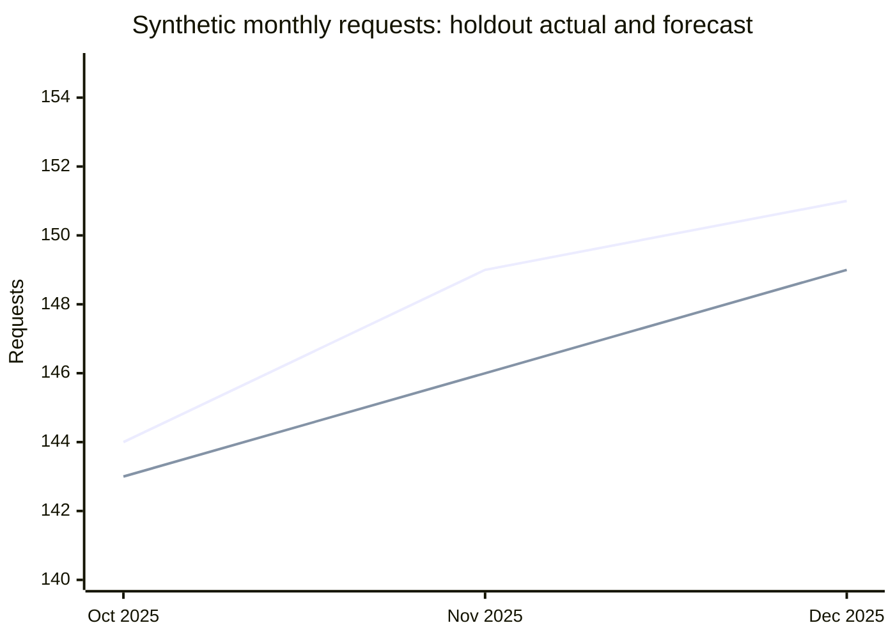

# Level 4 Data Fellowship — KSB answer and evidence guide

Prepared: 2 November 2026.  
Presentation updated: 3 November 2026 for the implemented study page; source-check dates below remain unchanged.  
Coverage: K1–K15, S1–S15 and B1–B7.  
Companion documents: [study page design](./design.md) and [complete fictional worked project](./worked-project.md).

## How to use these answers

This is a set of explanations, worked examples and answer-building prompts based on the learner’s original guides and the supplied spreadsheet-based KSB reference (converted 7 November 2026). It is preparation material, not an official mark scheme or a promise of a Pass. A strong answer connects a correct principle to something you personally did, explains why, and supports the result with evidence.

Read an answer, close it, explain the idea in your own words, then check what you missed. Complete the **Make it yours** template using genuine experience. Square-bracket placeholders are deliberately unfinished; they are not facts about your employer or project. Every example involving service requests, tools, numbers or stakeholders below is fictional or illustrative unless explicitly identified as an external source.

Each KSB begins with a concise spoken explanation, a fictional worked example, a common mistake and an authored probing question. Expand the detailed guide for definitions and calculations. In the page, a drafted response is separate from the explicit self-check that it contains a genuine personal example; neither reading nor copying the fictional portfolio marks evidence complete.

Use evidence held in your organisation's approved location. This repository is public: do not replace placeholders here with sensitive workplace information. The study page keeps sanitised personal responses separate from this public answer bank. A model answer, synthetic exercise or self-reflection does not by itself demonstrate a workplace Skill or Behaviour.

### Assessment context and source status

The official [Skills England Data Analyst standard, ST0118 version 1.1](https://skillsengland.education.gov.uk/apprenticeships/st0118-v1-1) and [assessment plan ST0118/AP03](https://skillsengland.education.gov.uk/media/5128/st0118_data_analyst_l4_ap-for-publication_20210527.pdf) were consulted on 2 November 2026. AP03 uses a project with presentation and questioning, plus a professional discussion with portfolio. Both methods must be passed. Confirm your applicable version and provider instructions before treating that plan as your assessment configuration.

| AP03 assessment route, conditional on applicability | KSBs mapped to that route |
| --- | --- |
| Project with presentation and questioning | K3, K4, K8, K9, K11, K12; S1, S2, S3, S4, S6, S7, S8, S12, S15; B3, B4 |
| Professional discussion with portfolio | K1, K2, K5, K6, K7, K10, K13, K14, K15; S5, S9, S10, S11, S13, S14; B1, B2, B5, B6, B7 |

The supplied `[1]`–`[109]` reference markers have no bibliography. They are not reproduced as verified citations. The coverage checks below follow the supplied preparation guide; detailed tool lists, a two-stakeholder example target and forecast artefacts are preparation targets, not claims that every detail is verbatim AP03 wording. AP03's S12 descriptor concerns relevant stakeholders and adapted communication; its S13 descriptor covers a range of techniques, including mining and forecasting. Retain that broader scope alongside the learner's more specific checklist.

Useful joint revision pairs are **K1/B1, K3/S2, K8/S6, K9/S7, K11/S15, K13/S10 and K14/S11**. Study together but keep individual explanations and evidence links visible.


### Spreadsheet-based provider guidance

The supplied **KSB-Codex-Content-Reference.md**, derived from **KSB list information 2.xlsx / Sheet1**, adds 30 grading groups across 37 KSBs. It supersedes the earlier provider transcription where wording differs; applicability to this learner and the original workbook remain unverified. Grading pass/distinction criteria, provider Meets/Exceeds expectations and derived learning are distinct. N/A lists no separate distinction criterion for that row; it does not determine an overall grade. Source-cell references, unresolved table boundaries and technical corrections are available in the assessment view. No personal progress or completed evidence was supplied.

## Knowledge

<a id="ksb-k1"></a>
### K1 — Current & Relevant Data Legislation

**Explain it in 60 seconds.** Data protection law governs how identifiable information is collected, accessed, used, shared and retained. The UK GDPR's seven principles are lawfulness, fairness and transparency; purpose limitation; data minimisation; accuracy; storage limitation; integrity and confidentiality; and accountability. Explain the controls and authorisations that shaped your own project, including the lawful basis and retention arrangements. Access to a system is not permission for every use, and consent is not the only possible lawful basis.

**Worked example.** The fictional service analyst requests only the fields needed for waiting-time analysis, uses approved access, limits disclosure and records the retention decision. The handling log connects each control to its purpose.

**Common mistake.** Listing legislation without explaining how it changed an access, processing or sharing decision.

**Probe further.** A colleague asks to reuse your extract for a different purpose. What must you check before agreeing?

**Answer guide.** Data protection legislation sets the rules for using information about identifiable people. In the UK, the UK General Data Protection Regulation (UK GDPR) operates alongside the Data Protection Act 2018. It affects collection, access, analysis, sharing and retention; permission to access a system does not permit every possible use of its data. See [the government overview](https://www.gov.uk/data-protection).

The seven principles are:

| Principle | Practical explanation |
| --- | --- |
| Lawfulness, fairness and transparency | Establish a valid basis, treat people fairly and explain the use |
| Purpose limitation | Use information for specified purposes; assess proposed reuse |
| Data minimisation | Take only the fields and detail needed |
| Accuracy | Check and correct personal information where needed |
| Storage limitation | Follow justified retention and deletion arrangements |
| Integrity and confidentiality | Protect against unauthorised access, loss and damage |
| Accountability | Be able to show how requirements were met |

The complete first principle includes fairness and transparency, not only lawfulness. The [ICO principles guide](https://ico.org.uk/for-organisations/uk-gdpr-guidance-and-resources/data-protection-principles/a-guide-to-the-data-protection-principles/) supports this list. Its search extract notes updates following the Data (Use and Access) Act 2025; verify the current detailed rules and commencement dates for a real decision. Consent is not the only possible lawful basis, and a government task is not automatically authorised simply because it serves the public.


**Additional preparation — derived learning.** Keep the knowledge and behaviour contributions visible. Explain the applicable UK GDPR/Data Protection Act context in your own words, including all seven principles, then show the safe, professional and productive habits you used. The full first principle includes fairness and transparency. Consent is one possible lawful basis, not an automatic requirement for every government task. Provider extension prompts about improving practices or educating colleagues are separate from the source grading column, which lists no separate distinction criterion. Confirm current law and your applicable organisational rules before relying on a legal claim.

**Provider source.** K1+B1 · AM2 · Sheet1!A110; Sheet1!A679. Exact criteria, provider guidance and source-review notes are kept separate in the page’s Assessment and evidence panel.

**Make it yours.** “For `[project purpose]`, I checked `[lawful basis/authorisation with responsible role]`, limited access and fields to `[necessary scope]`, used `[approved storage/sharing]`, followed `[retention rule]` and recorded `[compliance evidence]`. This protected `[people and working environment]`.”

**Evidence to reference.** An approved handling record, access rationale, minimisation decision and retention reference. Link B1 for everyday secure working.

**Coverage check.** Define the legislation; explain all seven principles; connect them to your own access, use and security decisions.

**Follow-up.** What would you do if someone requested a new use of the same data?

<a id="ksb-k2"></a>
### K2 — Organisational Data Policies & Standards

**Explain it in 60 seconds.** Organisational policies make data-handling expectations concrete: approved access and storage, classification, sharing, retention, incidents, quality and permitted AI use. Name the policies actually relevant to your role, explain the procedures you followed and show how they affected your analysis. A policy states a rule; a procedure explains how to follow it. Describe the harm, service disruption or organisational consequences that non-compliance could create, and where you seek clarification.

**Worked example.** The fictional handling log requires an approved analytical workspace and source-owner approval. A proposed use of an external AI service is checked against policy before any information is shared.

**Common mistake.** Naming tools or generic security rules as though they were verified policies of your employer.

**Probe further.** How would you handle a conflict between a stakeholder deadline and an organisational handling rule?

**Answer guide.** Organisational policies translate legal obligations and risk decisions into practical rules. Typical topics include information classification, access approval, acceptable use, passwords and authentication, approved storage, secure sharing, retention, incident reporting, quality standards and use of AI tools. A policy is a rule; a procedure explains how to carry it out; a standard sets a required level or format.

Describe the policies your organisation actually uses, their owner/version and how you find updates. Explain daily actions: use an authorised account, store work in an approved location, check recipients, follow change approval and report concerns through the agreed route. AI guidance may restrict which tools and data can be used; do not upload workplace information to an unapproved service. Non-compliance can harm individuals, interrupt services, trigger internal action, damage trust and create regulatory or contractual consequences.


**Additional preparation — derived learning.** Identify actual policy and standard names, their versions or review dates, the approved access route, and how they affected your work and contribution. Include an AI/data-handling policy if relevant. Explain compliance, consequences and escalation. The supplied marking table has an uncertain boundary around its compliance/recommendation bullets; retain that useful guidance while confirming its category with the provider. Do not treat basic compliance as optional because of the flattened table order.

**Provider source.** K2 · AM2 · Sheet1!A112; Sheet1!A826. Exact criteria, provider guidance and source-review notes are kept separate in the page’s Assessment and evidence panel.

**Make it yours.** “The relevant policies were `[actual titles/versions]`. I followed them by `[specific actions]`. They affected `[tool/access/output decision]`. If a requirement was unclear, I consulted `[responsible role]`; a breach would be handled through `[actual process]`.”

**Evidence to reference.** Safe policy references and an example showing application, not copies of restricted policies.

**Coverage check.** Name relevant internal data, security and AI rules; explain compliance, role impact and consequences.

**Follow-up.** How do you distinguish an approved exception from ignoring a policy?

<a id="ksb-k3"></a>
### K3 — Principles of the Data Analysis Lifecycle

**Explain it in 60 seconds.** The analysis lifecycle connects five stages: planning, preparation, analysis, refining/comparing and communication/implementation. Planning establishes the decision and success criteria. Preparation makes sources usable. Analysis answers the question. Refining checks results and alternatives. Communication turns findings into an informed decision and handover. Explain the output of each stage in one genuine project and show where validation or feedback led you back to an earlier stage.

**Worked example.** The fictional brief defines a service-capacity decision. Preparation investigates a duplicate lookup; analysis describes demand; validation compares a forecast baseline; the briefing explains a conditional capacity recommendation.

**Common mistake.** Describing the lifecycle in theory but omitting the refining or handover work you actually performed.

**Probe further.** Which finding made you revisit an earlier stage, and what would have happened if you had not?

**Answer guide.** The lifecycle turns a decision need into a useful analytical output:

1. **Planning:** define the question, stakeholders, scope, success criteria, data needs, risks and timetable.
2. **Data Preparation:** obtain authorised sources, profile quality, clean, reshape, combine and document transformations.
3. **Analysis:** explore distributions and patterns, calculate measures and apply suitable methods.
4. **Refining/Comparing:** validate outputs, compare baselines and alternatives, investigate anomalies and revise assumptions.
5. **Communication/Implementation:** explain findings, limitations and recommendations; support use, handover and review.

These stages have a useful order but analysis is iterative. Validation may expose a preparation error; stakeholder feedback may require refining the question. In a fictional service-performance project, the analyst agrees a waiting-time definition, prepares service records, analyses delays, reconciles results against source totals and briefs the service manager on a justified action.


**Additional preparation — derived learning.** For each lifecycle stage, identify an action you personally took, an output and a check. For example, planning can produce an agreed question and acceptance criteria; preparation produces a documented dataset; analysis produces an interpretable result; refining compares that result with alternatives or source totals; communication gives the decision owner an accessible conclusion and handover. Explain any iteration. The provider says a model is not compulsory in this AM1 project: substantial analysis, interpretation and evaluation still matter. Predictive examples requested for AM2 remain a separate preparation need.

**Provider source.** K3+S2 · AM1 · Sheet1!A7; Sheet1!A914. Exact criteria, provider guidance and source-review notes are kept separate in the page’s Assessment and evidence panel.

**Make it yours.** “At Planning I `[action/output]`; at Preparation I `[action/output]`; at Analysis I `[action/output]`; at Refining/Comparing I `[action/output]`; at Communication/Implementation I `[action/output]`. I revisited `[stage]` because `[reason]`.”

**Evidence to reference.** A chronological project record and one traceable output or decision per stage. Link S2 for execution.

**Coverage check.** Explain and apply every stage; do not stop after producing a chart.

**Follow-up.** Which check caused you to change your approach?

<a id="ksb-k4"></a>
### K4 — Data Classification Types

**Explain it in 60 seconds.** Open data allows reuse under an open licence. Public data can be accessed publicly, but reuse rights still need checking. Administrative data comes from running services or operations. Research data is collected or produced for research. These categories can overlap: operational data may support an open aggregate release. Identify your sources by origin, access and purpose, explain why you selected or excluded them, and assess security classification separately.

**Worked example.** The fictional request records represent administrative data. The published-style aggregate chart is an output, not evidence that the underlying records would be open or safe to release.

**Common mistake.** Treating the four dataset categories as mutually exclusive security levels.

**Probe further.** If a dataset is publicly accessible, what could still prevent you from reusing it?

**Answer guide.** These terms describe access, origin or purpose and can overlap:

| Type | Meaning and example |
| --- | --- |
| Open data | Available for reuse under an open licence, subject to its terms; for example, a published licensed aggregate dataset |
| Public data | Accessible to the public; availability alone does not establish unrestricted reuse rights |
| Administrative data | Generated by delivering services or running operations; for example, service request records |
| Research data | Collected or produced for research; for example, survey responses or experimental observations |

An administrative dataset may later produce an open aggregate release. Research data may remain restricted. These are not substitutes for organisational security markings or sensitivity assessment.

For a fictional waiting-time project, operational request records are administrative data because they originate from service delivery. Published population figures might add contextual denominators if their geography, date, licence and definitions are suitable. A research survey could help explain experience, but might be excluded if it does not answer the question or lacks suitable coverage.


**Additional preparation — derived learning.** Create a source inventory with origin, purpose, access conditions, reuse licence and reason for inclusion. Define open, public, administrative and research data even when you did not use all four. Explain why an unused type was unnecessary, unsuitable or unavailable. These categories may overlap: an administrative source can produce an open aggregate release. Assess sensitivity and organisational handling classification separately.

**Provider source.** K4 · AM1 · Sheet1!A9; Sheet1!A979. Exact criteria, provider guidance and source-review notes are kept separate in the page’s Assessment and evidence panel.

**Make it yours.** “My source `[source alias]` is `[type(s)]` because `[origin/access/purpose]`. I included `[other source]` for `[reason]` and excluded `[type/source]` because `[relevance/licence/quality/access reason]`.”

**Evidence to reference.** A source inventory, provenance notes, licence/access checks and a selection rationale.

**Coverage check.** Define all four types; classify your sources with reasons; explain inclusion and exclusion.

**Follow-up.** Can public information still contain personal data or have reuse restrictions?

<a id="ksb-k5"></a>
### K5 — Structured vs. Unstructured Data

**Explain it in 60 seconds.** Structured data has an explicit schema, such as records with defined fields and types. Unstructured data, including free text, images or audio, needs interpretation or extraction before many analyses. Semi-structured formats such as JSON provide organisation without always fitting a flat table. A structured table can contain an unstructured text field. Explain your source's characteristics and how those characteristics changed preparation, querying or interpretation.

**Worked example.** The fictional request CSV has defined identifiers and dates. Feedback comments sit in a table but their meaning remains free text until an analyst codes themes and checks context.

**Common mistake.** Assuming that putting comments in Excel makes their meaning structured.

**Probe further.** What information might you lose when you turn free text into a fixed set of categories?

**Answer guide.** Structured data follows an explicit schema, usually fields, types and relationships, so records can be queried consistently. A table of request ID, received date, service ID and status is structured. Unstructured data lacks that fixed analytical tabular schema: free-text comments, images, audio and video need interpretation or extraction before many analyses.

Semi-structured data, such as JSON with named fields and nested arrays, has organisation without necessarily fitting a single flat table. A structured table can contain an unstructured text column. Saving free text in a spreadsheet does not make its meaning structured. Structured data supports direct filtering and aggregation; text may require coding themes, language processing or manual review, each with quality and bias considerations.


**Additional preparation — derived learning.** Use examples of both structured and unstructured data and explain the characteristics of the data you actually analysed. A table can contain a free-text field, and JSON may be semi-structured. Discuss how organisation, extraction and quality risks affect preparation. The provider extension asks about workplace challenges with unstructured data; distinguish that extension from the broader source grading criterion. Qualitative categories and quantitative measurements are different from the question of whether a dataset has a schema.

**Provider source.** K5 · AM2 · Sheet1!A114; Sheet1!A1049. Exact criteria, provider guidance and source-review notes are kept separate in the page’s Assessment and evidence panel.

**Make it yours.** “My dataset contains `[actual fields/formats]`, follows `[schema]` and is `[structured/unstructured/mixed]` because `[reason]`. The `[text/nested field]` needed `[extraction/coding/reshaping]` before I could analyse it.”

**Evidence to reference.** A safe data dictionary, schema sketch and example of the analytical treatment.

**Coverage check.** Define and contrast the types; justify the classification of your own data.

**Follow-up.** How did you check that extracting structure did not discard important meaning?

<a id="ksb-k6"></a>
### K6 — Data Structures & Database System Design

**Explain it in 60 seconds.** A database organises data for storage and retrieval. A warehouse integrates data for analysis; a lake stores varied raw and processed formats. An RDBMS manages related tables, while NoSQL covers approaches such as documents and key-value stores. Normalisation reduces avoidable duplication and update anomalies. ETL extracts, transforms and loads data. Explain keys, design choices, interfaces and maintenance: pipelines, validation, access reviews, backups and recovery all matter.

**Worked example.** The fictional architecture sketch separates the operational source, controlled preparation and reporting output. A service lookup is intended to have one row per service; its broken uniqueness rule affects the join.

**Common mistake.** Describing normalisation as the whole maintenance process, or calling every central store a data lake.

**Probe further.** Why might a reporting model deliberately use a denormalised table, and what trade-off follows?

**Answer guide.** Use the terms precisely:

| Term | Explanation |
| --- | --- |
| Database | An organised collection of data managed for storage, retrieval and updates |
| Data warehouse | An integrated analytical store, often containing cleaned historical data from several systems |
| Data lake | A store for varied raw and processed formats; usefulness still depends on metadata, governance and quality |
| Relational database / RDBMS | Data organised in related tables and managed by a relational database management system, commonly queried with SQL |
| NoSQL | A family of non-relational approaches, such as document, key-value, graph and wide-column stores |
| Normalisation | Structuring relational tables to reduce avoidable duplication and update anomalies; analytical designs may deliberately denormalise |
| ETL | Extract data, transform it and load it into a target; ELT loads before transforming |

Implementation includes deciding record grain, data types, primary/foreign keys, constraints, indexes and access roles. Maintenance includes monitoring ETL jobs, validating loads, handling schema changes, reviewing access, patching, backing up and testing recovery. Normalisation is a design practice, not the whole maintenance process. Users may interact through SQL clients, application interfaces, APIs, approved drivers/connectors and BI tools; an API is not the only database connection method.


**Additional preparation — derived learning.** An ERD shows entities, keys and relationships; a data-flow sketch shows movement through systems. Use whichever clarifies your actual environment. Explain implementation, normalisation, ETL and maintenance responsibilities, and how you access data through queries or interfaces. You can understand a maintenance process without claiming to be its administrator. Relational systems can store text, JSON or binary content; unstructured information does not automatically require NoSQL.

**Provider source.** K6 · AM2 · Sheet1!A116; Sheet1!A1195. Exact criteria, provider guidance and source-review notes are kept separate in the page’s Assessment and evidence panel.

**Make it yours.** “Our approved architecture uses `[actual components]`. I interacted through `[tool/connection]`. `[responsible team]` maintains `[pipeline/schema/access/backup responsibilities]`. My analysis depended on `[key/refresh/design choice]`.”

**Evidence to reference.** An approved schema diagram, lineage explanation or query annotated with grain and relationships.

**Coverage check.** Define all seven requested terms and explain design, maintenance and interaction with concrete context.

**Follow-up.** When might a denormalised analytical table be preferable?

<a id="ksb-k7"></a>
### K7 — User Experience (UX) & Domain Context Principles

**Explain it in 60 seconds.** User experience is how easily a person can understand and use an output to complete a task. Domain context supplies the process definitions, vocabulary and constraints behind that task. Simplicity, clear labels and accessibility should support a specific decision. Domain knowledge also changes calculations: open cases, completed cases, working days and calendar days are not interchangeable. Explain a design decision and the real user need it serves.

**Worked example.** The fictional briefing separates open requests from completed-case duration and labels its time units. A manager sees the decision and caveats; a technical reviewer can inspect the supporting definitions.

**Common mistake.** Discussing colour choices without connecting them to the user's decision or the domain's metric definitions.

**Probe further.** Which apparently sensible metric would mislead users in your domain, and why?

**Answer guide.** UX is how well a person can understand and use an output to complete a task. Domain context is the sector's processes, vocabulary, constraints and decision rules. Together they determine which questions, metrics, definitions and interactions are useful.

Simplicity removes unnecessary choices; clarity makes titles, units, filters and definitions understandable; accessibility enables use across abilities and technologies. An analyst should consider colour contrast, non-colour cues, keyboard interaction, readable text and chart alternatives. Domain knowledge prevents plausible but misleading measures: calendar days and working days are different, open cases cannot be treated as completed, and a service target may change how a delay is interpreted.


**Additional preparation — derived learning.** User experience includes internal users such as a manager reading a dashboard or another team receiving a cleaned dataset. Explain a principle, the design choice it motivated, the domain rule you applied and the consequence for the user. Domain context can change definitions, acceptable values, aggregation periods and the interpretation of an apparent anomaly. Link this explanation to practical S5 examples without assuming that knowing a principle proves application.

**Provider source.** K7 · AM2 · Sheet1!A118; Sheet1!A1316. Exact criteria, provider guidance and source-review notes are kept separate in the page’s Assessment and evidence panel.

**Make it yours.** “Users needed to decide `[decision]`. I used `[layout/interaction/labels]` to support that task. The domain rule `[actual rule]` changed `[metric or visual choice]`. I checked usefulness with `[feedback/evaluation]`.”

**Evidence to reference.** A design rationale linking a user task, domain definition and evaluated output.

**Coverage check.** Define both terms; explain simplicity, clarity and accessibility; connect them to organisational analytics choices.

**Follow-up.** Which attractive design would be misleading in your domain?

<a id="ksb-k8"></a>
### K8 — Data Quality Risks

**Explain it in 60 seconds.** Quality means fitness for the intended decision. Accuracy asks whether values reflect reality; completeness asks whether expected data is present; consistency checks agreement; uniqueness checks intended records at the defined grain; and timeliness checks currency and availability. NULLs and outliers need investigation, not automatic deletion. Measure the problem, assess its impact, choose a justified treatment or escalation and validate the result. Report unresolved uncertainty rather than hiding it.

**Worked example.** The fictional lookup has two S2 rows. Joining it to 300 requests produces 357 rows. Missing completion dates also need interpretation because the fixture uses them for open cases.

**Common mistake.** Replacing every NULL with zero or deleting every outlier to make a chart look cleaner.

**Probe further.** What would you do if correcting an issue would miss a deadline, but publishing it unchanged could mislead a decision?

**Answer guide.** Quality means suitability for the intended decision. The [Government Data Quality Framework](https://www.gov.uk/government/publications/the-government-data-quality-framework/the-government-data-quality-framework) distinguishes several useful dimensions:

| Dimension | Question to ask |
| --- | --- |
| Accuracy | Does the value represent reality correctly? |
| Completeness | Are the expected records and required fields present? |
| Consistency | Do definitions and related values agree across records or sources? |
| Uniqueness | Is each entity represented only as often as intended at the defined grain? |
| Timeliness | Is the data sufficiently current and available when needed? |
| Validity | Does it conform to the allowed type, format and range? |

NULL can mean unknown, not applicable or not yet recorded; zero is a value, not a universal substitute. An outlier is unusual, not automatically wrong. Erroneous dates, duplicate keys and stale extracts can distort counts, averages, forecasts and resource decisions.

Profile the data, agree quality rules, measure the issue, assess its impact, investigate the cause, choose a justified treatment and validate the result. Escalate issues beyond your authority or where a material decision remains unsafe. Record unresolved risk. Do not improve a metric by silently deleting inconvenient records.


**Additional preparation — derived learning.** Record the check or issue, its potential decision impact, your action, the escalation owner, a recheck and residual risk. If another team already cleaned the data, explain the profiling and validation you actually performed. If no major issue was found, state the results and describe the escalation process as a contingency rather than claim it occurred. For the source distinction criterion, evaluate the analysis outcome and a feasible alternative tool or method, including its consequences for stakeholders.

**Provider source.** K8+S6 · AM1 · Sheet1!A11; Sheet1!A1430. Exact criteria, provider guidance and source-review notes are kept separate in the page’s Assessment and evidence panel.

**Make it yours.** “I found `[issue]` affecting `[dimension]` through `[check]`. It risked `[decision impact]`. I `[mitigated/resolved/escalated]` because `[reason]` and verified `[result]`. `[limitation]` remained.”

**Evidence to reference.** A quality log with counts, treatment rationale and validation. Link S6 and B5.

**Coverage check.** Explain the five requested dimensions, NULLs, outliers and errors; describe impact and treatment/escalation.

**Follow-up.** How can a complete and valid dataset still be inaccurate?

<a id="ksb-k9"></a>
### K9 — Defining Customer Requirements

**Explain it in 60 seconds.** Requirements start with the decision a stakeholder needs to make. Identify users and affected groups, gather needs through interviews, workshops or prototypes, and agree scope, definitions, constraints and acceptance checks. A Power-Interest Matrix helps plan engagement but should not exclude low-power affected people. Show how requirements shaped your methods, deliverables and timetable, and explain how changes or conflicting priorities were agreed.

**Worked example.** The fictional manager asks for service performance. The analyst converts this into defined counts, completed-case durations, a forecast horizon, a refresh requirement and explicit exclusions.

**Common mistake.** Treating a request for a dashboard as a complete, agreed analytical requirement.

**Probe further.** What would you do when two stakeholders ask for incompatible definitions of the same measure?

**Answer guide.** Requirements describe the decision to support, the intended users, necessary outputs, constraints and what success looks like. Start with the problem rather than a requested chart. Use interviews, workshops, observation, existing reports and prototypes to identify needs, then confirm understanding in an agreed brief.

A stakeholder map identifies affected people and decision-makers. A Power-Interest Matrix helps plan engagement: high-power/high-interest stakeholders need close involvement; high-power/lower-interest groups need appropriate assurance; lower-power/high-interest users need consultation and information. Revisit this assessment and include affected groups who may otherwise lack influence.

Translate needs into measurable acceptance criteria, definitions, data scope, delivery dates and priorities. Record out-of-scope work and a route for changes. For example, “show service performance” becomes a defined weekly view with agreed waiting-time units, filters, refresh timing and a clearly stated decision owner.


**Additional preparation — derived learning.** Trace each customer requirement to a scope decision, analytical method, deliverable and acceptance check. Compare feasible plans against the actual decision, available time, data access, accessibility, cost and maintenance. An optimum plan is the strongest fit for those constraints, not the most complicated technique. Explain what you rejected, why, and how stakeholder feedback changed the plan or output.

**Provider source.** K9+S7 · AM1 · Sheet1!A13; Sheet1!A1529. Exact criteria, provider guidance and source-review notes are kept separate in the page’s Assessment and evidence panel.

**Make it yours.** “I captured requirements using `[methods]`, involved `[roles]`, confirmed `[definitions and acceptance criteria]` and used them to set `[scope/method/output]`. I handled a change through `[agreement process]`.”

**Evidence to reference.** A stakeholder map, agreed requirements and decision/change log. Link S7.

**Coverage check.** Explain tools and communication methods and trace requirements into planning and outputs.

**Follow-up.** How did you resolve conflicting stakeholder priorities?

<a id="ksb-k10"></a>
### K10 — Combining Data Sources

**Explain it in 60 seconds.** A primary key uniquely identifies a row; a foreign key links related data; a composite key uses several fields. Inner joins keep matching combinations. Left and right joins retain the named side; full outer joins retain unmatched rows from both. UNION appends compatible rows and removes duplicates; UNION ALL retains them. Define grain and check cardinality, unmatched keys and totals before claiming a benefit. Even a left join can multiply records.

**Worked example.** The fictional service lookup contains a duplicate S2 key, so the left join creates 57 extra rows. An approved five-row lookup restores the request grain while leaving unmatched keys visible.

**Common mistake.** Assuming a left join always preserves the original row count, or describing UNION as a join type.

**Probe further.** Why could an inner join make your output appear cleaner while making its quality worse?

**Answer guide.** A primary key uniquely identifies a row and cannot be NULL; a foreign key refers to a key in a related table; a composite key uses more than one field. Define grain before joining: one row per request is different from one row per service per month.

| Operation | Result |
| --- | --- |
| Inner join | Matching combinations only |
| Left join | All left-side rows, matching right-side values and NULLs for unmatched right-side fields |
| Right join | All right-side rows and any matching left-side values |
| Full outer join | Matches plus unmatched rows from both sides |
| UNION | Appends compatible result rows and removes duplicates |
| UNION ALL | Appends compatible result rows and retains duplicates |

Joins combine related rows; unions append rows and are not join types. See [PostgreSQL's join documentation](https://www.postgresql.org/docs/current/queries-table-expressions.html) and [set-operation documentation](https://www.postgresql.org/docs/18/queries-union.html).

Check key types, formatting, uniqueness, cardinality, time periods, units, licences and unmatched records. A left join can multiply rows when the right key repeats. Combining a request table with a verified service lookup can standardise names and avoid repeated manual edits, but the benefit must be demonstrated through checks and an actual outcome.


**Additional preparation — derived learning.** Evaluate the gain from combining sources alongside cardinality, unmatched records, exclusions, security, licence and quality risks. For example, a join that improves labels but multiplies requests is not ready for reporting until its relationship is understood. Compare a realistic alternative and explain remaining risk. JOIN combines matched rows; UNION appends compatible result rows, while UNION ALL retains duplicates. The source distinction criterion asks for a reasoned balance of benefits and risks.

**Provider source.** K10 · AM2 · Sheet1!A120; Sheet1!A1592. Exact criteria, provider guidance and source-review notes are kept separate in the page’s Assessment and evidence panel.

**Make it yours.** “I combined `[sources]` at `[grain]` using `[keys and operation]` because `[reason]`. I checked `[cardinality/unmatched counts/totals]`. This improved `[accuracy/efficiency/customer benefit]`, supported by `[measurement or observed evidence]`.”

**Evidence to reference.** A join diagram, reproducible steps and before/after reconciliation. Link S8.

**Coverage check.** Explain the three keys, four joins and union distinction; connect combination to a justified benefit.

**Follow-up.** Why might an inner join conceal a quality problem?

<a id="ksb-k11"></a>
### K11 — Organisational Analysis Tools & Methods

**Explain it in 60 seconds.** Describe tools genuinely available in your organisation, then justify the tools selected for the task. Compare capability, scale, connectivity, security, reproducibility, accessibility, cost and support. SQL may suit governed joins; BI tools may suit reporting; code may suit custom methods. Familiarity matters, but it is not the only criterion. Explain the trade-off and whether the delivered workflow met the requirement, rather than claiming one tool is always best.

**Worked example.** The fictional team chooses a reproducible SQL join, a documented statistical calculation and an accessible visual briefing. Its decision log explains why manual repeated lookups would be harder to validate.

**Common mistake.** Justifying the tool only because you already knew how to use it.

**Probe further.** Which change in scale, staffing or analytical requirements would make you reconsider your chosen tool?

**Answer guide.** Describe tools your organisation actually makes available, then compare them against the analytical requirement. Typical options include Excel for small tabular exploration, Power Query for repeatable preparation, SQL for database querying, Power BI/Tableau for governed visual reporting and Python for reproducible custom analysis. Availability, permitted use and capability vary by employer.

Compare scale, source connectivity, statistical capability, accessibility, reproducibility, security, cost, team skills and maintenance. Licensed software may offer support and familiar sharing; code may offer flexibility and versionable workflows but still needs testing, support and suitable deployment. Neither is universally superior.


**Additional preparation — derived learning.** Compare tools that were realistically available in your organisation. Include data connectivity, reproducibility, analytical capability, security, licensing, team skills, accessibility and future maintenance. After delivery, evaluate what the outcome shows about your choice. A useful alternative recommendation explains the benefit, cost, risks and affected stakeholders rather than simply naming another product.

**Provider source.** K11+S15 · AM1 · Sheet1!A15; Sheet1!A1715. Exact criteria, provider guidance and source-review notes are kept separate in the page’s Assessment and evidence panel.

**Make it yours.** “Our available tools were `[actual options]`. I selected `[tool]` for `[specific task]` because it met `[criteria]`. I rejected `[alternative]` because `[trade-off]`. The outcome was `[verified result]`, with `[remaining limitation]`.”

**Evidence to reference.** A short options comparison tied to the project. Link S15 for applied selection.

**Coverage check.** Explain organisational tools and methods and justify the tools you actually selected.

**Follow-up.** What would make you choose a different tool next time?

<a id="ksb-k12"></a>
### K12 — Organisational Data Architecture

**Explain it in 60 seconds.** Data architecture explains how sources, storage, transformation, governance and consumers fit together. Describe your real components, owners, access routes, refresh arrangements and lineage. Architecture shapes where extracts may be stored, which connectors and tools are supported, and how retention and security work. Explain Big Data requirements only where relevant: a modest relational solution can be appropriate. Do not substitute a generic cloud diagram for knowledge of your actual environment.

**Worked example.** The fictional project sketches source records, a controlled preparation layer, approved reference data and a reporting output. The analyst queries and transforms data but does not claim database-administrator responsibilities.

**Common mistake.** Naming platforms without explaining how data moves through them or who controls access.

**Probe further.** How would an upstream schema change or failed refresh affect your analysis and its users?

**Answer guide.** Data architecture describes how sources, storage, transformation, governance and consumption fit together. Explain the architecture you actually work within, not a generic cloud diagram. It may involve operational databases, file stores, ETL/ELT, a warehouse or lake, a semantic model and approved reports.

A fictional flow is `service system → controlled staging → quality transformations → analytical warehouse → BI model → authorised users`. Each stage has an owner, permissions, refresh arrangements and lineage. Central storage policies affect where extracts can be saved, which interfaces are approved and how retention, backups and audit records work. Tool choice depends on supported connectors, identities, network routes and platform constraints.

Big Data concerns scale, speed and variety that may require distributed storage or processing. Do not claim your organisation uses a lake or Big Data platform if it does not. A modest relational solution may be entirely appropriate.


**Additional preparation — derived learning.** Sketch the genuine flow from source systems through storage and transformation to reports or other consumers. Identify ownership, authorised access, refresh and retention rules, and how those constrained your analysis. Use safe aliases for systems and references. Explain central storage choices and Big Data only where relevant; a modest relational solution can be appropriate.

**Provider source.** K12 · AM1 · Sheet1!A17; Sheet1!A1774. Exact criteria, provider guidance and source-review notes are kept separate in the page’s Assessment and evidence panel.

**Make it yours.** “Data moves from `[source]` through `[actual components]` to `[consumer]`. `[roles]` govern `[access/storage/refresh]`. This constrained my choice of `[tool/location/connection]` and affected `[analysis decision]`.”

**Evidence to reference.** An approved high-level lineage diagram with sensitive infrastructure details removed.

**Coverage check.** Outline actual architecture and explain its implications for storage, security, access and tools; address Big Data only to the extent relevant.

**Follow-up.** What happens to your output if an upstream schema or refresh changes?

<a id="ksb-k13"></a>
### K13 — Principles of Statistics

**Explain it in 60 seconds.** Descriptive statistics summarise the observed data: mean, median, mode, variance and standard deviation describe centre and spread. Inferential methods use a sample and assumptions to investigate a wider population or process. State null and alternative hypotheses, choose a suitable test and significance level, and interpret the result with effect size and uncertainty. A p-value is conditional on the null and assumptions; it is not the probability that the null is true.

**Worked example.** For the fictional values 2, 3, 3, 4 and 8 days, mean is 4, median and mode are 3, and sample standard deviation is about 2.345 days. The long value changes the mean.

**Common mistake.** Equating statistical significance with operational importance, or treating a large p-value as proof of equality.

**Probe further.** How would you explain a two-day difference that is operationally important but statistically inconclusive?

**Answer guide.** Descriptive statistics summarise observed data; inferential statistics use a sample and assumptions to reason about a wider process or population.

| Term | Meaning |
| --- | --- |
| Mean | Sum divided by count; sensitive to extreme values |
| Median | Middle ordered value; useful with skewed distributions |
| Mode | Most frequent value or category; may not be unique |
| Variance | Average squared spread around the mean; a sample estimate commonly divides by `n − 1` |
| Standard deviation | Square root of variance, expressed in the original units |
| Null hypothesis, H0 | The reference claim being tested, such as equal population means |
| Alternative hypothesis, H1 | The contrasting claim, such as a difference in population means |
| t-test | A test about means; choose paired/unpaired and variance assumptions to match the design |
| Significance level, alpha | A preselected threshold controlling a test's Type I error rate under its assumptions |
| p-value | Under H0 and the model assumptions, the probability of a test statistic at least as extreme as observed |

For synthetic completion times `[2, 3, 3, 4, 8]` days, the mean is **4**, median **3**, mode **3**, sample variance **5.5 days²** and sample standard deviation **2.345 days**. The larger mean reflects the long observation. Report distribution and sample size alongside summaries.

A small p-value is not the probability that H0 is true, and a large p-value does not prove equality. Report effect size, confidence intervals, assumptions and practical relevance. The [NIST t-test reference](https://www.itl.nist.gov/div898/handbook/eda/section3/eda353.htm) provides formulas; S10 below gives a separately constructed numerical example.


**Additional preparation — derived learning.** Explain why each descriptive measure and inferential method fits the business question, data and assumptions. The provider S10 guidance includes EDA, appropriate charts, explicit hypotheses and an applied inferential test; a t-test is one possible method rather than the only permitted choice. Discuss effect size, uncertainty and practical significance alongside p-values. Explain alpha in relation to decision risk: a Type I error rejects a true null; a Type II error fails to reject a false null. This group has provider extension guidance but no separate source distinction criterion.

**Provider source.** K13+S10 · AM2 · Sheet1!A122; Sheet1!A1911. Exact criteria, provider guidance and source-review notes are kept separate in the page’s Assessment and evidence panel.

**Make it yours.** “I used `[summaries]` to understand `[distribution]`. To investigate `[question]`, I set `[hypotheses and alpha]`, selected `[method]`, checked `[assumptions]` and interpreted `[effect/interval/p-value]` as `[appropriately limited conclusion]`.”

**Evidence to reference.** Reproducible calculations, distribution plots and a statistical interpretation.

**Coverage check.** Define all requested statistics and inferential terms; give a genuine application, not only definitions.

**Follow-up.** Could a statistically significant result still be operationally unimportant?

<a id="ksb-k14"></a>
### K14 — Principles of Analytics Types

**Explain it in 60 seconds.** Descriptive analytics explains what happened. Predictive analytics estimates unknown or future outcomes with uncertainty. Prescriptive analytics recommends an action under objectives and constraints. Connect the three: summarise a pattern, evaluate a prediction, then compare feasible actions using that evidence. A forecast is not itself a recommendation, and a predictive association is not proof of causation. Explain how the decision-maker should use the result and what it cannot establish.

**Worked example.** The fictional project describes monthly requests, evaluates a time-trend forecast and considers capacity options against an assumed limit of 150. The recommendation remains conditional and has not demonstrated an implemented benefit.

**Common mistake.** Calling any chart predictive or any unsupported recommendation prescriptive analytics.

**Probe further.** What additional evidence would you need before claiming your recommended action caused an improvement?

**Answer guide.** Descriptive analytics explains observed results: “What happened?” Predictive analytics estimates unknown or future outcomes with uncertainty: “What might happen?” Prescriptive analytics recommends actions using evidence, objectives and constraints: “What should we do?”

In a fictional service project, descriptive analysis summarises completed requests and waiting-time distributions. A predictive model forecasts future demand. Prescriptive analysis compares feasible staffing or scheduling responses against capacity, cost, service needs and uncertainty. A forecast alone is not a recommendation, and an unsupported recommendation is not a demonstrated analytical benefit.

Linear regression estimates a numerical outcome; logistic regression estimates a probability for a defined class. Neither automatically proves a causal effect. Predictions need suitable validation and monitoring, while recommendations need human judgement and policy context.


**Additional preparation — derived learning.** Show a complete chain: describe an observed pattern, make and validate a prediction, then recommend a feasible action under objectives and constraints. Explain all three forms of analytics using genuine practice. For a linear model, interpret coefficients in the response units and discuss the intercept in context. Logistic regression models an event probability through log-odds; observed binary labels are distinct from estimated probabilities. Choose metrics for the outcome: RMSE/MAE for numerical errors and suitable classification metrics for categories. Compare unseen-data performance with a baseline, investigate leakage or over/underfitting, and critically evaluate predictive risks, benefits and error consequences. A prediction does not establish a causal effect.

**Provider source.** K14+S11 · AM2 · Sheet1!A124; Sheet1!A2050. Exact criteria, provider guidance and source-review notes are kept separate in the page’s Assessment and evidence panel.

**Make it yours.** “I described `[observed pattern]`, predicted `[target/horizon with validation]` and recommended `[action]` because `[objective, constraints and evidence]`. The uncertainty was `[limitation]` and the decision owner was `[role]`.”

**Evidence to reference.** A linked descriptive output, predictive evaluation and reasoned recommendation. Link S11.

**Coverage check.** Define all three types and demonstrate their actual application within your practice.

**Follow-up.** What evidence would you need before claiming the recommended action caused an improvement?

<a id="ksb-k15"></a>
### K15 — Data Ethics

**Explain it in 60 seconds.** Ethics asks whether data use is appropriate, fair and accountable, including where it is legally permitted. Describe the source, collection purpose and population, then examine fairness, missing groups, bias, transparency, accountability and consent where relevant. Explain mitigation and remaining risks. A lawful basis does not remove ethical responsibility. Use the applicable government ethics framework and revisit the assessment when scope, data or decisions change.

**Worked example.** The fictional feedback is a small convenience sample. The briefing reports coded themes without presenting them as representative satisfaction or quoting identifiable people.

**Common mistake.** Assuming legality guarantees fairness, or treating missing groups as though they had no needs.

**Probe further.** Who could be harmed by your output even if its numbers are accurate and the processing is lawful?

**Answer guide.** Ethics asks whether data use is appropriate and fair, including where a use might be legally permitted. Start by describing the source, collection method, purpose, population, exclusions and intended decision.

Assess **fairness**: who benefits or may be harmed? Assess **bias**: who is missing or measured differently? Provide **transparency** about methods and limitations and **accountability** through named responsibilities and routes to challenge. Consider **consent** where relevant to collection or participation; do not confuse ethical participation arrangements with assuming consent is always the legal basis.

A fictional online-feedback analysis may underrepresent people who cannot use digital channels. Reporting complaint counts as satisfaction without checking the denominator could disadvantage some services. Mitigations might include consulting users, comparing channels, preserving qualitative context and limiting decisions unsupported by the data.

The current government [Data and AI Ethics Framework](https://www.gov.uk/government/publications/data-ethics-framework/data-and-ai-ethics-framework), updated 18 December 2025, extends the older Data Ethics Framework. Its principles include transparency, accountability, fairness, privacy, environmental sustainability, societal impact and safety. Use the applicable version in your organisation and revisit ethical questions as a project changes. Failures can cause harm, unfair decisions, service problems and loss of trust.


**Additional preparation — derived learning.** Map an appropriate ethics framework to a real decision: whose data is represented, who might be excluded, what bias or disclosure risk exists, who is accountable, what should be explained and which mitigation was prioritised. An anonymous form does not guarantee an unbiased sample or prevent identification from detailed answers. Password protection alone does not establish adequate access control. Ethical consequences can include the unequal costs of false positive and false negative decisions. Keep consent/lawful-basis and ethical suitability distinct.

**Provider source.** K15 · AM2 · Sheet1!A126; Sheet1!A2199. Exact criteria, provider guidance and source-review notes are kept separate in the page’s Assessment and evidence panel.

**Make it yours.** “The data came from `[source]`, collected through `[method]` for `[purpose]`. I identified `[ethical risk]`, considered `[affected groups]`, applied `[mitigation]` and documented `[accountability/transparency]`. `[residual risk]` remained.”

**Evidence to reference.** An approved ethical assessment or decision log and a concrete limitation communicated to users.

**Coverage check.** Describe the dataset and five requested ethical aspects; justify their importance and consequences.

**Follow-up.** What could make a legally permissible analysis unfair?

## Skills

<a id="ksb-s1"></a>
### S1 — Operating Data Systems in Compliance

**Explain it in 60 seconds.** Show the systems you personally operated and the controls you applied. Privacy by Design addresses access, necessary fields, storage, transfers, disclosure and retention throughout the lifecycle. Explain authorisation, minimum access, secure working copies and output checks, including when you consulted a responsible specialist. Pseudonymised data can still be personal data. Give performed actions and verification, rather than only listing controls you believe a system should have.

**Worked example.** The fictional handling record documents the intended purpose, approved analytical location, necessary fields, restricted recipients and retention review. It illustrates a control chain, not the learner's own compliance evidence.

**Common mistake.** Describing security features without showing which controls you personally followed or verified.

**Probe further.** Which privacy risk did your workflow prevent before the final report was produced?

**Answer guide.** Explain the systems you actually operated and the controls you personally applied throughout the work. Privacy by Design means addressing privacy while deciding requirements and designing the workflow, rather than adding protection only before publication.

Describe authorised access, minimum necessary fields, approved environments, controlled transfers, protected working copies, output disclosure checks and retention/deletion. Review risks when the scope changes. Pseudonymised data can still be personal data; anonymisation requires attention to re-identification, not merely removal of a name. Explain when you involved the data owner, security or data protection team and any privacy impact assessment required by the actual process.


**Additional preparation — derived learning.** Connect Privacy by Design to actual lifecycle decisions: purpose, minimum necessary data, authorised access, approved transfers, protected working copies, disclosure checks and retention. Explain the applicable policies and legislation, the controls you used and how you verified them. Refer specialist decisions to the responsible role; do not imply that every analysis requires the same impact assessment or that pseudonymisation removes personal-data obligations.

**Provider source.** S1 · AM1 · Sheet1!A19; Sheet1!A2599. Exact criteria, provider guidance and source-review notes are kept separate in the page’s Assessment and evidence panel.

**Make it yours.** “I operated `[system]` using `[approved role]`. During planning I `[privacy decision]`; during preparation/analysis I `[controls]`; before sharing I `[check]`; at closure I `[retention/deletion]`. I verified compliance through `[record/approval]`.”

**Evidence to reference.** A sanitised workflow and control record with no credentials or sensitive connection details.

**Coverage check.** Show performed actions and privacy considerations across the lifecycle, linked to real organisational/legal requirements.

**Follow-up.** How did the design reduce exposure before anyone accessed the output?

<a id="ksb-s2"></a>
### S2 — Applying the Data Analysis Lifecycle

**Explain it in 60 seconds.** Demonstrate the lifecycle through one genuine project. Show the agreed brief, authorised preparation, chosen analysis, validation or comparison, and communication or handover. Link each stage's output to the next and identify your own contribution. Include an example of iteration: a quality check or stakeholder response should lead to a reasoned adjustment where necessary. Producing a chart alone does not demonstrate the complete lifecycle.

**Worked example.** The fictional project connects a requirements brief to a join-quality log, analysis notes, validation checks and a stakeholder briefing. Each artefact records why the next stage was needed.

**Common mistake.** Providing unrelated screenshots without explaining a continuous route from requirement to outcome.

**Probe further.** What would another analyst need to reproduce your project from the original sources?

**Answer guide.** K3 explains the lifecycle; S2 shows that you carried it out. Select one genuine project and trace a continuous chain from the requirement to the decision or handover.

| Stage | What your account should demonstrate |
| --- | --- |
| Planning | Agreed question, scope, timetable, success criteria and risks |
| Data Preparation | Authorised acquisition, profiling, transformations and source combination |
| Analysis | Methods you used and why they answered the question |
| Refining/Comparing | Reconciliation, alternative checks, feedback and changes |
| Communication/Implementation | Audience-appropriate delivery, recommendations and handover/review |


**Additional preparation — derived learning.** For each lifecycle stage, identify an action you personally took, an output and a check. For example, planning can produce an agreed question and acceptance criteria; preparation produces a documented dataset; analysis produces an interpretable result; refining compares that result with alternatives or source totals; communication gives the decision owner an accessible conclusion and handover. Explain any iteration. The provider says a model is not compulsory in this AM1 project: substantial analysis, interpretation and evaluation still matter. Predictive examples requested for AM2 remain a separate preparation need.

**Provider source.** K3+S2 · AM1 · Sheet1!A7; Sheet1!A914. Exact criteria, provider guidance and source-review notes are kept separate in the page’s Assessment and evidence panel.

**Make it yours.** “The agreed objective was `[objective]`. My output at each stage was `[five linked outputs]`. A check at `[stage]` led me to change `[action]`, improving `[verified result]`. I handed over `[deliverable and limitations]`.”

**Evidence to reference.** One project timeline linking the brief, reproducible preparation, analysis, validation and final communication.

**Coverage check.** Demonstrate every stage with your own actions; label missing workplace experience as a gap.

**Follow-up.** How can another analyst reproduce your route from raw data to the reported result?

<a id="ksb-s3"></a>
### S3 — Applying Principles of Data Classification

**Explain it in 60 seconds.** Apply your organisation's classification and handling scheme to the actual data and intended use. Explain sensitivity, identifiability, access and potential harm, then justify protection such as restricted fields, redaction, pseudonymisation or checked aggregation. Explain any authorised flexibility and residual risk. Low, medium and high may be risk descriptions, but are not universal government security labels. Turning text into counts does not automatically make it anonymous.

**Worked example.** The fictional case separates an operational dataset's administrative origin from its handling assessment. The example public output uses synthetic aggregates; it does not imply real operational records are releasable.

**Common mistake.** Claiming anonymisation solely because names were removed or comments were replaced with counts.

**Probe further.** How could somebody identify a person from an apparently anonymous small-group result?

**Answer guide.** Assess sensitivity, identifiability, purpose, access and potential harm, then apply your organisation's real classification and handling scheme. Low/medium/high can be useful risk descriptions if the organisation uses them; they are not universal government security labels.

Describe the classification decision and the practical treatment: restrict fields and users, redact sensitive content, pseudonymise identifiers with the lookup separately controlled, or publish an appropriately checked aggregate. Explain why a change in treatment was appropriate for the particular use and who could authorise it. Turning text into counts does not automatically anonymise it; small groups, rare events and linked datasets can permit identification.


**Additional preparation — derived learning.** Document the source and purpose, structure, sensitivity, actual organisational classification, handling controls and any approved change. If the classification did not change, explain when a change might be appropriate and what approval/checks it would need. A category count does not automatically become anonymous; replacing identifiers with codes can leave personal data. High/medium/low are examples in the supplied guide, not universal government security labels.

**Provider source.** S3 · AM1 · Sheet1!A21; Sheet1!A2662. Exact criteria, provider guidance and source-review notes are kept separate in the page’s Assessment and evidence panel.

**Make it yours.** “I assessed `[dataset]` as `[actual classification/risk]` because `[reason]`. The handling rule was `[requirement]`. For `[approved purpose]`, I applied `[redaction/pseudonymisation/aggregation]`, checked `[remaining disclosure risk]` and retained `[controls/approval]`.”

**Evidence to reference.** An approved classification rationale and safe demonstration of treatment, without original sensitive content.

**Coverage check.** Show reasoned classification, confidentiality requirements, any justified flexibility and the purpose of protection.

**Follow-up.** Why might a pseudonymised extract still require restricted access?

<a id="ksb-s4"></a>
### S4 — Analysing Diverse Data Structures & Designs

**Explain it in 60 seconds.** State the actual shape, grain, keys and types of each source, then show how you adapted the analysis. Relational data may require joins, nested formats may need reshaping and text may need interpretation. Discuss RDBMS strengths such as constraints and querying, alongside relevant trade-offs. Validate that the transformed data still means what you think it means: joining multiple comments to one request can change the analytical grain.

**Worked example.** The fictional pack contains 300 requests, a six-row flawed lookup, 12 monthly observations and 36 comments. Monthly observations are a separate teaching series, not an aggregation of the requests.

**Common mistake.** Reporting row and column counts without explaining grain or how structural differences affected your approach.

**Probe further.** How would you combine repeated comments with request-level measures without duplicating those measures?

**Answer guide.** State the shape, grain, schema, keys and field types of each actual dataset, including row and column counts at the relevant extraction date. Explain how structure affected the work. A relational export may require joins; a JSON source may require flattening repeated arrays; free-text feedback may require thematic coding.

RDBMS strengths include relationships, constraints, transactions and established querying. Trade-offs can include schema-change effort, joins across many tables, and limits of a particular design or deployment when handling unusual formats or scale. NoSQL may fit some access patterns but does not remove governance or design requirements.

**Illustrative application.** A request table has one row per request, a service lookup one row per service, and feedback multiple comments per request. Joining all comments directly would change the request grain; aggregate or model feedback separately before combining measures.


**Additional preparation — derived learning.** For every dataset record its row count, columns, grain, types, schema and relationships. Explain how those characteristics changed your analysis: for example, a nested contact array may need aggregation to request grain before joining. Different filenames alone do not establish different database designs. For the source distinction criterion, demonstrate how the structural adaptation solved a problem or improved accuracy or efficiency. An ERD can help explain relationships, but do not claim design work you did not perform.

**Provider source.** S4 · AM1 · Sheet1!A23; Sheet1!A2747. Exact criteria, provider guidance and source-review notes are kept separate in the page’s Assessment and evidence panel.

**Make it yours.** “Source A had `[rows × columns, grain]`; source B had `[shape/grain]`. Their structures differed in `[way]`, so I `[query/reshape/aggregate choice]`. I checked `[count/key/meaning validation]`.”

**Evidence to reference.** Data dictionaries, safe schema examples, row-count records and annotated transformations.

**Coverage check.** Give actual shapes and data types, discuss RDBMS trade-offs and show adaptation to structural differences.

**Follow-up.** What would break if one request appeared several times after a join?

<a id="ksb-s5"></a>
### S5 — Applying UX & Domain Context

**Explain it in 60 seconds.** Connect specific visual and interaction choices to a real user task. Explain layout, hierarchy, colours, labels, accessibility and how domain rules changed calculations or interpretation. Evaluate the output with users and describe an actual change from their feedback. Distinguish a design target from verified accessibility conformance. Useful evidence shows why the output supports the decision, not merely that it looks professional.

**Worked example.** The fictional dashboard labels open cases separately from completed-case duration and provides exact data alongside charts. Its service-manager briefing foregrounds the decision while the technical view retains checks and definitions.

**Common mistake.** Describing a palette without explaining usability, domain meaning or how you evaluated the design.

**Probe further.** What would you change for a user who cannot use the dashboard's colours or pointer interactions?

**Answer guide.** Connect each design choice to a stakeholder task. Put the decision-critical measure and its definition near the top; group related information; make filter state and refresh timing visible. Use readable labels, sufficient contrast, non-colour cues and suitable alternatives for charts. Design and test keyboard interaction when the chosen tool supports it; explain limitations rather than assuming compliance.

For a web output, WCAG 2.2 AA is an appropriate accessibility target where applicable; a design intention is not verified conformance. Apply the actual standards and evaluation process required for your output and organisation.

Apply domain rules to calculations as well as presentation. In a fictional service output, separate open cases from completed-case duration, use the agreed working-day definition and identify the service target. Test a draft with intended users and document an actual change from feedback.


**Additional preparation — derived learning.** Record the audience, domain rule, layout/colour choice, accessibility check, feedback and resulting improvement. Explain why the output served the stakeholder rather than only describe its appearance. Reference sanitised visuals or approved feedback where available. Provider extension guidance asks about impact and further usability improvements; these are not automatically an EPA distinction row.

**Provider source.** S5 · AM2 · Sheet1!A128; Sheet1!A2824. Exact criteria, provider guidance and source-review notes are kept separate in the page’s Assessment and evidence panel.

**Make it yours.** “Users needed `[decision]`. I chose `[layout, palette and hierarchy]` because `[need]`, applied `[domain rule]` and checked `[accessibility/usability]`. Feedback from `[role]` led to `[change]`, with `[observed result]`.”

**Evidence to reference.** Safe before/after views, an explanation of design choices and actual user evaluation.

**Coverage check.** Demonstrate layout, colour, hierarchy, accessibility, stakeholder need and a concrete domain example.

**Follow-up.** How would the output work for someone who cannot distinguish its colours?

<a id="ksb-s6"></a>
### S6 — Mitigating & Resolving Quality Risks

**Explain it in 60 seconds.** Show a real quality issue from detection through treatment and validation. Measure its extent, assess its effect, investigate the cause and choose a proportionate correction, mitigation or escalation within your authority. Preserve the source and transformation trail. Explain unresolved risk to users. A strong account shows what changed and how it was checked; it does not rely on saying the data was cleaned.

**Worked example.** The fictional analyst checks the join, identifies duplicate lookup keys and records why 357 rows appeared from 300 requests. An approved reference list restores 300 rows without concealing unmatched service IDs.

**Common mistake.** Reporting that you removed errors without preserving checks, reasons or evidence of the result.

**Probe further.** What would you escalate if you could not establish which conflicting source value was authoritative?

**Answer guide.** Demonstrate a complete issue-handling loop: detect, measure, assess impact, investigate, mitigate or escalate, resolve where authorised, and validate. Preserve the original source and log transformations.

**Illustrative application.** NULL completion dates may represent genuinely open cases. The analyst separates these from completed-case duration rather than replacing them with zero. An apparent demand spike after a join triggers checks of lookup uniqueness and row counts. Conflicting lookup entries require source-owner clarification, not arbitrary deletion. An unresolved issue is reported with the affected outputs, interim mitigation, owner and next action.


**Additional preparation — derived learning.** Record the check or issue, its potential decision impact, your action, the escalation owner, a recheck and residual risk. If another team already cleaned the data, explain the profiling and validation you actually performed. If no major issue was found, state the results and describe the escalation process as a contingency rather than claim it occurred. For the source distinction criterion, evaluate the analysis outcome and a feasible alternative tool or method, including its consequences for stakeholders.

**Provider source.** K8+S6 · AM1 · Sheet1!A11; Sheet1!A1430. Exact criteria, provider guidance and source-review notes are kept separate in the page’s Assessment and evidence panel.

**Make it yours.** “My `[check]` found `[issue and scale]`. The risk was `[impact]`. I `[action]` within my remit and escalated `[part]` to `[role]`. Validation showed `[actual outcome]`; I communicated `[residual limitation]`.”

**Evidence to reference.** A quality log, failed and passed checks, approved resolution/escalation and a reconciled output.

**Coverage check.** Describe what you actually detected and did, including the reason for resolving or escalating. Link K8 and B5.

**Follow-up.** What stopped the same problem from silently returning at the next refresh?

<a id="ksb-s7"></a>
### S7 — Implementing Customer Requirements

**Explain it in 60 seconds.** Translate stakeholder needs into scope, analytical methods, deliverables and acceptance checks. Show a traceable link from each important requirement to a practical decision and final output. Agree definitions, priorities, exclusions and changes, then evaluate whether the output met them. If available data cannot support a request, explain the constraint and agree a defensible alternative rather than delivering an attractive but misleading result.

**Worked example.** The fictional brief requires comparable counts, completed-case duration and a three-month demand outlook. The traceability table links each need to a source, method, deliverable and validation check.

**Common mistake.** Collecting requirements at the start but never checking the final output against them.

**Probe further.** How did you handle a requirement that the available data could not reliably satisfy?

**Answer guide.** Show a chain from a stated need to planned method, output and acceptance check. Distinguish a stakeholder's requested feature from the decision it serves. Agree priorities, boundaries and changes rather than expanding scope informally.

| Fictional requirement | Planning/method implication | Deliverable and check |
| --- | --- | --- |
| Compare completed-case waits by service | Agree completion definition, period and units; prepare comparable records | View with agreed filters; reconcile counts and duration calculation |
| Identify services needing attention | Agree target and decision rule; assess small counts and uncertainty | Clearly labelled exceptions with caveats; stakeholder review |
| Refresh for a regular meeting | Set data cutoff, refresh dependencies and owner | Refresh timing and handover instructions; check a refresh cycle |


**Additional preparation — derived learning.** Trace each customer requirement to a scope decision, analytical method, deliverable and acceptance check. Compare feasible plans against the actual decision, available time, data access, accessibility, cost and maintenance. An optimum plan is the strongest fit for those constraints, not the most complicated technique. Explain what you rejected, why, and how stakeholder feedback changed the plan or output.

**Provider source.** K9+S7 · AM1 · Sheet1!A13; Sheet1!A1529. Exact criteria, provider guidance and source-review notes are kept separate in the page’s Assessment and evidence panel.

**Make it yours.** “Requirement `[R-id]` led to `[scope/method]`, was delivered through `[output]` and checked using `[acceptance evidence]`. A change to `[requirement]` was agreed with `[role]` and affected `[time/scope]`.”

**Evidence to reference.** An agreed brief, a traceability table and a recorded review of acceptance criteria.

**Coverage check.** Explicitly connect requirements to scope, methodology and final deliverables.

**Follow-up.** What would you do if a requested output could not be supported by the available data?

<a id="ksb-s8"></a>
### S8 — Combining & Preparing Multi-Source Data

**Explain it in 60 seconds.** Demonstrate a repeatable multi-source preparation and join process. State the source grain, expected relationship, keys and join type. Check data types, formatting, periods, units, uniqueness, unmatched keys and relevant totals. Document treatment decisions and lineage. Use a suitable SQL, Power Query, Python or BI workflow and explain its risks; a successful-looking join or a lookup formula does not prove the combined result is correct.

**Worked example.** The fictional SQL left-joins requests to a checked service lookup. The quality log distinguishes four missing service keys from eight non-null S99 keys without matches, and verifies the final 300-row grain.

**Common mistake.** Using the joined output without checking key uniqueness, unmatched records or measure inflation.

**Probe further.** Which checks would reveal a many-to-many join before it distorted your reported totals?

**Answer guide.** Demonstrate a repeatable join in an appropriate tool, with explicit keys, grain and validation. A lookup formula alone is not a complete explanation of combination risks. The supplied guide prioritises SQL, Power Query, Python or a suitable BI join; the underlying requirement is to show a robust, reasoned process.

For fictional tables `service_requests(request_id, service_id)` and `service_lookup(service_id, service_name)`, first investigate duplicate or missing lookup keys:

```sql
SELECT service_id, COUNT(*) AS rows_per_key
FROM service_lookup
GROUP BY service_id
HAVING COUNT(*) > 1 OR service_id IS NULL;
```

After resolving any issue through an authoritative rule, a left join preserves requests without a lookup match:

```sql
SELECT r.request_id, r.service_id, l.service_name
FROM service_requests AS r
LEFT JOIN service_lookup AS l
  ON r.service_id = l.service_id;
```

Identify unmatched non-null service keys explicitly:

```sql
SELECT r.service_id, COUNT(*) AS unmatched_requests
FROM service_requests AS r
LEFT JOIN service_lookup AS l
  ON r.service_id = l.service_id
WHERE r.service_id IS NOT NULL AND l.service_id IS NULL
GROUP BY r.service_id;
```

Check NULL request keys separately. Do not assume the final row count equals the original unless the right-side key is unique and the intended relationship supports that result. Other risks include mismatched data types, leading zeros, time periods, inconsistent units, privacy restrictions and changing definitions. Reconcile distinct request counts and relevant totals; keep an unmatched-record log.


**Additional preparation — derived learning.** The provider checklist asks for a repeatable join of at least two sources using SQL, Power Query, Python or a comparable BI method, rather than a basic lookup or a UNION-only example. State the grain, keys, join type and preparation. Reconcile source/result counts, unmatched rows, duplicate keys and totals, and explain access or licence risks. Sources can include separate tables from one database when they represent different origins or information.

**Provider source.** S8 · AM1 · Sheet1!A25; Sheet1!A2925. Exact criteria, provider guidance and source-review notes are kept separate in the page’s Assessment and evidence panel.

**Make it yours.** “I prepared `[sources]`, standardised `[fields]`, joined using `[keys, type, expected relationship]` and checked `[counts, duplicates, unmatched rows, totals]`. I mitigated `[risk]` with `[action]`.”

**Evidence to reference.** Actual queries or transformation steps, key profiling and reconciliation results.

**Coverage check.** Show a multi-source join and explain risks, preparation and validation; do not present the sample SQL as your work.

**Follow-up.** When would aggregation before joining be necessary?

<a id="ksb-s9"></a>
### S9 — Tools for Data Architecture

**Explain it in 60 seconds.** Explain which tool and interface you used with which architectural component, and why that choice fitted the infrastructure. Cover authorised permissions, supported connectors or gateways, refresh constraints and where transformations ran. Distinguish querying data from administering the system. Demonstrate actual interaction and an evaluated result without disclosing credentials, sensitive host details or information outside your authority.

**Worked example.** The fictional architecture note explains a read-only SQL extraction and controlled reporting output. It records the analyst's responsibilities separately from those of the platform owner.

**Common mistake.** Naming SSMS, Azure or a BI product without explaining the actual connection and architecture requirements.

**Probe further.** What would you check before moving an approved database transformation into a desktop tool?

**Answer guide.** Explain which tool you used to interact with which architectural component and why the connection satisfied the organisation's constraints. Examples include SSMS for an authorised SQL Server query, a supported Power BI connector for a governed dataset, Tableau for an approved data source or approved Azure services for storage/processing. Azure is a platform; name the relevant service if appropriate and safe.

Explain authentication, least-privilege access, refresh or query constraints, approved gateways/interfaces and where transformations ran. Do not claim you administered infrastructure if you only queried it. Distinguish responsibilities of an analyst, data engineer and administrator.


**Additional preparation — derived learning.** Connect the tool or interface to actual data architecture and authorised access. Explain why the connector, query environment or BI workflow fits the infrastructure and constraints. The provider extension asks for strengths and weaknesses of at least two relevant tools or techniques. Compare realistic organisational options without inventing access or experience.

**Provider source.** S9 · AM2 · Sheet1!A130; Sheet1!A3032. Exact criteria, provider guidance and source-review notes are kept separate in the page’s Assessment and evidence panel.

**Make it yours.** “The relevant component was `[actual architecture component]`. I used `[tool/interface]` because it supported `[infrastructure need]`. My permissions were `[role-level description]`. I applied `[connection/query/storage constraint]` and checked `[result]`.”

**Evidence to reference.** A sanitised connection/query workflow and approved high-level architecture reference; omit secrets and host details.

**Coverage check.** Identify actual tools and techniques, explain their architectural fit and demonstrate compliant interaction.

**Follow-up.** What would you check before moving a transformation from the database into a desktop tool?

<a id="ksb-s10"></a>
### S10 — Applying Statistical Methodologies

**Explain it in 60 seconds.** Start with exploratory analysis of types, missingness, duplicates, distributions and groups. Calculate suitable summaries, state hypotheses and a significance level, then choose and execute an inferential method that fits the design. Check assumptions and report effect size and uncertainty with the p-value. Interpret the result in the business context. A non-significant result does not prove no difference, and a correlation does not by itself establish causation.

**Worked example.** The fictional independent samples have means 10 and 8 days. Welch's test gives t = 2 and p about 0.08052; the interval includes zero, so the guide does not conclude a population difference at alpha 0.05.

**Common mistake.** Reporting a p-value without checking assumptions or explaining the practical meaning and limitations.

**Probe further.** Would your chosen test still be suitable if the observations were repeated measurements of the same cases?

**Answer guide.** Start with EDA: check shape, data types, missingness, duplicates, distributions, outliers, groups and possible sampling bias. Calculate summaries appropriate to the question. State hypotheses and alpha before the inferential analysis, choose the test to fit the design, check assumptions and interpret uncertainty in business terms.

**Worked synthetic example.** Compare independent completion times for two fictional service processes, measured in days:

- A: `[8, 9, 10, 11, 12]`; mean **10**, sample variance **2.5**.
- B: `[6, 7, 8, 9, 10]`; mean **8**, sample variance **2.5**.
- H0: population mean completion times are equal. H1: they differ. Use a two-sided Welch t-test with alpha **0.05**.
- The mean difference A minus B is **2 days**, the standard error **1 day**, t **2.000**, approximate degrees of freedom **8**, p **0.08052**, and the 95% confidence interval for the difference is approximately **−0.306 to 4.306 days**.

At alpha 0.05, do not reject H0. The sample suggests a difference but does not provide sufficient evidence under this test and its assumptions to conclude a population difference. This does not prove the processes are equal. With only five observations per group, the example is a calculation exercise; normality and representativeness cannot be established just by looking at these neat numbers. Check independence, distributional assumptions, collection methods and possible confounding in real work. Paired observations need an appropriate paired analysis.

The figures can be reproduced with Python and SciPy, if approved in the learning environment:

```python
from scipy.stats import ttest_ind

a = [8, 9, 10, 11, 12]
b = [6, 7, 8, 9, 10]
result = ttest_ind(a, b, equal_var=False)
print(result.statistic, result.pvalue)
```

The [NIST reference](https://www.itl.nist.gov/div898/handbook/eda/section3/eda353.htm) explains the underlying test. The numbers above were calculated for this guide; they are not copied results or workplace evidence. Correlation and regression require their own assumptions and interpretations; not every predictive library reports inferential p-values.


**Additional preparation — derived learning.** Explain why each descriptive measure and inferential method fits the business question, data and assumptions. The provider S10 guidance includes EDA, appropriate charts, explicit hypotheses and an applied inferential test; a t-test is one possible method rather than the only permitted choice. Discuss effect size, uncertainty and practical significance alongside p-values. Explain alpha in relation to decision risk: a Type I error rejects a true null; a Type II error fails to reject a false null. This group has provider extension guidance but no separate source distinction criterion.

**Provider source.** K13+S10 · AM2 · Sheet1!A122; Sheet1!A1911. Exact criteria, provider guidance and source-review notes are kept separate in the page’s Assessment and evidence panel.

**Make it yours.** “EDA showed `[findings]`. I set `[hypotheses/alpha]`, selected `[test]` because `[design]`, checked `[assumptions]` and obtained `[effect, interval, p-value]`. For `[business question]`, this supports `[limited conclusion]`.”

**Evidence to reference.** EDA, reproducible calculations, assumptions, effect size/interval and contextual interpretation.

**Coverage check.** Demonstrate EDA, descriptive statistics, hypotheses, an appropriate inferential test and correct p-value interpretation.

**Follow-up.** Why is “p > 0.05, therefore no difference” an unsafe conclusion?

<a id="ksb-s11"></a>
### S11 — Applying Predictive & Advanced Analytics

**Explain it in 60 seconds.** Connect descriptive findings to a validated predictive method and a justified recommendation. Define the target, available features, baseline, evaluation split and metric. Prevent leakage and report performance on unseen data, including meaningful limitations. Translate the result into a feasible decision under costs, policy and operational constraints. A model score alone is not an implemented benefit; explain what the result supports and what would still need evaluation.

**Worked example.** The fictional forecast beats a naive baseline on a short holdout. The analyst considers capacity options against an explicit assumed limit rather than claiming the model proved that extra staffing would solve demand pressure.

**Common mistake.** Claiming predictive accuracy establishes causation or guarantees the recommended outcome.

**Probe further.** What would you monitor if users began acting on your model's recommendations?

**Answer guide.** Demonstrate a connected descriptive, predictive and prescriptive workflow. Define the prediction target, unit of analysis, available-at-prediction-time features, baseline, training/validation split and metrics. Choose the method for the question: linear regression for a numerical target, logistic regression for a defined binary outcome, or another justified approach.

Prevent leakage from future information or from the same entity appearing in both training and test data inappropriately. Fit preprocessing on training data, evaluate on unseen observations and examine meaningful subgroup performance. Report assumptions and limitations as well as the headline score.

**Illustrative application.** The S13 example describes monthly request counts, evaluates a time-trend regression against a naive forecast and produces projections. For a fictional capacity of 150 requests per month, projections of 152–158 would prompt comparison of feasible staffing or scheduling options. That capacity is an assumption for discussion, not a fact about a service. A recommendation should consider cost, operational constraints, forecast uncertainty and the responsible decision-maker; it cannot claim an improvement before evaluating implementation.


**Additional preparation — derived learning.** Show a complete chain: describe an observed pattern, make and validate a prediction, then recommend a feasible action under objectives and constraints. Explain all three forms of analytics using genuine practice. For a linear model, interpret coefficients in the response units and discuss the intercept in context. Logistic regression models an event probability through log-odds; observed binary labels are distinct from estimated probabilities. Choose metrics for the outcome: RMSE/MAE for numerical errors and suitable classification metrics for categories. Compare unseen-data performance with a baseline, investigate leakage or over/underfitting, and critically evaluate predictive risks, benefits and error consequences. A prediction does not establish a causal effect.

**Provider source.** K14+S11 · AM2 · Sheet1!A124; Sheet1!A2050. Exact criteria, provider guidance and source-review notes are kept separate in the page’s Assessment and evidence panel.

**Make it yours.** “I described `[historical finding]`, built `[predictive method and target]`, compared `[baseline and validation]` and recommended `[action]` under `[constraints]`. The prediction could support `[decision]` but did not establish `[unsupported causal claim]`.”

**Evidence to reference.** The descriptive output, actual model code/settings, validation and a justified recommendation. Link K14.

**Coverage check.** Demonstrate all three analytics types and explain how your model and recommendation informed a real decision.

**Follow-up.** What would you monitor after the model began influencing decisions?

<a id="ksb-s12"></a>
### S12 — Stakeholder Communication & Collaboration

**Explain it in 60 seconds.** Prepare examples involving at least two distinct stakeholders, as requested in the supplied guide, and cover all relevant people for the work. Explain their needs, your communication channels and how you adapted detail, language or timing. Show collaboration, feedback and what changed as a result. Identify your own contribution. Two messages to one person do not provide the intended contrast between different stakeholder needs.

**Worked example.** The fictional manager receives a short decision briefing and uncertainty summary. A data engineer receives grain, SQL, unmatched-key counts and validation notes. Their fictional review questions lead to different, documented output changes.

**Common mistake.** Describing two presentations without showing different audiences, collaboration or any resulting change.

**Probe further.** How did you check that each stakeholder understood the uncertainty well enough to use the result?

**Answer guide.** Show communication with at least two distinct stakeholders as requested in the supplied preparation guide, and cover all relevant stakeholders for the work. Two messages to the same person do not provide the requested contrast. Explain each stakeholder's need, your channel and level of detail, what you learned and how the collaboration affected the output.

| Fictional stakeholder | Communication approach | Collaboration outcome to describe |
| --- | --- | --- |
| Service manager | Short briefing with a clear decision, accessible chart, caveats and recommendation | Clarified the operational priority and agreed next action |
| Data engineer | Technical walkthrough of grain, keys, transformations and failed validation checks | Investigated source behaviour and agreed a defensible correction |

These are suggested roles, not claims about your project. Suitable evidence could use meetings, documented reviews, presentations or approved written channels. Adapt to the situation: an urgent quality concern may need a direct escalation and a written follow-up, while a planned review can use a fuller demonstration.


**Additional preparation — derived learning.** Explain how you presented the outcomes to at least two stakeholders, as requested in the provider guidance. Compare their needs, the channels and vocabulary you used, and the feedback or decisions that followed. Record constructive conflict handling and how needs were prioritised where relevant. A Power-Interest Matrix or RACI can support the reasoning; the evidence is your actual communication and collaboration.

**Provider source.** S12 · AM1 · Sheet1!A27; Sheet1!A3105. Exact criteria, provider guidance and source-review notes are kept separate in the page’s Assessment and evidence panel.

**Make it yours.** “With `[stakeholder 1]`, I used `[style/channel]` because `[need]`, leading to `[result]`. With `[stakeholder 2]`, I changed `[detail/language/channel]` because `[need]`, leading to `[result]`. Their input changed `[deliverable]`.”

**Evidence to reference.** Two sanitised communication examples, collaboration notes and the corresponding output changes.

**Coverage check.** Identify two distinct stakeholders, adapted styles/channels, actual collaboration and outcomes.

**Follow-up.** How did you check that each audience understood the limitations?

<a id="ksb-s13"></a>
### S13 — Time Series Forecasting & Data Mining

**Explain it in 60 seconds.** Define the forecast target, frequency, history window and horizon. Investigate trend and seasonality, justify the model, preserve time order and compare with a baseline on later observations. Show a visual and exact values, calculate a suitable error metric such as RMSE and explain projections and uncertainty. Prepare a separate mining or modelling example for the broader range of techniques. A historical fitted line alone is not forecast validation.

**Worked example.** The fictional January–September trend gives 113 + 3t. Holdout RMSE is 2.160 versus 8.524 for the naive baseline. The same frozen model projects 152, 155 and 158; the short history does not establish annual seasonality.

**Common mistake.** Randomly splitting a time series, evaluating only the training fit or treating a short toy series as proof of seasonality.

**Probe further.** How would a service redesign or policy change limit the usefulness of your existing forecast?

**Answer guide.** Define a forecast target, frequency, observation window and horizon. Plot the series, investigate missing periods, trend and seasonality, then choose a model based on those features and the decision. Examples include exponential smoothing, ARIMA or a justified regression model. Preserve time order, compare against a baseline, evaluate forecast error on later observations and explain projections and uncertainty. A fitted line on historical data alone is not forecast validation. See [Forecasting: Principles and Practice, chapter 5](https://otexts.com/fpp3/toolbox.html).

**Worked synthetic forecast.** Target: monthly service requests. Observation window: January–December 2025. Training window: January–September 2025, with values `[116, 120, 121, 125, 128, 131, 133, 138, 140]`. Holdout: October–December 2025. The training series is constructed for teaching and has an upward trend; nine training months do not establish annual seasonality.

Fit an ordinary least-squares time-trend regression, with January 2025 as `t = 1`: **predicted requests = 113 + 3t**. It is a transparent candidate for this short, trend-dominated toy series, not a universal replacement for seasonal methods. Keep coefficients fixed while evaluating the holdout.

| Month | Held-out actual | Trend forecast | Actual minus forecast | Naive forecast using September's 140 |
| --- | --- | --- | --- | --- |
| October 2025 | 144 | 143 | 1 | 140 |
| November 2025 | 149 | 146 | 3 | 140 |
| December 2025 | 151 | 149 | 2 | 140 |



Actual demand uses the solid line and the forecast uses the dashed line. The table supplies exact values and an accessible alternative. Series labels and different line styles distinguish the results without relying on colour alone.

Root mean squared error is `sqrt(mean((actual − forecast)²))`. Here trend-model RMSE is **sqrt(14/3) = 2.160 requests**, compared with **sqrt(218/3) = 8.524 requests** for the naive baseline. Both metrics use the same three held-out months. This narrow result supports this candidate on this toy split, not a broad performance claim. Repeated model selection needs rolling-origin validation and a separate final test where feasible.

For a **three-month future horizon, January–March 2026**, the same frozen model gives **152, 155 and 158 requests**. These are illustrative out-of-sample projections. Do not refit with the held-out actuals and claim the old test error evaluates that new fitted model. In real work, after evaluation, document any refit, generate prediction intervals where supported and monitor errors. No reliable seasonal conclusion or calibrated uncertainty interval is claimed from this tiny example.

Reproduce the toy fit and forecast metrics using Python's standard library:

```python
from math import sqrt
from statistics import linear_regression

train = [116, 120, 121, 125, 128, 131, 133, 138, 140]
slope, intercept = linear_regression(range(1, 10), train)
actual = [144, 149, 151]
forecast = [intercept + slope * t for t in (10, 11, 12)]
baseline = [train[-1]] * 3
rmse = lambda observed, predicted: sqrt(
    sum((a - p) ** 2 for a, p in zip(observed, predicted)) / len(observed)
)
print(slope, intercept, forecast)
print(rmse(actual, forecast), rmse(actual, baseline))
print([intercept + slope * t for t in (13, 14, 15)])
```

**Range of techniques.** Also prepare a genuine mining/modelling example to address the standard's broader range: for instance, clustering service profiles after appropriate scaling, or a validated decision tree predicting a defined outcome. Explain features, method, validation, interpretation and usefulness. A clustering exercise does not replace the supplied guide's forecast visual, and a forecast does not automatically demonstrate the full range.


**Additional preparation — derived learning.** Explain the target, frequency, history/training window, held-out period, horizon, model and assumptions. Show the forecast, compare errors with a baseline and make a business-relevant recommendation. The provider recommends a forecasting example plus another predictive/mining technique; its extension asks for two forecasts and an error comparison. These are distinct guidance levels, and this group lists no separate distinction criterion. No visible trend alone does not prove stationarity: consider stability of the mean, variance and dependence structure. ADF is an optional unit-root diagnostic with assumptions and limitations. Assess seasonality over relevant cycles, avoid automatic outlier deletion and explain uncertainty rather than claim guaranteed future accuracy.

**Provider source.** S13 · AM2 · Sheet1!A132; Sheet1!A3180. Exact criteria, provider guidance and source-review notes are kept separate in the page’s Assessment and evidence panel.

**Make it yours.** “I forecast `[target/frequency]` from `[history window]` over `[horizon]` using `[model]` because `[reason]`. Trend/seasonality checks showed `[findings]`. On `[time-based evaluation]`, `[metric]` was `[result]` versus `[baseline]`. The visual showed `[projection and uncertainty]`. My separate mining/modelling example was `[technique, validation and use]`.”

**Evidence to reference.** Your real forecast plot and table, source/preparation notes, model settings/code, time split, metric calculation, limitations and a mining/modelling example where needed.

**Coverage check.** Include a visual forecast, target, window, horizon, model rationale, accuracy metric such as RMSE, trend, seasonality and projections; retain the broader mining/modelling preparation.

**Follow-up.** What would a structural change in service demand do to your forecast?

<a id="ksb-s14"></a>
### S14 — Visual Representation of Qualitative & Quantitative Data

**Explain it in 60 seconds.** Show how you collated, interpreted and visualised both numerical measures and qualitative information. Choose charts for the question: time series for change, bars for comparisons and tables for exact values. Explain labels, denominators, coding choices, context and uncertainty. Qualitative theme counts still depend on interpretation; multiple themes can apply to one comment. Do not present a convenience sample as representative satisfaction without suitable evidence.

**Worked example.** The fictional output combines request measures with 36 coded comments. Six comments contain both waiting-time and helpful-response themes, so theme assignments exceed the number of comments and the briefing explains why.

**Common mistake.** Providing two numerical charts while leaving qualitative interpretation and context unexplained.

**Probe further.** What could users misunderstand if you displayed comment-theme counts without the coding rules or denominator?

**Answer guide.** Quantitative data measures quantities such as counts or durations. Qualitative data describes characteristics, categories, opinions or experiences. A numeric code may still represent a category, and counting themes does not remove the qualitative interpretation behind them.

Collate the sources, define measures, code text consistently if needed and preserve context. Use line charts for change over time, bars for category comparisons, distributions for spread and tables for exact figures. Explain denominators, missing data and why a visual fits the question. Avoid interpreting numbers of comments as representative satisfaction without suitable sampling and denominators.

**Illustrative application.** Show completed-case duration by service alongside coded feedback themes. State whether a comment can have several themes, how coding was checked and what privacy/disclosure rules affect quotations or small groups. Use safe thematic summaries rather than identifiable quotes. Explain both the numeric pattern and the supporting or conflicting qualitative insight.


**Additional preparation — derived learning.** Compare two appropriate representations of the same stakeholder question and data. Explain the construction, what each reveals or hides, and accessibility. Categorical labels are qualitative even if encoded as numbers; counts or durations are numerical measures. A grouped bar chart may aid category comparison while aligned line charts emphasise change over time. Justify the choice for the audience and acknowledge limitations; two screenshots without reasoning do not demonstrate the source distinction criterion.

**Provider source.** S14 · AM2 · Sheet1!A134; Sheet1!A3313. Exact criteria, provider guidance and source-review notes are kept separate in the page’s Assessment and evidence panel.

**Make it yours.** “I collated `[numeric source]` and `[qualitative source]`, interpreted them using `[methods]`, chose `[visuals]` because `[rationale]` and found `[actual insight]`. I included `[accessible explanation/limitations]`.”

**Evidence to reference.** Annotated visuals, safe theme definitions, chart rationale and a clearly bounded interpretation.

**Coverage check.** Demonstrate collation, interpretation and visual display of both data types, not just two numerical charts.

**Follow-up.** What meaning might be lost when free text becomes a category count?

<a id="ksb-s15"></a>
### S15 — Selecting Optimal Data Analysis Tools

**Explain it in 60 seconds.** Evaluate realistic organisational tools against the actual requirement, select a justified workflow and show that you applied it. Compare scale, analytical capability, permissions, reproducibility, cost, accessibility and maintainability. Explain the trade-off and evaluate whether the outcome met acceptance criteria. A combination of tools can be appropriate, but each extra handoff needs a reason and a clear owner.

**Worked example.** The fictional decision log selects SQL for a repeatable, checked join and a documented analysis workflow for statistical calculations. The final briefing includes accessible alternatives rather than depending on one proprietary dashboard.

**Common mistake.** Giving a tool preference without showing comparison, actual application or the effect on the result.

**Probe further.** If the original developer left, what would make your chosen workflow sustainable?

**Answer guide.** Show the decision process and then show that you applied the selected tool. Set criteria from the actual requirement and organisational environment, compare realistic available options, explain trade-offs and evaluate the result. “It was familiar” is relevant to delivery time but insufficient on its own.

For a fictional recurring service report, SQL could handle governed extraction and joins; Power Query could provide maintainable transformation; Power BI could support an approved interactive report; Python could support methods unavailable in the BI tool. A justified combination may be best, subject to approved use, ownership, accessibility and support.


**Additional preparation — derived learning.** Compare tools that were realistically available in your organisation. Include data connectivity, reproducibility, analytical capability, security, licensing, team skills, accessibility and future maintenance. After delivery, evaluate what the outcome shows about your choice. A useful alternative recommendation explains the benefit, cost, risks and affected stakeholders rather than simply naming another product.

**Provider source.** K11+S15 · AM1 · Sheet1!A15; Sheet1!A1715. Exact criteria, provider guidance and source-review notes are kept separate in the page’s Assessment and evidence panel.

**Make it yours.** “I compared `[available tools]` against `[data scale, capability, security, reproducibility, cost, accessibility and support]`. I selected and used `[tool/workflow]` because `[reason]`. The result met `[acceptance criteria]`, while `[trade-off]` remained.”

**Evidence to reference.** An options matrix, actual analysis artefact and outcome evaluation. Link K11.

**Coverage check.** Evaluate, select, apply and justify the outcome; name only tools genuinely available to you.

**Follow-up.** Who could maintain your solution if you moved to another role?

## Behaviours

Use **STAR-L: Situation, Task, Action, Result, Learning** to structure genuine examples. The fictional scenarios below illustrate the kind of reasoning to describe; replace them with your own experience. State what you did, what was outside your remit, how others were affected and how the result was checked.

<a id="ksb-b1"></a>
### B1 — Safe & Secure Working Environment

**Explain it in 60 seconds.** Use a specific example to explain secure, professional and productive working. Describe the habits and controls you applied, including approved accounts and locations, authentication, access checks, careful sharing and incident reporting. Connect the actions to the risk they controlled and the actual outcome. Security continues during screen sharing, meetings and remote work. Explain your own behaviour rather than claiming that the organisation's policies alone made the work safe.

**Worked example.** Before the fictional briefing, the analyst checks recipients, shows only approved synthetic aggregates and keeps working data in the designated location. The example illustrates the connection between K1 and everyday practice.

**Common mistake.** Saying you follow GDPR without giving a concrete secure-working action and outcome.

**Probe further.** What would you do immediately if a report appeared to have been shared with the wrong audience?

**Answer guide.** Explain secure, professional habits as part of productive working: use approved devices and accounts, protect authentication, lock unattended screens, check access and recipients, use approved storage, minimise exposed information and follow incident reporting and retention rules. Security responsibilities continue in meetings, screen sharing and remote work.

**Illustrative scenario.** Before a report review, an analyst shares a sanitised output through the approved channel, checks recipient access and removes an unnecessary identifying field. When a permission is unclear, they seek clarification instead of broadening access themselves. This connects legislation in K1 to everyday behaviour.


**Additional preparation — derived learning.** Keep the knowledge and behaviour contributions visible. Explain the applicable UK GDPR/Data Protection Act context in your own words, including all seven principles, then show the safe, professional and productive habits you used. The full first principle includes fairness and transparency. Consent is one possible lawful basis, not an automatic requirement for every government task. Provider extension prompts about improving practices or educating colleagues are separate from the source grading column, which lists no separate distinction criterion. Confirm current law and your applicable organisational rules before relying on a legal claim.

**Provider source.** K1+B1 · AM2 · Sheet1!A110; Sheet1!A679. Exact criteria, provider guidance and source-review notes are kept separate in the page’s Assessment and evidence panel.

**Make it yours.** “In `[situation]`, I needed to `[task]`. I applied `[specific secure practices]`, checked `[control]` and handled `[concern]` through `[route]`. The result was `[verified outcome]`; I learned `[improvement]`.”

**Evidence to reference.** A safe handling example, approved review note or reflection on a specific security decision.

**Coverage check.** Connect regulations, actual controls and working habits to a secure, professional and productive environment.

**Follow-up.** What would you do immediately if you suspected an incorrect disclosure?

<a id="ksb-b2"></a>
### B2 — Adaptability & Problem Solving

**Explain it in 60 seconds.** Describe a minor unexpected change and show initiative within your responsibility. Explain the options, your adaptation, the quality checks you retained and how you kept progress visible. Seek help where authority or expertise is needed; resourcefulness does not justify bypassing controls. Use a genuine example with a result and lesson. Distinguish this small operational adjustment from the wider shift in direction addressed by B7.

**Worked example.** In the fictional decision log, a nonessential feedback field is unavailable. The analyst keeps a clearly limited briefing scope, records the omission and checks that no unsupported claim depends on that field.

**Common mistake.** Describing a large strategic change but not showing how you handled a minor unexpected issue within your remit.

**Probe further.** What would make the same operational issue too significant to handle without escalation?

**Answer guide.** Describe a minor unexpected change, your initiative, the options considered and the adjustment you made within your responsibility. Explain how you protected quality and kept progress visible. Seek help when the problem exceeds your remit; resourcefulness does not mean bypassing controls.

**Illustrative scenario.** An export arrives without a field used by a report filter. An analyst confirms whether an approved alternative exists, checks its meaning, adjusts the preparation if valid and tells the stakeholder about the change. If the field is essential, they escalate rather than inventing values.


**Additional preparation — derived learning.** Describe a minor unexpected operational change, your adjustment, initiative and checks that protected quality or productivity. A different extract or unavailable tool can provide a concrete example. Compare this with B7 contextual shifts while recognising that real situations may overlap. Proactive preparation for major changes is provider extension guidance; no separate distinction criterion is listed for this row.

**Provider source.** B2 · AM2 · Sheet1!A136; Sheet1!A159. Exact criteria, provider guidance and source-review notes are kept separate in the page’s Assessment and evidence panel.

**Make it yours.** “The unexpected change was `[minor issue]`. I was responsible for `[task]`. I considered `[options]`, chose `[adaptation]` because `[reason]`, checked `[quality]` and achieved `[actual result]`. Next time I would `[lesson]`.”

**Evidence to reference.** A specific issue/decision record and evidence of the checked outcome.

**Coverage check.** Show a minor unexpected change, initiative, adjustment, ownership and maintained quality/productivity.

**Follow-up.** What would have made escalation necessary?

<a id="ksb-b3"></a>
### B3 — Independent & Collaborative Working

**Explain it in 60 seconds.** Explain the responsibilities and decisions you owned independently, then show when collaboration improved the work. Distinguish your contribution from the team's and describe the effects on colleagues or stakeholders. Organise tasks, recognise dependencies, prepare useful information and seek appropriate expertise. A strong answer connects those actions to an observed result or feedback rather than claiming that teamwork was generally good.

**Worked example.** The fictional analyst profiles the data independently, prepares a precise issue summary for the source owner and uses a stakeholder review to refine the briefing. The annotated log separates the roles and contributions.

**Common mistake.** Using only “we” so the assessor cannot identify your own decisions or impact on others.

**Probe further.** What did your preparation enable someone else to do more effectively?

**Answer guide.** Explain how you organised and delivered your own responsibilities, recognised when others' expertise mattered and coordinated dependencies. Distinguish your contribution from the team's. State how your decisions affected colleagues' workload, confidence, understanding or ability to deliver.

**Illustrative scenario.** An analyst independently profiles data and prepares a concise issue summary, then works with a source owner to resolve a definition problem and with a user to review the output. Clear preparation makes the discussion efficient, but any benefit claimed in a real answer needs supporting observation or feedback.


**Additional preparation — derived learning.** Distinguish your independent responsibilities from team contributions. Explain when you sought guidance or moved into collaboration, why that was appropriate, and how your work affected other people or the shared workflow. Use an actual outcome or safe feedback reference to support the impact. Independence does not require working without appropriate support.

**Provider source.** B3 · AM1 · Sheet1!A29; Sheet1!A257. Exact criteria, provider guidance and source-review notes are kept separate in the page’s Assessment and evidence panel.

**Make it yours.** “I independently owned `[tasks/decisions]`. I collaborated with `[roles]` on `[dependencies]`, contributing `[specific work]`. Their input changed `[decision]`. My work affected others by `[observed positive impact]`; I learned `[lesson]`.”

**Evidence to reference.** A contribution log, actual feedback or a handover/review artefact.

**Coverage check.** Demonstrate both independent work and collaboration, with a specific impact on others.

**Follow-up.** How did you avoid creating unnecessary work for your collaborators?

<a id="ksb-b4"></a>
### B4 — Logical & Analytical Thinking

**Explain it in 60 seconds.** Show how you independently turned an ambiguous problem into ordered checks. Define the question, identify plausible explanations, test them and revise your judgement from evidence. Explain why each step followed from the previous result and how you validated the solution. The important behaviour is your reasoned initiative, not simply executing instructions or using a complicated tool.

**Worked example.** The fictional analyst tests source counts, then join relationships, then lookup uniqueness to explain an inflated total. They change one cause at a time and reconcile the final result.

**Common mistake.** Presenting the final answer without the hypotheses, checks or rationale that led you there.

**Probe further.** Which result would have caused you to reject your preferred explanation?

**Answer guide.** Show how you independently structured an uncertain problem, formed explanations, chose tests and revised your judgement from evidence. State assumptions and why each step followed from the previous finding. Distinguish a supported conclusion from a plausible guess.

**Illustrative scenario.** A report total rises unexpectedly. An analyst checks whether the change exists in the source, tests extraction counts, inspects join cardinality and compares the result before and after a transformation. The order narrows the problem efficiently instead of changing several steps at once.


**Additional preparation — derived learning.** Make the reasoning visible: the business question, candidate explanations, checks, alternatives, chosen approach and evidence supporting the conclusion. Explain which decisions you made independently. For the source distinction criterion, evaluate the outcome and a feasible alternative tool or method, including benefits and trade-offs for stakeholders.

**Provider source.** B4 · AM1 · Sheet1!A31; Sheet1!A336. Exact criteria, provider guidance and source-review notes are kept separate in the page’s Assessment and evidence panel.

**Make it yours.** “I defined the problem as `[question]`, considered `[hypotheses]`, tested `[checks in order]` and interpreted `[findings]`. I chose `[solution]` because `[evidence]`, validated `[outcome]` and recorded `[limitation/lesson]`.”

**Evidence to reference.** A reasoning log, annotated exploration or decision trail demonstrating your initiative.

**Coverage check.** Show independent, step-by-step reasoning and a rationale for choices, not merely that instructions were followed.

**Follow-up.** What evidence would have caused you to reject your preferred explanation?

<a id="ksb-b5"></a>
### B5 — Root Cause Analysis

**Explain it in 60 seconds.** Describe a problem whose cause was initially unknown. Reproduce it, gather evidence, test alternatives and distinguish the symptom from its underlying cause. Explain the authorised correction, validation and prevention mechanism, including ownership and follow-up. Five Whys or a diagram can organise an investigation but cannot prove a cause by themselves. Show why the solution addresses recurrence rather than only repairing the current output.

**Worked example.** The fictional join symptom is an inflated total. Duplicate lookup keys are the mechanism; the missing uniqueness check at loading is the underlying process weakness. The example adds a validation gate and a named owner role.

**Common mistake.** Treating deletion of duplicate rows as proof that the underlying process problem has been solved permanently.

**Probe further.** What follow-up evidence would show your prevention control actually worked on later loads?

**Answer guide.** Separate the visible symptom, the immediate mechanism and the underlying cause. Define the issue, reproduce it, gather evidence, test competing explanations, identify the cause, implement an authorised correction and verify both the immediate fix and prevention. Tools such as Five Whys or a cause diagram can organise thinking but do not prove a cause on their own.

**Illustrative scenario.** A count is inflated after a join. Testing identifies duplicate lookup keys. Investigation then finds a missing uniqueness check in the lookup-loading process. Correcting the lookup treats the current issue; adding an approved validation gate with a clear owner addresses recurrence. Monitor later loads before claiming the problem cannot return.


**Additional preparation — derived learning.** Start with a problem whose cause was unknown. Explain the investigation, evidence supporting the root cause, solution and a prevention or monitoring control. Describe how you validated the change and gained appropriate support. A preventive control can reduce recurrence risk; avoid promising that a problem can never return. Preserve your specific contribution and a safe evidence reference.

**Provider source.** B5 · AM2 · Sheet1!A138; Sheet1!A404. Exact criteria, provider guidance and source-review notes are kept separate in the page’s Assessment and evidence panel.

**Make it yours.** “The problem `[symptom]` initially had an unknown cause. I investigated by `[tests]`, ruled out `[alternatives]` and established `[root cause with evidence]`. The solution was `[authorised change]`; prevention was `[control/owner]`, checked through `[follow-up]`.”

**Evidence to reference.** Investigation notes, causal evidence, implemented change and follow-up validation.

**Coverage check.** State the initially unknown problem, systematic investigation, true cause, solution and recurrence-prevention mechanism.

**Follow-up.** How do you know you fixed the cause rather than only the current dataset?

<a id="ksb-b6"></a>
### B6 — Resilience & Lessons Learned

**Explain it in 60 seconds.** Give a specific setback and explain a constructive response: reassess the work, use feedback, seek appropriate support and adapt without abandoning quality. Report the outcome honestly, including when a method did not succeed. State what you learned and what changed in later practice. Resilience is shown through actions and improvement, not a claim that you never struggled or that every model worked.

**Worked example.** The fictional review warns that a tiny statistical sample is inconclusive. The analyst keeps that conclusion, records the limitation and plans stronger evaluation rather than rewriting the result as a success.

**Common mistake.** Describing effort or determination without identifying a concrete lesson and changed behaviour.

**Probe further.** What did you do differently afterwards that demonstrates the lesson was applied?

**Answer guide.** Give a specific challenge and explain a constructive response: reassess, seek appropriate support, break work into manageable steps, use feedback and maintain quality. Resilience is demonstrated by what you changed and learned, not by claiming you never struggled.

**Illustrative scenario.** An initial predictive model performs worse than a baseline. An analyst investigates leakage and features, accepts the result, discusses limitations, tries a justified alternative and documents what the comparison taught them. An unsuccessful model can still produce useful learning if its limitations are reported honestly.


**Additional preparation — derived learning.** A challenge may concern analysis or wider workplace activity, and a useful reflection need not describe an optimal outcome. Explain resilient actions, appropriate support, what you learned and how that changed later practice. Distinguish an honest setback and response from a fictional success story. Future prevention is a provider extension, not a separate source distinction row.

**Provider source.** B6 · AM2 · Sheet1!A140; Sheet1!A501. Exact criteria, provider guidance and source-review notes are kept separate in the page’s Assessment and evidence panel.

**Make it yours.** “The challenge was `[specific setback]`. I responded through `[actions/support]`, adapted `[approach]` and achieved `[honest outcome]`. I learned `[specific lesson]`, which I later applied in `[actual subsequent work/change]`.”

**Evidence to reference.** A retrospective, feedback and a concrete later change in practice where available.

**Coverage check.** Explain the challenge, resilient actions, outcome and lessons that improve future work.

**Follow-up.** What evidence shows that the lesson changed your behaviour?

<a id="ksb-b7"></a>
### B7 — Flexibility in Contextual Shifts

**Explain it in 60 seconds.** Describe a shift in project scope, organisational goals or your responsibilities. Explain the old and new context, then how you reassessed requirements, methods, risks, dependencies and timing. Agree a revised plan, manage stakeholder feedback and state the outcome with its limitations. Distinguish this wider change from the minor operational adjustment used for B2. Adaptation should preserve essential quality and handling controls.

**Worked example.** The fictional scope log records a change from an annual review to a capacity briefing. The analyst agrees a smaller defensible deliverable, keeps validation checks and explicitly records excluded claims.

**Common mistake.** Saying the scope changed without explaining your revised plan or how stakeholder expectations were managed.

**Probe further.** Which checks would you keep even if the revised deadline became urgent?

**Answer guide.** Describe a change in project scope, organisational direction or responsibilities and how you adapted the plan. Explain what changed, what remained a priority, the effects on requirements, methods, risks and timescales, and how you managed feedback and expectations.

**Illustrative scenario.** A project shifts from an annual performance review to an urgent operational briefing. An analyst agrees the minimum defensible scope, revises outputs and dates, records excluded analysis and checks the new output with stakeholders. The shift is broader than the small operational issue used for B2.


**Additional preparation — derived learning.** Compare the original scope, priorities or responsibilities with the changed context. Explain the revised plan, new approach or tool, stakeholder feedback and the outcome. Organisational or role changes can be relevant as well as project changes. Keep reflections specific about what you personally adapted and what remains uncertain.

**Provider source.** B7 · AM2 · Sheet1!A142; Sheet1!A574. Exact criteria, provider guidance and source-review notes are kept separate in the page’s Assessment and evidence panel.

**Make it yours.** “The context changed from `[old scope/direction]` to `[new scope/direction]` because `[reason]`. I reassessed `[requirements/dependencies/risks]`, agreed `[revised plan]`, responded to `[stakeholder feedback]` and delivered `[actual result with limitations]`.”

**Evidence to reference.** The agreed scope change, revised plan and safe feedback/review record.

**Coverage check.** Identify a meaningful contextual change, explain your pivot and describe stakeholder-feedback handling.

**Follow-up.** How did you prevent an urgent change from removing essential quality checks?

<a id="personal-answer-checklist"></a>
## Building your own final responses

For every KSB, prepare a short explanation, one genuine application and an evidence reference. Use the paired topics to avoid contradictory accounts, but do not assume one generic story demonstrates every criterion. Your response should answer:

1. What was the context and the analytical or workplace need?
2. What did you personally do, and why was it suitable?
3. What alternatives, legal/policy constraints, quality risks or ethical issues mattered?
4. How did you validate the result and communicate uncertainty?
5. What changed, who benefited or was affected, and what did you learn?

Do not invent numerical benefits, approval, feedback, experience with a tool or results from a model. If an item is missing, record the gap and plan a suitable genuine task with the responsible person. Provider/assessor decisions determine whether evidence is sufficient.

<a id="sources"></a>
## Reference register

The spreadsheet-based provider reference (conversion 7 November 2026) is curated in [assessment-criteria.json](./assessment-criteria.json). Exact overview criteria retain worksheet cells; examples, provider marking guidance and editorial corrections are labelled separately. Its reported workbook checksum has not been verified against the original workbook. The current-law and assessment-version caveats below remain applicable.


Sources were consulted on **2 November 2026**. Links support the specific principles noted; they do not verify the learner's employer policies, experience or applicable assessment configuration.

| Source | Scope and verification note |
| --- | --- |
| Learner's two supplied KSB guides | Primary brief for this preparation bank; original numbered bibliographies were not supplied |
| [Skills England: ST0118 version 1.1](https://skillsengland.education.gov.uk/apprenticeships/st0118-v1-1) | Official standard page read; applicability to this learner remains to be confirmed |
| [Skills England: ST0118/AP03 assessment plan](https://skillsengland.education.gov.uk/media/5128/st0118_data_analyst_l4_ap-for-publication_20210527.pdf) | Official plan read, including grading and method mapping; standard v1.1; use provider instructions for applicable arrangements |
| [GOV.UK: UK data protection legislation](https://www.gov.uk/data-protection) | Page read; supports UK GDPR/DPA context, principles and safeguards |
| [ICO: guide to data protection principles](https://ico.org.uk/for-organisations/uk-gdpr-guidance-and-resources/data-protection-principles/a-guide-to-the-data-protection-principles/) | Search extract checked for seven principles and amendment notice; direct full-page retrieval returned 403, so detailed current-law verification remains necessary |
| [GOV.UK: Data and AI Ethics Framework](https://www.gov.uk/government/publications/data-ethics-framework/data-and-ai-ethics-framework) | Page read; updated 18 December 2025; supports K15's framework context |
| [GOV.UK: Government Data Quality Framework](https://www.gov.uk/government/publications/the-government-data-quality-framework/the-government-data-quality-framework) | Search extracts checked for quality dimensions and completeness/accuracy distinction |
| [PostgreSQL: table expressions](https://www.postgresql.org/docs/current/queries-table-expressions.html) | Official documentation search extract checked for joins; consult your database dialect for syntax |
| [PostgreSQL 18: combining queries](https://www.postgresql.org/docs/18/queries-union.html) | Page read; supports UNION/UNION ALL and compatible-column requirements |
| [NIST: two-sample t-test](https://www.itl.nist.gov/div898/handbook/eda/section3/eda353.htm) | Page read; supports test definitions and Welch formulation; synthetic calculations in this guide are independently constructed |
| [Hyndman and Athanasopoulos: Forecasting, Principles and Practice, chapter 5](https://otexts.com/fpp3/toolbox.html) | Authors' textbook page consulted for forecast workflow, time-based evaluation, baselines and RMSE; toy data and results here are independently constructed |

The supplied preparation targets are preserved, with technical clarifications: the full first GDPR principle; overlapping dataset types; organisational classification rather than universal low/medium/high labels; unions versus joins; pseudonymisation versus anonymisation; uncertainty in statistics and forecasting; and a separate mining/modelling example alongside forecast preparation. None of these explanations substitutes for verified organisational rules or genuine performed work.

<a id="quiz-answer-key"></a>
## Misconception quiz answer key

Added 4 November 2026. These are authored revision questions, not official assessment questions. The page reveals the explanation after an answer; a quiz result does not demonstrate a workplace Skill or Behaviour. Missed questions can be reviewed again without changing personal KSB evidence or recall records.

### Q01 — A left join always preserves the number of rows in the left table.

**KSBs.** K10, S8

**Answer.** False

**Explanation.** A left join retains left-side records, but one record can match several right-side rows. A repeated lookup key can therefore multiply the result. Define grain, check expected cardinality and reconcile counts and measures. The fictional project shows 300 requests becoming 357 joined rows.

### Q02 — If a dataset is publicly accessible, it can always be reused without checking a licence or other restrictions.

**KSBs.** K4, K15

**Answer.** False

**Explanation.** Public availability is different from open reuse rights. Check licensing, purpose, personal information, provenance and other relevant restrictions. Administrative or research data can be public, open or restricted depending on the release; these labels are not interchangeable security levels.

### Q03 — A structured table can contain an unstructured free-text field.

**KSBs.** K5, S4

**Answer.** True

**Explanation.** Rows and named columns provide a structure, but a comment's meaning can remain free form. Analysing that field may require thematic coding or another justified extraction method. Putting comments in a spreadsheet does not make their meaning fully structured.

### Q04 — Consent is the only possible lawful basis for using personal data.

**KSBs.** K1, S1

**Answer.** False

**Explanation.** Consent is not the only possible lawful basis. The appropriate basis depends on the purpose, relationship and applicable rules, and must be established through the responsible organisational process. Neither a public-service purpose nor system access alone establishes permission for every use. Consult current guidance for a real decision.

### Q05 — Pseudonymised data can still be personal data that requires protection.

**KSBs.** K1, K15, S3

**Answer.** True

**Explanation.** Replacing direct identifiers does not necessarily prevent re-identification, particularly when a lookup or other identifying information exists. Assess the residual risk, separate and control any mapping, and follow the actual handling rules. Pseudonymisation and anonymisation are different claims.

### Q06 — If every expected field is populated, the data must be accurate.

**KSBs.** K8, S6

**Answer.** False

**Explanation.** Completeness asks whether expected data is present; accuracy asks whether it represents reality. A fully populated date can be wrong, or refer to the wrong event. Check the dimensions relevant to the intended decision rather than using one quality measure as proof of all others.

### Q07 — Replacing every missing numerical value with zero is a safe default.

**KSBs.** K8, S6, S10

**Answer.** False

**Explanation.** Zero is an observed value, not a universal substitute for unknown, not applicable or not yet completed. Filling a missing duration with zero changes denominators, averages and distributions. Investigate why data is missing, choose a justified treatment and explain remaining uncertainty. The statistics lab makes this distortion visible.

### Q08 — An outlier can be a genuine observation rather than an error.

**KSBs.** K8, K13, S6

**Answer.** True

**Explanation.** Unusual values may reflect genuine events, collection problems or a different population. Investigate their meaning and influence before deciding on treatment. Removing an observation simply because it changes a chart or test result can bias the analysis. Keep the rationale and transformation trail.

### Q09 — UNION ALL appends compatible result rows and retains duplicates.

**KSBs.** K10, S8

**Answer.** True

**Explanation.** UNION ALL appends rows from compatible queries without removing duplicates. UNION removes duplicate result rows. These are set operations, not joins; joins combine matching records according to a relationship. Check compatible columns, data types and whether repeated records are meaningful.

### Q10 — Normalisation can reduce avoidable duplication and update anomalies in relational data.

**KSBs.** K6

**Answer.** True

**Explanation.** Normalisation structures relationships to reduce certain duplication and consistency problems. It is not the whole maintenance process and is not always the best analytical presentation. Reporting models may deliberately denormalise when the trade-off is justified and the data remains governed.

### Q11 — A data warehouse and a data lake are interchangeable names for the same architecture.

**KSBs.** K6, K12, S9

**Answer.** False

**Explanation.** A warehouse commonly integrates data for analysis; a lake commonly stores varied raw and processed formats. Actual platforms can combine patterns, but the concepts are not identical. Explain your real sources, transformations, metadata, permissions and consumers rather than assuming a particular technology from a label.

### Q12 — Tool selection should consider infrastructure, reproducibility, support and the analytical requirement.

**KSBs.** K11, S9, S15

**Answer.** True

**Explanation.** The most suitable tool depends on capability, scale, access, security, accessibility, cost, team skills and maintainability. Familiarity is relevant but insufficient on its own. Explain the realistic alternatives, apply the selected workflow and check whether it met the actual requirements.

### Q13 — A useful requirement connects an output to a decision and an acceptance check.

**KSBs.** K9, S7

**Answer.** True

**Explanation.** A chart request alone leaves definitions, scope and success unclear. Establish the decision, users, population, units, timing and constraints, then agree how the result will be checked. This makes it possible to trace needs into methods, deliverables and proportionate change control.

### Q14 — Validation or stakeholder feedback can require revisiting an earlier analysis-lifecycle stage.

**KSBs.** K3, S2

**Answer.** True

**Explanation.** The stages provide a useful order but the work is iterative. A failed reconciliation can send you back to preparation; changed requirements can alter planning. Explain why you revisited a stage and how you checked the revised output, rather than treating iteration as an omission or failure.

### Q15 — User experience in analytics is only about choosing an attractive colour palette.

**KSBs.** K7, S5

**Answer.** False

**Explanation.** UX concerns whether users can understand and use the output for their task. Definitions, hierarchy, interactions, labels, accessibility and evaluation all matter. Domain context can change the calculation itself, such as separating open cases from completed-case waiting time. Colour is one design decision within that larger task.

### Q16 — A p-value above 0.05 proves that there is no difference between the populations.

**KSBs.** K13, S10

**Answer.** False

**Explanation.** A non-significant result does not prove equality. The data may be too limited or noisy to distinguish an effect under the test and its assumptions. Report the estimated effect, interval, design limitations and practical implications. The guide's two-day sample difference is inconclusive at alpha 0.05.

### Q17 — A p-value is calculated under the null hypothesis and the model assumptions.

**KSBs.** K13, S10

**Answer.** True

**Explanation.** It describes the probability, under those conditions, of a test statistic at least as extreme as the observed statistic. It is not the probability that the null hypothesis is true. Interpretation also needs the design, assumptions, effect size, uncertainty and the decision context.

### Q18 — Statistical significance guarantees that a result is operationally important.

**KSBs.** K13, S10

**Answer.** False

**Explanation.** A small effect can be statistically detectable without mattering to the decision, while an important effect may be uncertain in a small sample. Assess the effect, confidence interval, costs and context. Do not reduce practical judgement to whether a threshold was crossed.

### Q19 — A useful predictive association does not by itself establish causation.

**KSBs.** K14, S11

**Answer.** True

**Explanation.** A model can exploit an association while confounding, selection or other mechanisms explain it. Prediction asks about unknown outcomes; a causal claim about an intervention needs suitable evidence and design. Explain the limits before recommending an action or claiming a benefit.

### Q20 — A model that fits the training data well has proved it will forecast future observations accurately.

**KSBs.** K14, S11, S13

**Answer.** False

**Explanation.** Training fit measures behaviour on data used for estimation and can reward overfitting. Evaluate genuinely later or unseen observations, compare a relevant baseline and check the intended horizon. A small teaching holdout supports only a limited comparison, not a broad performance claim.

### Q21 — Randomly shuffling past and future observations is always an appropriate way to evaluate a time-series forecast.

**KSBs.** S11, S13

**Answer.** False

**Explanation.** Forecast evaluation should represent the information available at prediction time. Mixing later observations into training can leak future information and overstate performance. Use a time-ordered split or suitable rolling-origin evaluation and compare methods on the same evaluation observations.

### Q22 — A simple naive forecast can be a useful baseline for evaluating a more complex candidate.

**KSBs.** K14, S13

**Answer.** True

**Explanation.** A baseline makes added value assessable. The last observed value is one simple option; seasonal data may require a suitable seasonal baseline. Compare like-for-like horizons and observations using appropriate error metrics. Complexity alone is not evidence of improvement.

### Q23 — Theme assignments can exceed the number of comments when one comment receives several themes.

**KSBs.** S14

**Answer.** True

**Explanation.** Multi-label coding allows a comment to discuss several issues. Explain coding rules, denominator and overlap so users do not interpret assignments as independent people or mutually exclusive categories. The fictional example has 42 assignments across 36 comments and makes no representative-satisfaction claim.

### Q24 — A field containing numeric codes can still represent qualitative categories.

**KSBs.** K5, S14

**Answer.** True

**Explanation.** The meaning of the variable determines its analytical type, not just its storage format. Codes such as 1, 2 and 3 can identify service categories rather than measured quantities. Calculating their mean may therefore be meaningless; use the appropriate category definitions and representations.

### Q25 — Using identical technical detail and terminology for every stakeholder is always the clearest approach.

**KSBs.** K7, S12

**Answer.** False

**Explanation.** Adapt language, channel, detail and emphasis to the audience and situation while keeping the factual conclusion consistent. A manager may need a decision and caveats; a technical reviewer may need grain, code and checks. Verify understanding and show how collaboration affected the output.

### Q26 — One evidence reference can support several KSBs, but each link needs a clear rationale.

**KSBs.** S2, S7, S12

**Answer.** True

**Explanation.** A single artefact may illuminate several parts of the work, but the connection is not automatic. Identify the specific action, section or result that supports each KSB and distinguish your contribution. A study-page link or self-check does not establish assessor approval; follow the applicable provider requirements.

### Q27 — A root-cause solution needs a reasoned prevention mechanism and follow-up checks, not only a repaired output.

**KSBs.** S6, B4, B5

**Answer.** True

**Explanation.** A corrected file can treat the symptom while the source process remains broken. Establish the cause with evidence, assign an authorised control and owner, then check later operation. A proposed validation gate is a plan until it has been implemented and evaluated.

### Q28 — Having permission to access a system authorises every possible use of the information it contains.

**KSBs.** K1, K2, S1, B1

**Answer.** False

**Explanation.** Access permission does not remove purpose, legal, ethical or organisational restrictions. Check the intended use, authority, necessary fields, sharing and retention requirements. Follow the actual policy and escalation route when a request is unclear or extends beyond the approved purpose.

### Q29 — A material change in project scope should prompt a proportionate review of requirements, risks and stakeholder expectations.

**KSBs.** K9, S7, B2, B3, B7

**Answer.** True

**Explanation.** Reassess what changed, what remains essential and how scope, quality, timing and responsibilities interact. Agree a revised plan and communicate limitations. Small operational adjustments and broader contextual shifts can need different responses; neither justifies silently discarding essential controls.

### Q30 — Learning from an unsuccessful analytical method can be part of a constructive, resilient response.

**KSBs.** S10, B6

**Answer.** True

**Explanation.** An honest result can reveal assumptions, data or methods that need improvement. Explain the challenge, your response, support used, the outcome and a specific subsequent change in practice. Do not relabel an inconclusive test or a weak model as a success to make the account look better.
