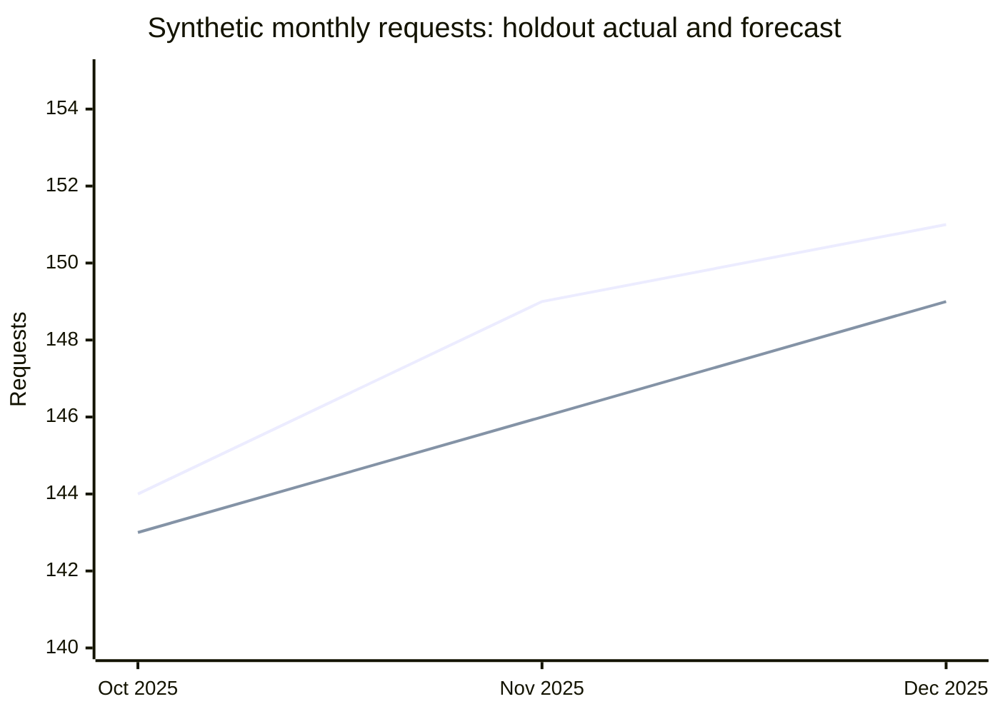

# Level 4 Data Fellowship — KSB answer and evidence guide

Prepared: 2 November 2026.  
Presentation updated: 3 November 2026 for the implemented study page; source-check dates below remain unchanged.  
Coverage: K1–K15, S1–S15 and B1–B7.  
Companion document: [study page design](./design.md).

## How to use these answers

This is a set of explanations, worked examples and answer-building prompts based on the two KSB guides supplied by the learner. It is preparation material, not an official mark scheme or a promise of a Pass. A strong answer connects a correct principle to something you personally did, explains why, and supports the result with evidence.

Read an answer, close it, explain the idea in your own words, then check what you missed. Complete the **Make it yours** template using genuine experience. Square-bracket placeholders are deliberately unfinished; they are not facts about your employer or project. Every example involving service requests, tools, numbers or stakeholders below is fictional or illustrative unless explicitly identified as an external source.

Use evidence held in your organisation's approved location. This repository is public: do not replace placeholders here with sensitive workplace information. The study page keeps sanitised personal responses separate from this public answer bank. A model answer, synthetic exercise or self-reflection does not by itself demonstrate a workplace Skill or Behaviour.

### Assessment context and source status

The official [Skills England Data Analyst standard, ST0118 version 1.1](https://skillsengland.education.gov.uk/apprenticeships/st0118-v1-1) and [assessment plan ST0118/AP03](https://skillsengland.education.gov.uk/media/5128/st0118_data_analyst_l4_ap-for-publication_20210527.pdf) were consulted on 2 November 2026. AP03 uses a project with presentation and questioning, plus a professional discussion with portfolio. Both methods must be passed. Confirm your applicable version and provider instructions before treating that plan as your assessment configuration.

| AP03 assessment route, conditional on applicability | KSBs mapped to that route |
| --- | --- |
| Project with presentation and questioning | K3, K4, K8, K9, K11, K12; S1, S2, S3, S4, S6, S7, S8, S12, S15; B3, B4 |
| Professional discussion with portfolio | K1, K2, K5, K6, K7, K10, K13, K14, K15; S5, S9, S10, S11, S13, S14; B1, B2, B5, B6, B7 |

The supplied `[1]`–`[109]` reference markers have no bibliography. They are not reproduced as verified citations. The coverage checks below follow the supplied preparation guide; detailed tool lists, a two-stakeholder example target and forecast artefacts are preparation targets, not claims that every detail is verbatim AP03 wording. AP03's S12 descriptor concerns relevant stakeholders and adapted communication; its S13 descriptor covers a range of techniques, including mining and forecasting. Retain that broader scope alongside the learner's more specific checklist.

Useful joint revision pairs are **K1/B1, K3/S2, K8/S6, K9/S7, K11/S15, K13/S10 and K14/S11**. Study together but keep individual explanations and evidence links visible.

## Knowledge

<a id="ksb-k1"></a>
### K1 — Current & Relevant Data Legislation

**Answer guide.** Data protection legislation sets the rules for using information about identifiable people. In the UK, the UK General Data Protection Regulation (UK GDPR) operates alongside the Data Protection Act 2018. It affects collection, access, analysis, sharing and retention; permission to access a system does not permit every possible use of its data. See [the government overview](https://www.gov.uk/data-protection).

The seven principles are:

| Principle | Practical explanation |
| --- | --- |
| Lawfulness, fairness and transparency | Establish a valid basis, treat people fairly and explain the use |
| Purpose limitation | Use information for specified purposes; assess proposed reuse |
| Data minimisation | Take only the fields and detail needed |
| Accuracy | Check and correct personal information where needed |
| Storage limitation | Follow justified retention and deletion arrangements |
| Integrity and confidentiality | Protect against unauthorised access, loss and damage |
| Accountability | Be able to show how requirements were met |

The complete first principle includes fairness and transparency, not only lawfulness. The [ICO principles guide](https://ico.org.uk/for-organisations/uk-gdpr-guidance-and-resources/data-protection-principles/a-guide-to-the-data-protection-principles/) supports this list. Its search extract notes updates following the Data (Use and Access) Act 2025; verify the current detailed rules and commencement dates for a real decision. Consent is not the only possible lawful basis, and a government task is not automatically authorised simply because it serves the public.

**Make it yours.** “For `[project purpose]`, I checked `[lawful basis/authorisation with responsible role]`, limited access and fields to `[necessary scope]`, used `[approved storage/sharing]`, followed `[retention rule]` and recorded `[compliance evidence]`. This protected `[people and working environment]`.”

**Evidence to reference.** An approved handling record, access rationale, minimisation decision and retention reference. Link B1 for everyday secure working.

**Coverage check.** Define the legislation; explain all seven principles; connect them to your own access, use and security decisions.

**Follow-up.** What would you do if someone requested a new use of the same data?

<a id="ksb-k2"></a>
### K2 — Organisational Data Policies & Standards

**Answer guide.** Organisational policies translate legal obligations and risk decisions into practical rules. Typical topics include information classification, access approval, acceptable use, passwords and authentication, approved storage, secure sharing, retention, incident reporting, quality standards and use of AI tools. A policy is a rule; a procedure explains how to carry it out; a standard sets a required level or format.

Describe the policies your organisation actually uses, their owner/version and how you find updates. Explain daily actions: use an authorised account, store work in an approved location, check recipients, follow change approval and report concerns through the agreed route. AI guidance may restrict which tools and data can be used; do not upload workplace information to an unapproved service. Non-compliance can harm individuals, interrupt services, trigger internal action, damage trust and create regulatory or contractual consequences.

**Make it yours.** “The relevant policies were `[actual titles/versions]`. I followed them by `[specific actions]`. They affected `[tool/access/output decision]`. If a requirement was unclear, I consulted `[responsible role]`; a breach would be handled through `[actual process]`.”

**Evidence to reference.** Safe policy references and an example showing application, not copies of restricted policies.

**Coverage check.** Name relevant internal data, security and AI rules; explain compliance, role impact and consequences.

**Follow-up.** How do you distinguish an approved exception from ignoring a policy?

<a id="ksb-k3"></a>
### K3 — Principles of the Data Analysis Lifecycle

**Answer guide.** The lifecycle turns a decision need into a useful analytical output:

1. **Planning:** define the question, stakeholders, scope, success criteria, data needs, risks and timetable.
2. **Data Preparation:** obtain authorised sources, profile quality, clean, reshape, combine and document transformations.
3. **Analysis:** explore distributions and patterns, calculate measures and apply suitable methods.
4. **Refining/Comparing:** validate outputs, compare baselines and alternatives, investigate anomalies and revise assumptions.
5. **Communication/Implementation:** explain findings, limitations and recommendations; support use, handover and review.

These stages have a useful order but analysis is iterative. Validation may expose a preparation error; stakeholder feedback may require refining the question. In a fictional service-performance project, the analyst agrees a waiting-time definition, prepares service records, analyses delays, reconciles results against source totals and briefs the service manager on a justified action.

**Make it yours.** “At Planning I `[action/output]`; at Preparation I `[action/output]`; at Analysis I `[action/output]`; at Refining/Comparing I `[action/output]`; at Communication/Implementation I `[action/output]`. I revisited `[stage]` because `[reason]`.”

**Evidence to reference.** A chronological project record and one traceable output or decision per stage. Link S2 for execution.

**Coverage check.** Explain and apply every stage; do not stop after producing a chart.

**Follow-up.** Which check caused you to change your approach?

<a id="ksb-k4"></a>
### K4 — Data Classification Types

**Answer guide.** These terms describe access, origin or purpose and can overlap:

| Type | Meaning and example |
| --- | --- |
| Open data | Available for reuse under an open licence, subject to its terms; for example, a published licensed aggregate dataset |
| Public data | Accessible to the public; availability alone does not establish unrestricted reuse rights |
| Administrative data | Generated by delivering services or running operations; for example, service request records |
| Research data | Collected or produced for research; for example, survey responses or experimental observations |

An administrative dataset may later produce an open aggregate release. Research data may remain restricted. These are not substitutes for organisational security markings or sensitivity assessment.

For a fictional waiting-time project, operational request records are administrative data because they originate from service delivery. Published population figures might add contextual denominators if their geography, date, licence and definitions are suitable. A research survey could help explain experience, but might be excluded if it does not answer the question or lacks suitable coverage.

**Make it yours.** “My source `[source alias]` is `[type(s)]` because `[origin/access/purpose]`. I included `[other source]` for `[reason]` and excluded `[type/source]` because `[relevance/licence/quality/access reason]`.”

**Evidence to reference.** A source inventory, provenance notes, licence/access checks and a selection rationale.

**Coverage check.** Define all four types; classify your sources with reasons; explain inclusion and exclusion.

**Follow-up.** Can public information still contain personal data or have reuse restrictions?

<a id="ksb-k5"></a>
### K5 — Structured vs. Unstructured Data

**Answer guide.** Structured data follows an explicit schema, usually fields, types and relationships, so records can be queried consistently. A table of request ID, received date, service ID and status is structured. Unstructured data lacks that fixed analytical tabular schema: free-text comments, images, audio and video need interpretation or extraction before many analyses.

Semi-structured data, such as JSON with named fields and nested arrays, has organisation without necessarily fitting a single flat table. A structured table can contain an unstructured text column. Saving free text in a spreadsheet does not make its meaning structured. Structured data supports direct filtering and aggregation; text may require coding themes, language processing or manual review, each with quality and bias considerations.

**Make it yours.** “My dataset contains `[actual fields/formats]`, follows `[schema]` and is `[structured/unstructured/mixed]` because `[reason]`. The `[text/nested field]` needed `[extraction/coding/reshaping]` before I could analyse it.”

**Evidence to reference.** A safe data dictionary, schema sketch and example of the analytical treatment.

**Coverage check.** Define and contrast the types; justify the classification of your own data.

**Follow-up.** How did you check that extracting structure did not discard important meaning?

<a id="ksb-k6"></a>
### K6 — Data Structures & Database System Design

**Answer guide.** Use the terms precisely:

| Term | Explanation |
| --- | --- |
| Database | An organised collection of data managed for storage, retrieval and updates |
| Data warehouse | An integrated analytical store, often containing cleaned historical data from several systems |
| Data lake | A store for varied raw and processed formats; usefulness still depends on metadata, governance and quality |
| Relational database / RDBMS | Data organised in related tables and managed by a relational database management system, commonly queried with SQL |
| NoSQL | A family of non-relational approaches, such as document, key-value, graph and wide-column stores |
| Normalisation | Structuring relational tables to reduce avoidable duplication and update anomalies; analytical designs may deliberately denormalise |
| ETL | Extract data, transform it and load it into a target; ELT loads before transforming |

Implementation includes deciding record grain, data types, primary/foreign keys, constraints, indexes and access roles. Maintenance includes monitoring ETL jobs, validating loads, handling schema changes, reviewing access, patching, backing up and testing recovery. Normalisation is a design practice, not the whole maintenance process. Users may interact through SQL clients, application interfaces, APIs, approved drivers/connectors and BI tools; an API is not the only database connection method.

**Make it yours.** “Our approved architecture uses `[actual components]`. I interacted through `[tool/connection]`. `[responsible team]` maintains `[pipeline/schema/access/backup responsibilities]`. My analysis depended on `[key/refresh/design choice]`.”

**Evidence to reference.** An approved schema diagram, lineage explanation or query annotated with grain and relationships.

**Coverage check.** Define all seven requested terms and explain design, maintenance and interaction with concrete context.

**Follow-up.** When might a denormalised analytical table be preferable?

<a id="ksb-k7"></a>
### K7 — User Experience (UX) & Domain Context Principles

**Answer guide.** UX is how well a person can understand and use an output to complete a task. Domain context is the sector's processes, vocabulary, constraints and decision rules. Together they determine which questions, metrics, definitions and interactions are useful.

Simplicity removes unnecessary choices; clarity makes titles, units, filters and definitions understandable; accessibility enables use across abilities and technologies. An analyst should consider colour contrast, non-colour cues, keyboard interaction, readable text and chart alternatives. Domain knowledge prevents plausible but misleading measures: calendar days and working days are different, open cases cannot be treated as completed, and a service target may change how a delay is interpreted.

**Make it yours.** “Users needed to decide `[decision]`. I used `[layout/interaction/labels]` to support that task. The domain rule `[actual rule]` changed `[metric or visual choice]`. I checked usefulness with `[feedback/evaluation]`.”

**Evidence to reference.** A design rationale linking a user task, domain definition and evaluated output.

**Coverage check.** Define both terms; explain simplicity, clarity and accessibility; connect them to organisational analytics choices.

**Follow-up.** Which attractive design would be misleading in your domain?

<a id="ksb-k8"></a>
### K8 — Data Quality Risks

**Answer guide.** Quality means suitability for the intended decision. The [Government Data Quality Framework](https://www.gov.uk/government/publications/the-government-data-quality-framework/the-government-data-quality-framework) distinguishes several useful dimensions:

| Dimension | Question to ask |
| --- | --- |
| Accuracy | Does the value represent reality correctly? |
| Completeness | Are the expected records and required fields present? |
| Consistency | Do definitions and related values agree across records or sources? |
| Uniqueness | Is each entity represented only as often as intended at the defined grain? |
| Timeliness | Is the data sufficiently current and available when needed? |
| Validity | Does it conform to the allowed type, format and range? |

NULL can mean unknown, not applicable or not yet recorded; zero is a value, not a universal substitute. An outlier is unusual, not automatically wrong. Erroneous dates, duplicate keys and stale extracts can distort counts, averages, forecasts and resource decisions.

Profile the data, agree quality rules, measure the issue, assess its impact, investigate the cause, choose a justified treatment and validate the result. Escalate issues beyond your authority or where a material decision remains unsafe. Record unresolved risk. Do not improve a metric by silently deleting inconvenient records.

**Make it yours.** “I found `[issue]` affecting `[dimension]` through `[check]`. It risked `[decision impact]`. I `[mitigated/resolved/escalated]` because `[reason]` and verified `[result]`. `[limitation]` remained.”

**Evidence to reference.** A quality log with counts, treatment rationale and validation. Link S6 and B5.

**Coverage check.** Explain the five requested dimensions, NULLs, outliers and errors; describe impact and treatment/escalation.

**Follow-up.** How can a complete and valid dataset still be inaccurate?

<a id="ksb-k9"></a>
### K9 — Defining Customer Requirements

**Answer guide.** Requirements describe the decision to support, the intended users, necessary outputs, constraints and what success looks like. Start with the problem rather than a requested chart. Use interviews, workshops, observation, existing reports and prototypes to identify needs, then confirm understanding in an agreed brief.

A stakeholder map identifies affected people and decision-makers. A Power-Interest Matrix helps plan engagement: high-power/high-interest stakeholders need close involvement; high-power/lower-interest groups need appropriate assurance; lower-power/high-interest users need consultation and information. Revisit this assessment and include affected groups who may otherwise lack influence.

Translate needs into measurable acceptance criteria, definitions, data scope, delivery dates and priorities. Record out-of-scope work and a route for changes. For example, “show service performance” becomes a defined weekly view with agreed waiting-time units, filters, refresh timing and a clearly stated decision owner.

**Make it yours.** “I captured requirements using `[methods]`, involved `[roles]`, confirmed `[definitions and acceptance criteria]` and used them to set `[scope/method/output]`. I handled a change through `[agreement process]`.”

**Evidence to reference.** A stakeholder map, agreed requirements and decision/change log. Link S7.

**Coverage check.** Explain tools and communication methods and trace requirements into planning and outputs.

**Follow-up.** How did you resolve conflicting stakeholder priorities?

<a id="ksb-k10"></a>
### K10 — Combining Data Sources

**Answer guide.** A primary key uniquely identifies a row and cannot be NULL; a foreign key refers to a key in a related table; a composite key uses more than one field. Define grain before joining: one row per request is different from one row per service per month.

| Operation | Result |
| --- | --- |
| Inner join | Matching combinations only |
| Left join | All left-side rows, matching right-side values and NULLs for unmatched right-side fields |
| Right join | All right-side rows and any matching left-side values |
| Full outer join | Matches plus unmatched rows from both sides |
| UNION | Appends compatible result rows and removes duplicates |
| UNION ALL | Appends compatible result rows and retains duplicates |

Joins combine related rows; unions append rows and are not join types. See [PostgreSQL's join documentation](https://www.postgresql.org/docs/current/queries-table-expressions.html) and [set-operation documentation](https://www.postgresql.org/docs/18/queries-union.html).

Check key types, formatting, uniqueness, cardinality, time periods, units, licences and unmatched records. A left join can multiply rows when the right key repeats. Combining a request table with a verified service lookup can standardise names and avoid repeated manual edits, but the benefit must be demonstrated through checks and an actual outcome.

**Make it yours.** “I combined `[sources]` at `[grain]` using `[keys and operation]` because `[reason]`. I checked `[cardinality/unmatched counts/totals]`. This improved `[accuracy/efficiency/customer benefit]`, supported by `[measurement or observed evidence]`.”

**Evidence to reference.** A join diagram, reproducible steps and before/after reconciliation. Link S8.

**Coverage check.** Explain the three keys, four joins and union distinction; connect combination to a justified benefit.

**Follow-up.** Why might an inner join conceal a quality problem?

<a id="ksb-k11"></a>
### K11 — Organisational Analysis Tools & Methods

**Answer guide.** Describe tools your organisation actually makes available, then compare them against the analytical requirement. Typical options include Excel for small tabular exploration, Power Query for repeatable preparation, SQL for database querying, Power BI/Tableau for governed visual reporting and Python for reproducible custom analysis. Availability, permitted use and capability vary by employer.

Compare scale, source connectivity, statistical capability, accessibility, reproducibility, security, cost, team skills and maintenance. Licensed software may offer support and familiar sharing; code may offer flexibility and versionable workflows but still needs testing, support and suitable deployment. Neither is universally superior.

**Make it yours.** “Our available tools were `[actual options]`. I selected `[tool]` for `[specific task]` because it met `[criteria]`. I rejected `[alternative]` because `[trade-off]`. The outcome was `[verified result]`, with `[remaining limitation]`.”

**Evidence to reference.** A short options comparison tied to the project. Link S15 for applied selection.

**Coverage check.** Explain organisational tools and methods and justify the tools you actually selected.

**Follow-up.** What would make you choose a different tool next time?

<a id="ksb-k12"></a>
### K12 — Organisational Data Architecture

**Answer guide.** Data architecture describes how sources, storage, transformation, governance and consumption fit together. Explain the architecture you actually work within, not a generic cloud diagram. It may involve operational databases, file stores, ETL/ELT, a warehouse or lake, a semantic model and approved reports.

A fictional flow is `service system → controlled staging → quality transformations → analytical warehouse → BI model → authorised users`. Each stage has an owner, permissions, refresh arrangements and lineage. Central storage policies affect where extracts can be saved, which interfaces are approved and how retention, backups and audit records work. Tool choice depends on supported connectors, identities, network routes and platform constraints.

Big Data concerns scale, speed and variety that may require distributed storage or processing. Do not claim your organisation uses a lake or Big Data platform if it does not. A modest relational solution may be entirely appropriate.

**Make it yours.** “Data moves from `[source]` through `[actual components]` to `[consumer]`. `[roles]` govern `[access/storage/refresh]`. This constrained my choice of `[tool/location/connection]` and affected `[analysis decision]`.”

**Evidence to reference.** An approved high-level lineage diagram with sensitive infrastructure details removed.

**Coverage check.** Outline actual architecture and explain its implications for storage, security, access and tools; address Big Data only to the extent relevant.

**Follow-up.** What happens to your output if an upstream schema or refresh changes?

<a id="ksb-k13"></a>
### K13 — Principles of Statistics

**Answer guide.** Descriptive statistics summarise observed data; inferential statistics use a sample and assumptions to reason about a wider process or population.

| Term | Meaning |
| --- | --- |
| Mean | Sum divided by count; sensitive to extreme values |
| Median | Middle ordered value; useful with skewed distributions |
| Mode | Most frequent value or category; may not be unique |
| Variance | Average squared spread around the mean; a sample estimate commonly divides by `n − 1` |
| Standard deviation | Square root of variance, expressed in the original units |
| Null hypothesis, H0 | The reference claim being tested, such as equal population means |
| Alternative hypothesis, H1 | The contrasting claim, such as a difference in population means |
| t-test | A test about means; choose paired/unpaired and variance assumptions to match the design |
| Significance level, alpha | A preselected threshold controlling a test's Type I error rate under its assumptions |
| p-value | Under H0 and the model assumptions, the probability of a test statistic at least as extreme as observed |

For synthetic completion times `[2, 3, 3, 4, 8]` days, the mean is **4**, median **3**, mode **3**, sample variance **5.5 days²** and sample standard deviation **2.345 days**. The larger mean reflects the long observation. Report distribution and sample size alongside summaries.

A small p-value is not the probability that H0 is true, and a large p-value does not prove equality. Report effect size, confidence intervals, assumptions and practical relevance. The [NIST t-test reference](https://www.itl.nist.gov/div898/handbook/eda/section3/eda353.htm) provides formulas; S10 below gives a separately constructed numerical example.

**Make it yours.** “I used `[summaries]` to understand `[distribution]`. To investigate `[question]`, I set `[hypotheses and alpha]`, selected `[method]`, checked `[assumptions]` and interpreted `[effect/interval/p-value]` as `[appropriately limited conclusion]`.”

**Evidence to reference.** Reproducible calculations, distribution plots and a statistical interpretation.

**Coverage check.** Define all requested statistics and inferential terms; give a genuine application, not only definitions.

**Follow-up.** Could a statistically significant result still be operationally unimportant?

<a id="ksb-k14"></a>
### K14 — Principles of Analytics Types

**Answer guide.** Descriptive analytics explains observed results: “What happened?” Predictive analytics estimates unknown or future outcomes with uncertainty: “What might happen?” Prescriptive analytics recommends actions using evidence, objectives and constraints: “What should we do?”

In a fictional service project, descriptive analysis summarises completed requests and waiting-time distributions. A predictive model forecasts future demand. Prescriptive analysis compares feasible staffing or scheduling responses against capacity, cost, service needs and uncertainty. A forecast alone is not a recommendation, and an unsupported recommendation is not a demonstrated analytical benefit.

Linear regression estimates a numerical outcome; logistic regression estimates a probability for a defined class. Neither automatically proves a causal effect. Predictions need suitable validation and monitoring, while recommendations need human judgement and policy context.

**Make it yours.** “I described `[observed pattern]`, predicted `[target/horizon with validation]` and recommended `[action]` because `[objective, constraints and evidence]`. The uncertainty was `[limitation]` and the decision owner was `[role]`.”

**Evidence to reference.** A linked descriptive output, predictive evaluation and reasoned recommendation. Link S11.

**Coverage check.** Define all three types and demonstrate their actual application within your practice.

**Follow-up.** What evidence would you need before claiming the recommended action caused an improvement?

<a id="ksb-k15"></a>
### K15 — Data Ethics

**Answer guide.** Ethics asks whether data use is appropriate and fair, including where a use might be legally permitted. Start by describing the source, collection method, purpose, population, exclusions and intended decision.

Assess **fairness**: who benefits or may be harmed? Assess **bias**: who is missing or measured differently? Provide **transparency** about methods and limitations and **accountability** through named responsibilities and routes to challenge. Consider **consent** where relevant to collection or participation; do not confuse ethical participation arrangements with assuming consent is always the legal basis.

A fictional online-feedback analysis may underrepresent people who cannot use digital channels. Reporting complaint counts as satisfaction without checking the denominator could disadvantage some services. Mitigations might include consulting users, comparing channels, preserving qualitative context and limiting decisions unsupported by the data.

The current government [Data and AI Ethics Framework](https://www.gov.uk/government/publications/data-ethics-framework/data-and-ai-ethics-framework), updated 18 December 2025, extends the older Data Ethics Framework. Its principles include transparency, accountability, fairness, privacy, environmental sustainability, societal impact and safety. Use the applicable version in your organisation and revisit ethical questions as a project changes. Failures can cause harm, unfair decisions, service problems and loss of trust.

**Make it yours.** “The data came from `[source]`, collected through `[method]` for `[purpose]`. I identified `[ethical risk]`, considered `[affected groups]`, applied `[mitigation]` and documented `[accountability/transparency]`. `[residual risk]` remained.”

**Evidence to reference.** An approved ethical assessment or decision log and a concrete limitation communicated to users.

**Coverage check.** Describe the dataset and five requested ethical aspects; justify their importance and consequences.

**Follow-up.** What could make a legally permissible analysis unfair?

## Skills

<a id="ksb-s1"></a>
### S1 — Operating Data Systems in Compliance

**Answer guide.** Explain the systems you actually operated and the controls you personally applied throughout the work. Privacy by Design means addressing privacy while deciding requirements and designing the workflow, rather than adding protection only before publication.

Describe authorised access, minimum necessary fields, approved environments, controlled transfers, protected working copies, output disclosure checks and retention/deletion. Review risks when the scope changes. Pseudonymised data can still be personal data; anonymisation requires attention to re-identification, not merely removal of a name. Explain when you involved the data owner, security or data protection team and any privacy impact assessment required by the actual process.

**Make it yours.** “I operated `[system]` using `[approved role]`. During planning I `[privacy decision]`; during preparation/analysis I `[controls]`; before sharing I `[check]`; at closure I `[retention/deletion]`. I verified compliance through `[record/approval]`.”

**Evidence to reference.** A sanitised workflow and control record with no credentials or sensitive connection details.

**Coverage check.** Show performed actions and privacy considerations across the lifecycle, linked to real organisational/legal requirements.

**Follow-up.** How did the design reduce exposure before anyone accessed the output?

<a id="ksb-s2"></a>
### S2 — Applying the Data Analysis Lifecycle

**Answer guide.** K3 explains the lifecycle; S2 shows that you carried it out. Select one genuine project and trace a continuous chain from the requirement to the decision or handover.

| Stage | What your account should demonstrate |
| --- | --- |
| Planning | Agreed question, scope, timetable, success criteria and risks |
| Data Preparation | Authorised acquisition, profiling, transformations and source combination |
| Analysis | Methods you used and why they answered the question |
| Refining/Comparing | Reconciliation, alternative checks, feedback and changes |
| Communication/Implementation | Audience-appropriate delivery, recommendations and handover/review |

**Make it yours.** “The agreed objective was `[objective]`. My output at each stage was `[five linked outputs]`. A check at `[stage]` led me to change `[action]`, improving `[verified result]`. I handed over `[deliverable and limitations]`.”

**Evidence to reference.** One project timeline linking the brief, reproducible preparation, analysis, validation and final communication.

**Coverage check.** Demonstrate every stage with your own actions; label missing workplace experience as a gap.

**Follow-up.** How can another analyst reproduce your route from raw data to the reported result?

<a id="ksb-s3"></a>
### S3 — Applying Principles of Data Classification

**Answer guide.** Assess sensitivity, identifiability, purpose, access and potential harm, then apply your organisation's real classification and handling scheme. Low/medium/high can be useful risk descriptions if the organisation uses them; they are not universal government security labels.

Describe the classification decision and the practical treatment: restrict fields and users, redact sensitive content, pseudonymise identifiers with the lookup separately controlled, or publish an appropriately checked aggregate. Explain why a change in treatment was appropriate for the particular use and who could authorise it. Turning text into counts does not automatically anonymise it; small groups, rare events and linked datasets can permit identification.

**Make it yours.** “I assessed `[dataset]` as `[actual classification/risk]` because `[reason]`. The handling rule was `[requirement]`. For `[approved purpose]`, I applied `[redaction/pseudonymisation/aggregation]`, checked `[remaining disclosure risk]` and retained `[controls/approval]`.”

**Evidence to reference.** An approved classification rationale and safe demonstration of treatment, without original sensitive content.

**Coverage check.** Show reasoned classification, confidentiality requirements, any justified flexibility and the purpose of protection.

**Follow-up.** Why might a pseudonymised extract still require restricted access?

<a id="ksb-s4"></a>
### S4 — Analysing Diverse Data Structures & Designs

**Answer guide.** State the shape, grain, schema, keys and field types of each actual dataset, including row and column counts at the relevant extraction date. Explain how structure affected the work. A relational export may require joins; a JSON source may require flattening repeated arrays; free-text feedback may require thematic coding.

RDBMS strengths include relationships, constraints, transactions and established querying. Trade-offs can include schema-change effort, joins across many tables, and limits of a particular design or deployment when handling unusual formats or scale. NoSQL may fit some access patterns but does not remove governance or design requirements.

**Illustrative application.** A request table has one row per request, a service lookup one row per service, and feedback multiple comments per request. Joining all comments directly would change the request grain; aggregate or model feedback separately before combining measures.

**Make it yours.** “Source A had `[rows × columns, grain]`; source B had `[shape/grain]`. Their structures differed in `[way]`, so I `[query/reshape/aggregate choice]`. I checked `[count/key/meaning validation]`.”

**Evidence to reference.** Data dictionaries, safe schema examples, row-count records and annotated transformations.

**Coverage check.** Give actual shapes and data types, discuss RDBMS trade-offs and show adaptation to structural differences.

**Follow-up.** What would break if one request appeared several times after a join?

<a id="ksb-s5"></a>
### S5 — Applying UX & Domain Context

**Answer guide.** Connect each design choice to a stakeholder task. Put the decision-critical measure and its definition near the top; group related information; make filter state and refresh timing visible. Use readable labels, sufficient contrast, non-colour cues and suitable alternatives for charts. Design and test keyboard interaction when the chosen tool supports it; explain limitations rather than assuming compliance.

For a web output, WCAG 2.2 AA is an appropriate accessibility target where applicable; a design intention is not verified conformance. Apply the actual standards and evaluation process required for your output and organisation.

Apply domain rules to calculations as well as presentation. In a fictional service output, separate open cases from completed-case duration, use the agreed working-day definition and identify the service target. Test a draft with intended users and document an actual change from feedback.

**Make it yours.** “Users needed `[decision]`. I chose `[layout, palette and hierarchy]` because `[need]`, applied `[domain rule]` and checked `[accessibility/usability]`. Feedback from `[role]` led to `[change]`, with `[observed result]`.”

**Evidence to reference.** Safe before/after views, an explanation of design choices and actual user evaluation.

**Coverage check.** Demonstrate layout, colour, hierarchy, accessibility, stakeholder need and a concrete domain example.

**Follow-up.** How would the output work for someone who cannot distinguish its colours?

<a id="ksb-s6"></a>
### S6 — Mitigating & Resolving Quality Risks

**Answer guide.** Demonstrate a complete issue-handling loop: detect, measure, assess impact, investigate, mitigate or escalate, resolve where authorised, and validate. Preserve the original source and log transformations.

**Illustrative application.** NULL completion dates may represent genuinely open cases. The analyst separates these from completed-case duration rather than replacing them with zero. An apparent demand spike after a join triggers checks of lookup uniqueness and row counts. Conflicting lookup entries require source-owner clarification, not arbitrary deletion. An unresolved issue is reported with the affected outputs, interim mitigation, owner and next action.

**Make it yours.** “My `[check]` found `[issue and scale]`. The risk was `[impact]`. I `[action]` within my remit and escalated `[part]` to `[role]`. Validation showed `[actual outcome]`; I communicated `[residual limitation]`.”

**Evidence to reference.** A quality log, failed and passed checks, approved resolution/escalation and a reconciled output.

**Coverage check.** Describe what you actually detected and did, including the reason for resolving or escalating. Link K8 and B5.

**Follow-up.** What stopped the same problem from silently returning at the next refresh?

<a id="ksb-s7"></a>
### S7 — Implementing Customer Requirements

**Answer guide.** Show a chain from a stated need to planned method, output and acceptance check. Distinguish a stakeholder's requested feature from the decision it serves. Agree priorities, boundaries and changes rather than expanding scope informally.

| Fictional requirement | Planning/method implication | Deliverable and check |
| --- | --- | --- |
| Compare completed-case waits by service | Agree completion definition, period and units; prepare comparable records | View with agreed filters; reconcile counts and duration calculation |
| Identify services needing attention | Agree target and decision rule; assess small counts and uncertainty | Clearly labelled exceptions with caveats; stakeholder review |
| Refresh for a regular meeting | Set data cutoff, refresh dependencies and owner | Refresh timing and handover instructions; check a refresh cycle |

**Make it yours.** “Requirement `[R-id]` led to `[scope/method]`, was delivered through `[output]` and checked using `[acceptance evidence]`. A change to `[requirement]` was agreed with `[role]` and affected `[time/scope]`.”

**Evidence to reference.** An agreed brief, a traceability table and a recorded review of acceptance criteria.

**Coverage check.** Explicitly connect requirements to scope, methodology and final deliverables.

**Follow-up.** What would you do if a requested output could not be supported by the available data?

<a id="ksb-s8"></a>
### S8 — Combining & Preparing Multi-Source Data

**Answer guide.** Demonstrate a repeatable join in an appropriate tool, with explicit keys, grain and validation. A lookup formula alone is not a complete explanation of combination risks. The supplied guide prioritises SQL, Power Query, Python or a suitable BI join; the underlying requirement is to show a robust, reasoned process.

For fictional tables `service_requests(request_id, service_id)` and `service_lookup(service_id, service_name)`, first investigate duplicate or missing lookup keys:

```sql
SELECT service_id, COUNT(*) AS rows_per_key
FROM service_lookup
GROUP BY service_id
HAVING COUNT(*) > 1 OR service_id IS NULL;
```

After resolving any issue through an authoritative rule, a left join preserves requests without a lookup match:

```sql
SELECT r.request_id, r.service_id, l.service_name
FROM service_requests AS r
LEFT JOIN service_lookup AS l
  ON r.service_id = l.service_id;
```

Identify unmatched non-null service keys explicitly:

```sql
SELECT r.service_id, COUNT(*) AS unmatched_requests
FROM service_requests AS r
LEFT JOIN service_lookup AS l
  ON r.service_id = l.service_id
WHERE r.service_id IS NOT NULL AND l.service_id IS NULL
GROUP BY r.service_id;
```

Check NULL request keys separately. Do not assume the final row count equals the original unless the right-side key is unique and the intended relationship supports that result. Other risks include mismatched data types, leading zeros, time periods, inconsistent units, privacy restrictions and changing definitions. Reconcile distinct request counts and relevant totals; keep an unmatched-record log.

**Make it yours.** “I prepared `[sources]`, standardised `[fields]`, joined using `[keys, type, expected relationship]` and checked `[counts, duplicates, unmatched rows, totals]`. I mitigated `[risk]` with `[action]`.”

**Evidence to reference.** Actual queries or transformation steps, key profiling and reconciliation results.

**Coverage check.** Show a multi-source join and explain risks, preparation and validation; do not present the sample SQL as your work.

**Follow-up.** When would aggregation before joining be necessary?

<a id="ksb-s9"></a>
### S9 — Tools for Data Architecture

**Answer guide.** Explain which tool you used to interact with which architectural component and why the connection satisfied the organisation's constraints. Examples include SSMS for an authorised SQL Server query, a supported Power BI connector for a governed dataset, Tableau for an approved data source or approved Azure services for storage/processing. Azure is a platform; name the relevant service if appropriate and safe.

Explain authentication, least-privilege access, refresh or query constraints, approved gateways/interfaces and where transformations ran. Do not claim you administered infrastructure if you only queried it. Distinguish responsibilities of an analyst, data engineer and administrator.

**Make it yours.** “The relevant component was `[actual architecture component]`. I used `[tool/interface]` because it supported `[infrastructure need]`. My permissions were `[role-level description]`. I applied `[connection/query/storage constraint]` and checked `[result]`.”

**Evidence to reference.** A sanitised connection/query workflow and approved high-level architecture reference; omit secrets and host details.

**Coverage check.** Identify actual tools and techniques, explain their architectural fit and demonstrate compliant interaction.

**Follow-up.** What would you check before moving a transformation from the database into a desktop tool?

<a id="ksb-s10"></a>
### S10 — Applying Statistical Methodologies

**Answer guide.** Start with EDA: check shape, data types, missingness, duplicates, distributions, outliers, groups and possible sampling bias. Calculate summaries appropriate to the question. State hypotheses and alpha before the inferential analysis, choose the test to fit the design, check assumptions and interpret uncertainty in business terms.

**Worked synthetic example.** Compare independent completion times for two fictional service processes, measured in days:

- A: `[8, 9, 10, 11, 12]`; mean **10**, sample variance **2.5**.
- B: `[6, 7, 8, 9, 10]`; mean **8**, sample variance **2.5**.
- H0: population mean completion times are equal. H1: they differ. Use a two-sided Welch t-test with alpha **0.05**.
- The mean difference A minus B is **2 days**, the standard error **1 day**, t **2.000**, approximate degrees of freedom **8**, p **0.08052**, and the 95% confidence interval for the difference is approximately **−0.306 to 4.306 days**.

At alpha 0.05, do not reject H0. The sample suggests a difference but does not provide sufficient evidence under this test and its assumptions to conclude a population difference. This does not prove the processes are equal. With only five observations per group, the example is a calculation exercise; normality and representativeness cannot be established just by looking at these neat numbers. Check independence, distributional assumptions, collection methods and possible confounding in real work. Paired observations need an appropriate paired analysis.

The figures can be reproduced with Python and SciPy, if approved in the learning environment:

```python
from scipy.stats import ttest_ind

a = [8, 9, 10, 11, 12]
b = [6, 7, 8, 9, 10]
result = ttest_ind(a, b, equal_var=False)
print(result.statistic, result.pvalue)
```

The [NIST reference](https://www.itl.nist.gov/div898/handbook/eda/section3/eda353.htm) explains the underlying test. The numbers above were calculated for this guide; they are not copied results or workplace evidence. Correlation and regression require their own assumptions and interpretations; not every predictive library reports inferential p-values.

**Make it yours.** “EDA showed `[findings]`. I set `[hypotheses/alpha]`, selected `[test]` because `[design]`, checked `[assumptions]` and obtained `[effect, interval, p-value]`. For `[business question]`, this supports `[limited conclusion]`.”

**Evidence to reference.** EDA, reproducible calculations, assumptions, effect size/interval and contextual interpretation.

**Coverage check.** Demonstrate EDA, descriptive statistics, hypotheses, an appropriate inferential test and correct p-value interpretation.

**Follow-up.** Why is “p > 0.05, therefore no difference” an unsafe conclusion?

<a id="ksb-s11"></a>
### S11 — Applying Predictive & Advanced Analytics

**Answer guide.** Demonstrate a connected descriptive, predictive and prescriptive workflow. Define the prediction target, unit of analysis, available-at-prediction-time features, baseline, training/validation split and metrics. Choose the method for the question: linear regression for a numerical target, logistic regression for a defined binary outcome, or another justified approach.

Prevent leakage from future information or from the same entity appearing in both training and test data inappropriately. Fit preprocessing on training data, evaluate on unseen observations and examine meaningful subgroup performance. Report assumptions and limitations as well as the headline score.

**Illustrative application.** The S13 example describes monthly request counts, evaluates a time-trend regression against a naive forecast and produces projections. For a fictional capacity of 150 requests per month, projections of 152–158 would prompt comparison of feasible staffing or scheduling options. That capacity is an assumption for discussion, not a fact about a service. A recommendation should consider cost, operational constraints, forecast uncertainty and the responsible decision-maker; it cannot claim an improvement before evaluating implementation.

**Make it yours.** “I described `[historical finding]`, built `[predictive method and target]`, compared `[baseline and validation]` and recommended `[action]` under `[constraints]`. The prediction could support `[decision]` but did not establish `[unsupported causal claim]`.”

**Evidence to reference.** The descriptive output, actual model code/settings, validation and a justified recommendation. Link K14.

**Coverage check.** Demonstrate all three analytics types and explain how your model and recommendation informed a real decision.

**Follow-up.** What would you monitor after the model began influencing decisions?

<a id="ksb-s12"></a>
### S12 — Stakeholder Communication & Collaboration

**Answer guide.** Show communication with at least two distinct stakeholders as requested in the supplied preparation guide, and cover all relevant stakeholders for the work. Two messages to the same person do not provide the requested contrast. Explain each stakeholder's need, your channel and level of detail, what you learned and how the collaboration affected the output.

| Fictional stakeholder | Communication approach | Collaboration outcome to describe |
| --- | --- | --- |
| Service manager | Short briefing with a clear decision, accessible chart, caveats and recommendation | Clarified the operational priority and agreed next action |
| Data engineer | Technical walkthrough of grain, keys, transformations and failed validation checks | Investigated source behaviour and agreed a defensible correction |

These are suggested roles, not claims about your project. Suitable evidence could use meetings, documented reviews, presentations or approved written channels. Adapt to the situation: an urgent quality concern may need a direct escalation and a written follow-up, while a planned review can use a fuller demonstration.

**Make it yours.** “With `[stakeholder 1]`, I used `[style/channel]` because `[need]`, leading to `[result]`. With `[stakeholder 2]`, I changed `[detail/language/channel]` because `[need]`, leading to `[result]`. Their input changed `[deliverable]`.”

**Evidence to reference.** Two sanitised communication examples, collaboration notes and the corresponding output changes.

**Coverage check.** Identify two distinct stakeholders, adapted styles/channels, actual collaboration and outcomes.

**Follow-up.** How did you check that each audience understood the limitations?

<a id="ksb-s13"></a>
### S13 — Time Series Forecasting & Data Mining

**Answer guide.** Define a forecast target, frequency, observation window and horizon. Plot the series, investigate missing periods, trend and seasonality, then choose a model based on those features and the decision. Examples include exponential smoothing, ARIMA or a justified regression model. Preserve time order, compare against a baseline, evaluate forecast error on later observations and explain projections and uncertainty. A fitted line on historical data alone is not forecast validation. See [Forecasting: Principles and Practice, chapter 5](https://otexts.com/fpp3/toolbox.html).

**Worked synthetic forecast.** Target: monthly service requests. Observation window: January–December 2025. Training window: January–September 2025, with values `[116, 120, 121, 125, 128, 131, 133, 138, 140]`. Holdout: October–December 2025. The training series is constructed for teaching and has an upward trend; nine training months do not establish annual seasonality.

Fit an ordinary least-squares time-trend regression, with January 2025 as `t = 1`: **predicted requests = 113 + 3t**. It is a transparent candidate for this short, trend-dominated toy series, not a universal replacement for seasonal methods. Keep coefficients fixed while evaluating the holdout.

| Month | Held-out actual | Trend forecast | Actual minus forecast | Naive forecast using September's 140 |
| --- | --- | --- | --- | --- |
| October 2025 | 144 | 143 | 1 | 140 |
| November 2025 | 149 | 146 | 3 | 140 |
| December 2025 | 151 | 149 | 2 | 140 |



Actual demand uses the solid line and the forecast uses the dashed line. The table supplies exact values and an accessible alternative. Series labels and different line styles distinguish the results without relying on colour alone.

Root mean squared error is `sqrt(mean((actual − forecast)²))`. Here trend-model RMSE is **sqrt(14/3) = 2.160 requests**, compared with **sqrt(218/3) = 8.524 requests** for the naive baseline. Both metrics use the same three held-out months. This narrow result supports this candidate on this toy split, not a broad performance claim. Repeated model selection needs rolling-origin validation and a separate final test where feasible.

For a **three-month future horizon, January–March 2026**, the same frozen model gives **152, 155 and 158 requests**. These are illustrative out-of-sample projections. Do not refit with the held-out actuals and claim the old test error evaluates that new fitted model. In real work, after evaluation, document any refit, generate prediction intervals where supported and monitor errors. No reliable seasonal conclusion or calibrated uncertainty interval is claimed from this tiny example.

Reproduce the toy fit and forecast metrics using Python's standard library:

```python
from math import sqrt
from statistics import linear_regression

train = [116, 120, 121, 125, 128, 131, 133, 138, 140]
slope, intercept = linear_regression(range(1, 10), train)
actual = [144, 149, 151]
forecast = [intercept + slope * t for t in (10, 11, 12)]
baseline = [train[-1]] * 3
rmse = lambda observed, predicted: sqrt(
    sum((a - p) ** 2 for a, p in zip(observed, predicted)) / len(observed)
)
print(slope, intercept, forecast)
print(rmse(actual, forecast), rmse(actual, baseline))
print([intercept + slope * t for t in (13, 14, 15)])
```

**Range of techniques.** Also prepare a genuine mining/modelling example to address the standard's broader range: for instance, clustering service profiles after appropriate scaling, or a validated decision tree predicting a defined outcome. Explain features, method, validation, interpretation and usefulness. A clustering exercise does not replace the supplied guide's forecast visual, and a forecast does not automatically demonstrate the full range.

**Make it yours.** “I forecast `[target/frequency]` from `[history window]` over `[horizon]` using `[model]` because `[reason]`. Trend/seasonality checks showed `[findings]`. On `[time-based evaluation]`, `[metric]` was `[result]` versus `[baseline]`. The visual showed `[projection and uncertainty]`. My separate mining/modelling example was `[technique, validation and use]`.”

**Evidence to reference.** Your real forecast plot and table, source/preparation notes, model settings/code, time split, metric calculation, limitations and a mining/modelling example where needed.

**Coverage check.** Include a visual forecast, target, window, horizon, model rationale, accuracy metric such as RMSE, trend, seasonality and projections; retain the broader mining/modelling preparation.

**Follow-up.** What would a structural change in service demand do to your forecast?

<a id="ksb-s14"></a>
### S14 — Visual Representation of Qualitative & Quantitative Data

**Answer guide.** Quantitative data measures quantities such as counts or durations. Qualitative data describes characteristics, categories, opinions or experiences. A numeric code may still represent a category, and counting themes does not remove the qualitative interpretation behind them.

Collate the sources, define measures, code text consistently if needed and preserve context. Use line charts for change over time, bars for category comparisons, distributions for spread and tables for exact figures. Explain denominators, missing data and why a visual fits the question. Avoid interpreting numbers of comments as representative satisfaction without suitable sampling and denominators.

**Illustrative application.** Show completed-case duration by service alongside coded feedback themes. State whether a comment can have several themes, how coding was checked and what privacy/disclosure rules affect quotations or small groups. Use safe thematic summaries rather than identifiable quotes. Explain both the numeric pattern and the supporting or conflicting qualitative insight.

**Make it yours.** “I collated `[numeric source]` and `[qualitative source]`, interpreted them using `[methods]`, chose `[visuals]` because `[rationale]` and found `[actual insight]`. I included `[accessible explanation/limitations]`.”

**Evidence to reference.** Annotated visuals, safe theme definitions, chart rationale and a clearly bounded interpretation.

**Coverage check.** Demonstrate collation, interpretation and visual display of both data types, not just two numerical charts.

**Follow-up.** What meaning might be lost when free text becomes a category count?

<a id="ksb-s15"></a>
### S15 — Selecting Optimal Data Analysis Tools

**Answer guide.** Show the decision process and then show that you applied the selected tool. Set criteria from the actual requirement and organisational environment, compare realistic available options, explain trade-offs and evaluate the result. “It was familiar” is relevant to delivery time but insufficient on its own.

For a fictional recurring service report, SQL could handle governed extraction and joins; Power Query could provide maintainable transformation; Power BI could support an approved interactive report; Python could support methods unavailable in the BI tool. A justified combination may be best, subject to approved use, ownership, accessibility and support.

**Make it yours.** “I compared `[available tools]` against `[data scale, capability, security, reproducibility, cost, accessibility and support]`. I selected and used `[tool/workflow]` because `[reason]`. The result met `[acceptance criteria]`, while `[trade-off]` remained.”

**Evidence to reference.** An options matrix, actual analysis artefact and outcome evaluation. Link K11.

**Coverage check.** Evaluate, select, apply and justify the outcome; name only tools genuinely available to you.

**Follow-up.** Who could maintain your solution if you moved to another role?

## Behaviours

Use **STAR-L: Situation, Task, Action, Result, Learning** to structure genuine examples. The fictional scenarios below illustrate the kind of reasoning to describe; replace them with your own experience. State what you did, what was outside your remit, how others were affected and how the result was checked.

<a id="ksb-b1"></a>
### B1 — Safe & Secure Working Environment

**Answer guide.** Explain secure, professional habits as part of productive working: use approved devices and accounts, protect authentication, lock unattended screens, check access and recipients, use approved storage, minimise exposed information and follow incident reporting and retention rules. Security responsibilities continue in meetings, screen sharing and remote work.

**Illustrative scenario.** Before a report review, an analyst shares a sanitised output through the approved channel, checks recipient access and removes an unnecessary identifying field. When a permission is unclear, they seek clarification instead of broadening access themselves. This connects legislation in K1 to everyday behaviour.

**Make it yours.** “In `[situation]`, I needed to `[task]`. I applied `[specific secure practices]`, checked `[control]` and handled `[concern]` through `[route]`. The result was `[verified outcome]`; I learned `[improvement]`.”

**Evidence to reference.** A safe handling example, approved review note or reflection on a specific security decision.

**Coverage check.** Connect regulations, actual controls and working habits to a secure, professional and productive environment.

**Follow-up.** What would you do immediately if you suspected an incorrect disclosure?

<a id="ksb-b2"></a>
### B2 — Adaptability & Problem Solving

**Answer guide.** Describe a minor unexpected change, your initiative, the options considered and the adjustment you made within your responsibility. Explain how you protected quality and kept progress visible. Seek help when the problem exceeds your remit; resourcefulness does not mean bypassing controls.

**Illustrative scenario.** An export arrives without a field used by a report filter. An analyst confirms whether an approved alternative exists, checks its meaning, adjusts the preparation if valid and tells the stakeholder about the change. If the field is essential, they escalate rather than inventing values.

**Make it yours.** “The unexpected change was `[minor issue]`. I was responsible for `[task]`. I considered `[options]`, chose `[adaptation]` because `[reason]`, checked `[quality]` and achieved `[actual result]`. Next time I would `[lesson]`.”

**Evidence to reference.** A specific issue/decision record and evidence of the checked outcome.

**Coverage check.** Show a minor unexpected change, initiative, adjustment, ownership and maintained quality/productivity.

**Follow-up.** What would have made escalation necessary?

<a id="ksb-b3"></a>
### B3 — Independent & Collaborative Working

**Answer guide.** Explain how you organised and delivered your own responsibilities, recognised when others' expertise mattered and coordinated dependencies. Distinguish your contribution from the team's. State how your decisions affected colleagues' workload, confidence, understanding or ability to deliver.

**Illustrative scenario.** An analyst independently profiles data and prepares a concise issue summary, then works with a source owner to resolve a definition problem and with a user to review the output. Clear preparation makes the discussion efficient, but any benefit claimed in a real answer needs supporting observation or feedback.

**Make it yours.** “I independently owned `[tasks/decisions]`. I collaborated with `[roles]` on `[dependencies]`, contributing `[specific work]`. Their input changed `[decision]`. My work affected others by `[observed positive impact]`; I learned `[lesson]`.”

**Evidence to reference.** A contribution log, actual feedback or a handover/review artefact.

**Coverage check.** Demonstrate both independent work and collaboration, with a specific impact on others.

**Follow-up.** How did you avoid creating unnecessary work for your collaborators?

<a id="ksb-b4"></a>
### B4 — Logical & Analytical Thinking

**Answer guide.** Show how you independently structured an uncertain problem, formed explanations, chose tests and revised your judgement from evidence. State assumptions and why each step followed from the previous finding. Distinguish a supported conclusion from a plausible guess.

**Illustrative scenario.** A report total rises unexpectedly. An analyst checks whether the change exists in the source, tests extraction counts, inspects join cardinality and compares the result before and after a transformation. The order narrows the problem efficiently instead of changing several steps at once.

**Make it yours.** “I defined the problem as `[question]`, considered `[hypotheses]`, tested `[checks in order]` and interpreted `[findings]`. I chose `[solution]` because `[evidence]`, validated `[outcome]` and recorded `[limitation/lesson]`.”

**Evidence to reference.** A reasoning log, annotated exploration or decision trail demonstrating your initiative.

**Coverage check.** Show independent, step-by-step reasoning and a rationale for choices, not merely that instructions were followed.

**Follow-up.** What evidence would have caused you to reject your preferred explanation?

<a id="ksb-b5"></a>
### B5 — Root Cause Analysis

**Answer guide.** Separate the visible symptom, the immediate mechanism and the underlying cause. Define the issue, reproduce it, gather evidence, test competing explanations, identify the cause, implement an authorised correction and verify both the immediate fix and prevention. Tools such as Five Whys or a cause diagram can organise thinking but do not prove a cause on their own.

**Illustrative scenario.** A count is inflated after a join. Testing identifies duplicate lookup keys. Investigation then finds a missing uniqueness check in the lookup-loading process. Correcting the lookup treats the current issue; adding an approved validation gate with a clear owner addresses recurrence. Monitor later loads before claiming the problem cannot return.

**Make it yours.** “The problem `[symptom]` initially had an unknown cause. I investigated by `[tests]`, ruled out `[alternatives]` and established `[root cause with evidence]`. The solution was `[authorised change]`; prevention was `[control/owner]`, checked through `[follow-up]`.”

**Evidence to reference.** Investigation notes, causal evidence, implemented change and follow-up validation.

**Coverage check.** State the initially unknown problem, systematic investigation, true cause, solution and recurrence-prevention mechanism.

**Follow-up.** How do you know you fixed the cause rather than only the current dataset?

<a id="ksb-b6"></a>
### B6 — Resilience & Lessons Learned

**Answer guide.** Give a specific challenge and explain a constructive response: reassess, seek appropriate support, break work into manageable steps, use feedback and maintain quality. Resilience is demonstrated by what you changed and learned, not by claiming you never struggled.

**Illustrative scenario.** An initial predictive model performs worse than a baseline. An analyst investigates leakage and features, accepts the result, discusses limitations, tries a justified alternative and documents what the comparison taught them. An unsuccessful model can still produce useful learning if its limitations are reported honestly.

**Make it yours.** “The challenge was `[specific setback]`. I responded through `[actions/support]`, adapted `[approach]` and achieved `[honest outcome]`. I learned `[specific lesson]`, which I later applied in `[actual subsequent work/change]`.”

**Evidence to reference.** A retrospective, feedback and a concrete later change in practice where available.

**Coverage check.** Explain the challenge, resilient actions, outcome and lessons that improve future work.

**Follow-up.** What evidence shows that the lesson changed your behaviour?

<a id="ksb-b7"></a>
### B7 — Flexibility in Contextual Shifts

**Answer guide.** Describe a change in project scope, organisational direction or responsibilities and how you adapted the plan. Explain what changed, what remained a priority, the effects on requirements, methods, risks and timescales, and how you managed feedback and expectations.

**Illustrative scenario.** A project shifts from an annual performance review to an urgent operational briefing. An analyst agrees the minimum defensible scope, revises outputs and dates, records excluded analysis and checks the new output with stakeholders. The shift is broader than the small operational issue used for B2.

**Make it yours.** “The context changed from `[old scope/direction]` to `[new scope/direction]` because `[reason]`. I reassessed `[requirements/dependencies/risks]`, agreed `[revised plan]`, responded to `[stakeholder feedback]` and delivered `[actual result with limitations]`.”

**Evidence to reference.** The agreed scope change, revised plan and safe feedback/review record.

**Coverage check.** Identify a meaningful contextual change, explain your pivot and describe stakeholder-feedback handling.

**Follow-up.** How did you prevent an urgent change from removing essential quality checks?

<a id="personal-answer-checklist"></a>
## Building your own final responses

For every KSB, prepare a short explanation, one genuine application and an evidence reference. Use the paired topics to avoid contradictory accounts, but do not assume one generic story demonstrates every criterion. Your response should answer:

1. What was the context and the analytical or workplace need?
2. What did you personally do, and why was it suitable?
3. What alternatives, legal/policy constraints, quality risks or ethical issues mattered?
4. How did you validate the result and communicate uncertainty?
5. What changed, who benefited or was affected, and what did you learn?

Do not invent numerical benefits, approval, feedback, experience with a tool or results from a model. If an item is missing, record the gap and plan a suitable genuine task with the responsible person. Provider/assessor decisions determine whether evidence is sufficient.

<a id="sources"></a>
## Reference register

Sources were consulted on **2 November 2026**. Links support the specific principles noted; they do not verify the learner's employer policies, experience or applicable assessment configuration.

| Source | Scope and verification note |
| --- | --- |
| Learner's two supplied KSB guides | Primary brief for this preparation bank; original numbered bibliographies were not supplied |
| [Skills England: ST0118 version 1.1](https://skillsengland.education.gov.uk/apprenticeships/st0118-v1-1) | Official standard page read; applicability to this learner remains to be confirmed |
| [Skills England: ST0118/AP03 assessment plan](https://skillsengland.education.gov.uk/media/5128/st0118_data_analyst_l4_ap-for-publication_20210527.pdf) | Official plan read, including grading and method mapping; standard v1.1; use provider instructions for applicable arrangements |
| [GOV.UK: UK data protection legislation](https://www.gov.uk/data-protection) | Page read; supports UK GDPR/DPA context, principles and safeguards |
| [ICO: guide to data protection principles](https://ico.org.uk/for-organisations/uk-gdpr-guidance-and-resources/data-protection-principles/a-guide-to-the-data-protection-principles/) | Search extract checked for seven principles and amendment notice; direct full-page retrieval returned 403, so detailed current-law verification remains necessary |
| [GOV.UK: Data and AI Ethics Framework](https://www.gov.uk/government/publications/data-ethics-framework/data-and-ai-ethics-framework) | Page read; updated 18 December 2025; supports K15's framework context |
| [GOV.UK: Government Data Quality Framework](https://www.gov.uk/government/publications/the-government-data-quality-framework/the-government-data-quality-framework) | Search extracts checked for quality dimensions and completeness/accuracy distinction |
| [PostgreSQL: table expressions](https://www.postgresql.org/docs/current/queries-table-expressions.html) | Official documentation search extract checked for joins; consult your database dialect for syntax |
| [PostgreSQL 18: combining queries](https://www.postgresql.org/docs/18/queries-union.html) | Page read; supports UNION/UNION ALL and compatible-column requirements |
| [NIST: two-sample t-test](https://www.itl.nist.gov/div898/handbook/eda/section3/eda353.htm) | Page read; supports test definitions and Welch formulation; synthetic calculations in this guide are independently constructed |
| [Hyndman and Athanasopoulos: Forecasting, Principles and Practice, chapter 5](https://otexts.com/fpp3/toolbox.html) | Authors' textbook page consulted for forecast workflow, time-based evaluation, baselines and RMSE; toy data and results here are independently constructed |

The supplied preparation targets are preserved, with technical clarifications: the full first GDPR principle; overlapping dataset types; organisational classification rather than universal low/medium/high labels; unions versus joins; pseudonymisation versus anonymisation; uncertainty in statistics and forecasting; and a separate mining/modelling example alongside forecast preparation. None of these explanations substitutes for verified organisational rules or genuine performed work.
